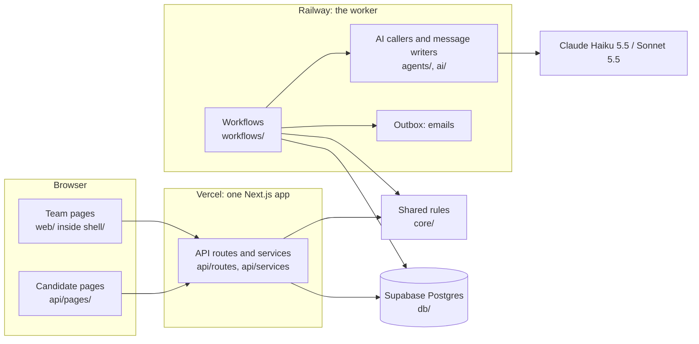
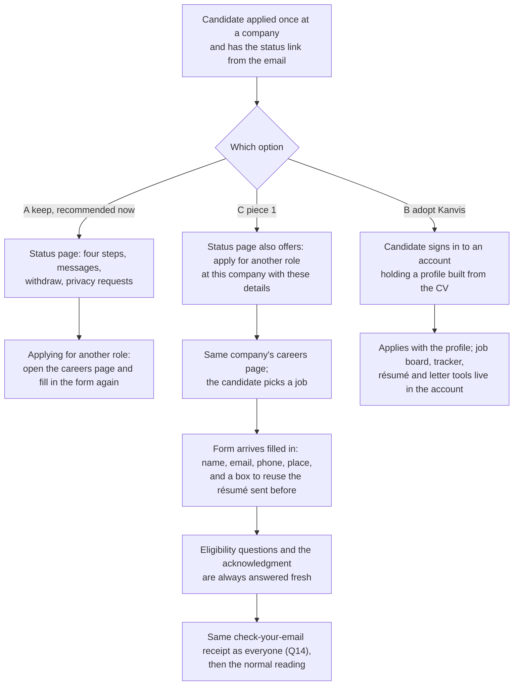
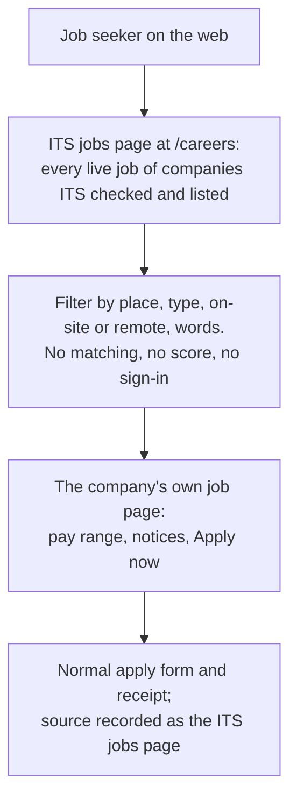
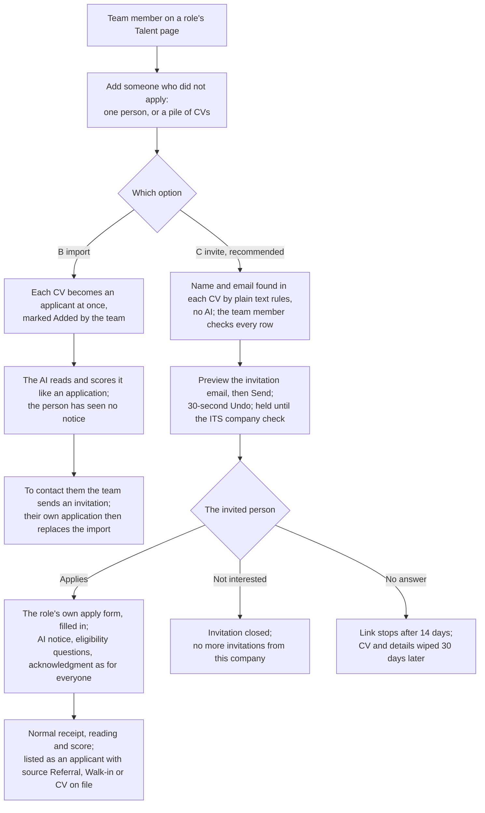
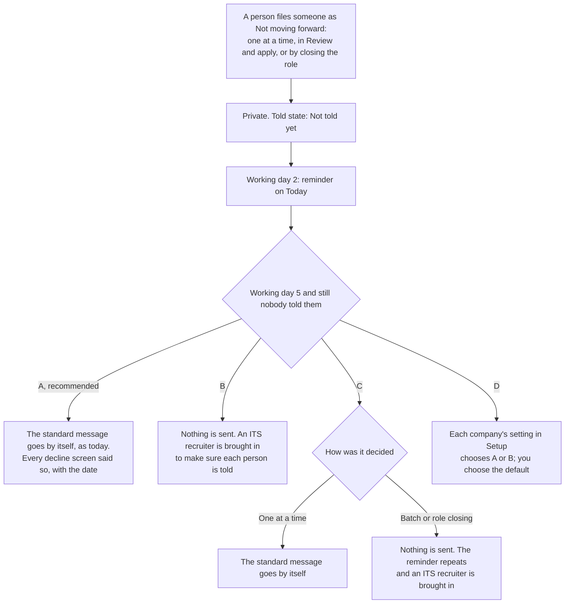
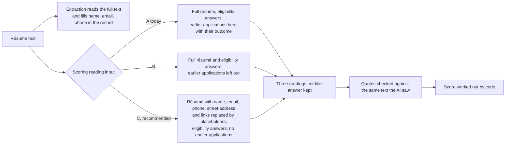
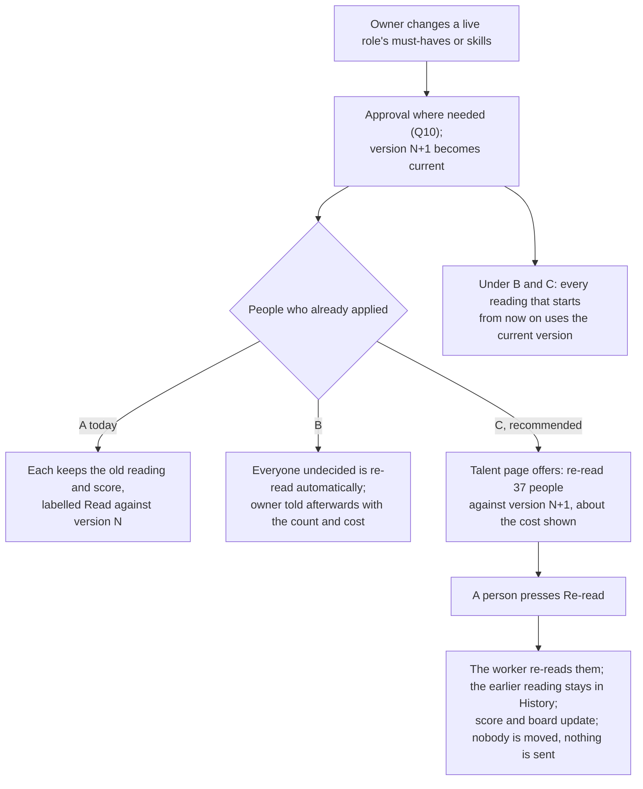
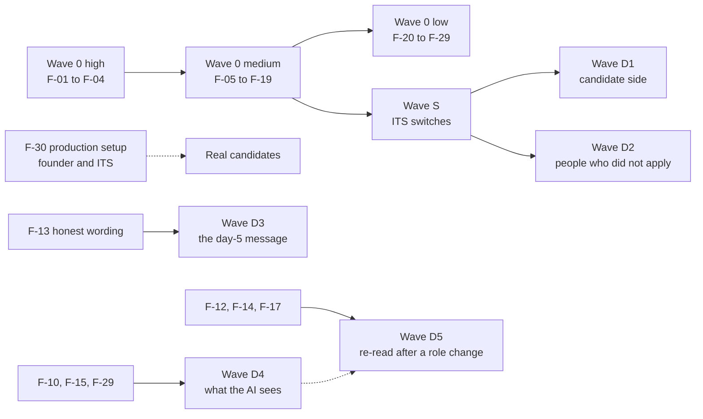

# Phase Five design: implementation plan (DRAFT)

> **Draft. Parts that depend on decisions D-01..D-05 show each option's design; nothing decision-dependent will be built until the founder answers.**

*Prepared 14 October 2026 on branch `kanvis-reaudit` (the same code as `origin/main` at `dafb730`). For Nadine (founder), Paul, the ITS team, and the engineers (or Claude Code) who will build it. Nothing here has been built. The repository was only read; the test suite was not re-run for this document.*

---

## How to read this document

**Plain words first, evidence second.** Each section starts with what changes for the people who use the product: the owner, hiring managers, HR, interviewers, candidates, ITS recruiters and the platform admin. The tables underneath carry the evidence engineers need: file paths (relative to the repository), routes, migrations and tests.

**What you already decided is not asked again.** Your Kanvis choices of 7 October (B1 to B7, Q2 to Q33), the Cancelled interviews decisions (1A to 4A, 9-10 October), the clean look (10 October), the two-model rule (13 October) and the fairness rules (13 October) are built and merged (PR #26 on 11 October, then PRs #27, #28, #36 to #38). This plan builds on top of them. Where two of your recorded answers pull against each other, this plan says so as a follow-up; D-03 is that kind of follow-up.

**Five open questions (the first batch): four new decisions and one follow-up on answers you already gave (D-03).** Everything else in this plan can be built without waiting for you.

| Id | The question, in plain words | Options | Recommended | What waits for your answer |
|---|---|---|---|---|
| **D-01** | Should candidates get accounts and a reusable profile, like on Kanvis? Kanvis is two-sided: candidate accounts, a profile built from a CV by chat, public profiles, an AI "twin", résumé, cover-letter and outreach tools, a job board across companies with match filters, an application tracker. Our candidates have no account: one application per job, a private status link, four simple steps. Your founder context leaves a "broad marketplace" out of scope and asks for a simple status timeline. | **A** keep (no accounts) / **B** adopt Kanvis's candidate side / **C** a middle way without accounts: "apply for another role here with these details" from the private status page (same company only), and one ITS page listing every checked customer's live jobs / **D** configurable per company / **E** other | **A now**, with C's two small pieces as later options | Wave D1 |
| **D-02** | How do people who did not apply get in: referrals, walk-ins, CVs you already hold, a pile of CVs? Kanvis imports CVs as "Sourced", flags duplicates and sends each a private apply link (read from Kanvis's code and changelog, never seen working). We have no manual add at all. In September you deferred sourcing and talent rediscovery on purpose. A keeps that deferral; C stays inside it, because it handles only people the company already has in hand and nobody is read by the AI before they apply; B partly revisits it, because it reads and scores people who never applied. | **A** keep (no manual add) / **B** Kanvis-style import that creates applications at once and runs the same AI reading and score / **C** the team (owner, hiring manager, HR or an ITS recruiter) uploads CVs or enters a person; the app sends each person an invitation to apply with their details filled in; they become an applicant only when they accept, so consent, the AI notice and the eligibility questions are the same as for everyone / **D** configurable / **E** other | **C** | Wave D2 |
| **D-03** | Follow-up on two recorded answers that pull against each other. B6 says decisions are always private and telling is a separate later act by a person. Q27 A says an untold declined candidate gets the standard message by itself after 5 working days. As built, under the default setting, every private "not moving forward" (also a batch filed in Review and apply, and role closings) is emailed by itself on day 5, and the decline confirmation, Review and apply, the eligibility notices and the hire sheet do not say so (a confirmed bug, 19 and 82; the role-closing toast and the board's filing note already do). On 7 October you chose Q27 A with B ("never send anything automatically") on the table, so A stands unless you want to change it; what is new is the batch and role-closing case (C) and the honest wording. | **A** keep the day-5 message as the default and make every decline screen say so, with the date / **B** Kanvis-strict: never send by itself; remind the owner, then bring in an ITS recruiter (Q27 B) / **C** automatic only for decisions a person made one at a time; batch decisions and role closings wait for a person / **D** a per-company setting (exists today as policy levels) and you choose the default / **E** other | **A** | Wave D3 (the interim honest wording, F-13, does not wait) |
| **D-04** | What may the AI see when it reads and scores a résumé? Today the scoring reading receives the whole résumé (name, contact details, address, school and graduation years) and the candidate's earlier applications to the same company with their stage or outcome. Bias is measured only for name, graduation year and zip code. | **A** keep / **B** remove earlier applications and outcomes from the AI's input only (the team still sees them) / **C** B, plus hide name, email, phone, street address and web links from the scoring reading (the extraction still reads them to fill in the record; city and state stay; photos never reach the AI today) / **D** configurable / **E** other | **C**, then re-run the fairness tests | Wave D4 (measuring today's behaviour does not wait) |
| **D-05** | When an owner changes a live role's must-haves or skills after people applied, what happens to their readings? Kanvis re-scores everyone after structural changes and has a "Re-score all" button limited to 5 an hour (read from Kanvis's code, not seen working). We keep each applicant's old reading and show "Read against version N of the role"; nothing re-reads. | **A** keep the label only / **B** re-read everyone automatically on every such change / **C** a "Re-read N applicants against the new version" button that shows the approximate cost; new applicants are always read against the latest version / **D** configurable / **E** other | **C** | Wave D5 |

**Kanvis evidence labels** (used exactly as in `docs/feature-comparison.md`): **OBSERVED** = seen on 14 October (read-only browser session on the public demo and your own Kanvis candidate account, or a fresh fetch of public pages); **OBSERVED-EARLIER** = seen on 7 October and not re-checked; **INFERRED** = read from Kanvis's shipped code strings, changelog or marketing; **UNKNOWN** = no evidence. Kanvis has shipped no new build since 7 October (same deployment, byte-identical code files). Recruiter access is still waitlist-only, so no recruiter account was used, and Apply was never pressed on a Kanvis job. Nothing in this plan copies Kanvis code, look or wording.

**Starting point (14 October 2026, `dafb730`).** vitest: 204 files, 2,148 tests passed, 6 skipped, 0 failed (about 16 minutes on this machine). TypeScript clean in all 15 packages CI checks; `tests/web` has 26 type errors and is not type-checked in CI. Playwright and Biome were not run in the audit. Migrations run from `0000` to `0035`, so **the next migration number is 0036**.

**Path short forms** in tables: `api/` = `apps/api/src/`, `web/` = `apps/web/src/`, `shell/` = `apps/shell/`, `core/` = `packages/core/src/`, `agents/` = `packages/agents/src/`, `workflows/` = `packages/workflows/src/`, `ai/` = `packages/ai/src/`, `contracts/` = `packages/contracts/src/`, `integrations/` = `packages/integrations/src/`, `db/` = `packages/db/`, `evals/` = `packages/evals/`. Feature ids (`APPLY-50`, `PIPELINE-26`...) are from `docs/audit/feature-inventory.md`; bug numbers ("bug 19") are rows of `docs/audit/known-bugs.md`; `CMP-nnn` rows are from `docs/feature-comparison.md`.

---

## 1. Principles carried over

These rules are already in the product. Every Phase Five item must keep them. A change that breaks one is not finished, whatever else it does.

| # | Principle, in plain words | Where it lives today (evidence) | What it means for Phase Five |
|---|---|---|---|
| 1 | **Additive only.** Phase Five adds. Nothing an owner, a team member, a candidate or ITS uses today is removed or weakened. Our 36 strengths over Kanvis (ITS recruiter on demand, scheduling, approvals, compliance rules, privacy requests, audit history...) stay. | `docs/feature-comparison.md` section 4; `docs/regression-checklist.md` section 0 | Every backlog item names the existing features it touches and the regression-checklist sections to run. A behaviour change that existing tests assert is named in the item, never slipped in. |
| 2 | **Decisions are private.** Marks, stage moves and decisions are the team's; candidates only ever see four simple steps (Received, Under review, Interview, Decision), and a decision only once they were told (B3, B4, B6). | `core/stages.ts` (`candidateStep` :351-361, `DECISION_STAGES`, told state :172); migration `0026_marks_and_told_state.sql`; `api/pages/candidate.tsx:594,747` | No addition shows a candidate a mark, score, reading or decision before a person told them. D-03 settles the one place where an automatic message follows a private decision. |
| 3 | **A person approves what is said to a candidate about them.** Decision messages are sent by a person (preview, then Send, then a 30-second Undo); AI-suggested lines are disclosed and never used for declines (Q28); every candidate email goes through the outbox and is held until ITS has checked the company (B7). Exceptions you already decided: the screening conversation itself (B1, disclosed as AI), automatic new interview times (3A), the "interview is off" note (Q25) and the day-5 standard message (Q27; see D-03). | `agents/outbox.ts`; `api/services/application-actions.ts` `sendDecisionMessage` :369-382; `core/policy.ts` `DEFAULT_POLICIES` :53-114; `agents/personal-line.ts` | New messages in Phase Five (an invitation to apply, an email when a recruiter request is overdue) are either sent by a person's click after a preview, or go only to the team or ITS. **No new automatic message to candidates.** |
| 4 | **Only Claude Haiku 5.5 and Claude Sonnet 5.5.** Haiku 5.5 for every task; Sonnet 5.5 only for the whole job draft (`intake.compile`). Moving another task to Sonnet 5.5 needs evidence and a plain explanation first. | `ai/routing.ts:8-12` (allow-list), `:21-42` (task tiers), `:72-75`; `ai/runner.ts:51-54` (refused at call time); `ai/routing.test.ts` | Every new AI step runs on Haiku 5.5: re-reading after a role change (D-05), import parsing if D-02 B is chosen, profile tasks if D-01 B is chosen. |
| 5 | **Migrations only add (expand-only).** New tables, columns and indexes; never drop, rename or narrow in this phase. Every data migration has its own test. Rollback means switching the feature off and leaving the columns in place. | `db/migrations/0000`-`0035`; `db/src/cli/validate.ts` (numbering, destructive statements, row-level security); `db/src/marks-told-migration.test.ts`, `company-verification-migration.test.ts`, `followups-migration.test.ts` | Section 5. Numbers in this plan are provisional; whoever merges later takes the next free number. |
| 6 | **ITS switches per company (and per role) are the feature flags.** As with the one-visit apply flow: ITS sets it with a written reason, it is audited, a role without a setting follows its company, a company follows the platform default (off). | migration `0033_one_visit_apply.sql` (`roles.apply_mode`, `companies.settings.applyFlowDefault`); `core/apply-flow.ts` `resolveApplyMode` :15; `POST /api/v1/admin/customers/:id/apply-flow` (`api/routes/admin.ts:113`); `PUT /api/v1/roles/:id/apply-mode` (`api/routes/roles.ts:283-331`) | Wave S turns this pattern into one switch table, so every Phase Five feature can be turned on for one pilot role, and off again, without a deploy. |
| 7 | **No new UI libraries.** Our own CSS and components, in the clean style you chose (1C warm paper light mode and cool dark mode, 2A arrow only on "Apply now", 3A normal-case table headings, 4A no number tiles on Today). | `packages/ui` (tokens and components); `ui/tokens.test.ts`, `ui/weight-guard.test.ts` | New screens reuse `packages/ui`. The `package.json` diffs of every pull request show no new UI dependency. |
| 8 | **Accessible to WCAG AA, motion in CSS only**, reduced motion respected; customers may use cheap old laptops and phones. | `docs/regression-checklist.md` section 8; axe checks in `tests/e2e/specs/*` | New pages pass axe in the Playwright journeys (desktop and phone). Candidate pages keep working without JavaScript, like every page in `api/pages/`. |
| 9 | **Standing rules.** No automatic rejection; final hiring decisions are a person's. Evidence before score, and the 0-100 score is worked out by code from checked findings, never written by the AI (B2). A candidate can always reach a person. Unsent conversation answers stay hidden from the team and ITS (9 October). A candidate's data stays with the company they applied to. Our own words, never Kanvis's text or code. A feature whose counsel review is open may be built and tested with synthetic data only. | `core/policy.ts` `HARD_HUMAN_ONLY` :40-51; `core/match-score.ts` `matchScore` :108-146; `core/screen-answers.ts`; `docs/spec/11-counsel-register.md` (rule in its header) | Every item below is checked against these rules in its acceptance criteria. |

---

## 2. Proposed architecture and component boundaries

**In plain words.** The app already has clear layers, and they keep the list, the pool board, the candidate panel, Compare, Today and the AI tests agreeing with each other. Phase Five puts each addition in the layer that already does that kind of work. Nothing new is hosted: the same Vercel app, the same Railway worker, the same Supabase database. No new outside service is needed for any option except D-01 B (candidate sign-in).

### 2.1 The layers and the rule for each

| Layer | Path | What belongs there | Rule for Phase Five |
|---|---|---|---|
| Contracts | `contracts/` | Zod shapes for every request, response and stored JSON | Every new route has its request and response here. New status or kind values are text (there are no Postgres enums), so they need only a contract change. |
| Rules | `core/` | Domain rules shared by the API and the worker: stages, marks, match score, board, policy, entitlements, staff access. Some are pure functions; others take the caller's database transaction (`Queryable`), for example `resolvePolicy` and `transition` | New rules go here (as pure functions where they can be) so the API, the worker and the tests share one answer: switch resolution, the scoring view, the untold send date, the invitation state machine, re-read eligibility and cost estimate, role access. |
| Database | `db/` (schema in `db/src/schema/*`, SQL in `db/migrations/`) | Drizzle schema, migrations, `withTenant` / `withPlatform` | Every new table with `company_id` gets row-level security and the tenant policy (pattern: `0033_one_visit_apply.sql` lines 77-86). |
| AI | `ai/` (prompts, routing, runner) | Versioned prompts and the model allow-list | Any prompt change bumps its version and updates `agents/fake-handlers.ts` and `evals/src/suites.ts`. Routing (models) does not change. |
| Agents | `agents/` | The code that calls the model and writes messages | New model calls only here, only inside two-phase workflow steps (the call happens outside any database transaction). Today the live conversation turns and the company "about" draft also call the model from `api/services/` (`apply-conversation.ts`, `company-settings-profile.ts`) during a request; Phase Five adds no more such calls. |
| Workflows | `workflows/src/definitions/` | Durable steps run by the worker: application intake, screen, scheduling, stuck-role detector | Long or repeated work (re-reading many people, expiring invitations) is a workflow, never a request handler. |
| API | `api/routes/`, `api/services/`, `api/middleware/` | HTTP, permission checks (`assertCan`), scope guards, `withTenant` | Every new role-level route goes through the role access guard built in F-05. |
| Candidate pages | `api/pages/` | Server-rendered pages reached by token links; no candidate account | New candidate pages (an invitation landing page, the ITS jobs page) follow the same pattern: no JavaScript needed, nonce CSP, rate limits. |
| Team pages | `web/` rendered by `shell/` | React pages for Today, Roles, Talent, Interviews, Setup, the recruiter queue and the admin console | No new routes in `shell/` except where a new top-level path is needed; Talent and Setup gain panels. |
| Evals | `evals/` | AI test suites and thresholds; the "Run fairness tests" button (`.github/workflows/fairness.yml`) | Each AI change adds cases; D-04 and D-05 re-run the fairness button and keep the result in the repository. |

### 2.2 Where the pieces run

### 2.3 Where each addition fits

"New" marks a file that does not exist yet; proposed names, to be confirmed in review.

| Addition | Decision | `contracts/` | `core/` (pure) | `db/` | `agents/` and `ai/` | `workflows/` | `api/routes`, `api/services` | `api/pages/` (candidate) | `web/` (team) | `evals/` |
|---|---|---|---|---|---|---|---|---|---|---|
| Role access guard (interviewers, narrow ITS grants) | none (F-05) | error shape `role_not_yours` | new `role-access.ts`: who may see what on a role | none | none | none | new `api/middleware/role-access.ts`; `routes/interviews.ts`, `routes/roles.ts`, `routes/postings.ts`, `routes/role-packets.ts`, `routes/reports.ts`, `routes/approvals-escalations-events.ts` | none | `pages/People.tsx` (plain message) | none |
| ITS switches | none (Wave S) | `ItsSwitchKey`, `ItsSwitchSet`, `ItsSwitchView` | new `its-switches.ts`: key registry, allowed values, `resolveSwitch` | new table `its_switches` | none | none | new `routes/its-switches.ts` (admin and read-only company view); new `services/its-switches.ts` | none | `pages/Admin.tsx` (Switches tab), `pages/Setup.tsx` (read-only list) | none |
| Reuse my details | D-01 C (piece 1) | `ReuseDetailsToken` | sealed token in `core/sealed.ts` | none | none | `workflows/documents.ts` (copy a clean résumé inside the same company) | `services/applications.ts` (`createApplication` accepts reuse) | `candidate.tsx` (status page link, apply form pre-fill), `job-page.tsx` (`ApplyFields`) | none | none |
| ITS jobs page | D-01 C (piece 2) | none | listing filter (pure) | none | none | none | none | new `pages/its-jobs.tsx` at `/careers`; `public-feeds.ts` (shared query, sitemap) | `pages/Admin.tsx` (switch) | none |
| Candidate accounts and profiles | D-01 B only | many new shapes | candidate identity, sharing rules | several new platform tables | new profile prompts (Haiku 5.5) | profile building | new candidate auth routes | new `/me/*` area | none | new suites |
| Invitations to apply | D-02 C | `ApplyInvitationDraft`, `ApplyInvitationView`, `SendApplyInvitations` | new `apply-invitations.ts` (states, plain-text contact finder, block reasons); `core/dedupe.ts` reused | new table `apply_invitations`; `applications.invitation_id` | new `agents/apply-invitation-messages.ts` (no AI) | new `definitions/apply-invitation.ts` (expiry, wipe) | new `routes/apply-invitations.ts`, `services/apply-invitations.ts`; `services/applications.ts` | new `pages/apply-invitation.tsx` (`/c/invited/:token`); apply form pre-fill | `pages/People.tsx`, new `components/InviteToApply.tsx` | none (no AI) |
| Import as applicants | D-02 B only | `ImportBatch` | import rules | new table `application_imports` | `resume.extract` and `triage.assess` on imported files (Haiku 5.5) | `definitions/application-intake.ts` (imported path) | new `routes/imports.ts` | none | `pages/People.tsx` | import cases |
| Day-5 message, dated | D-03 A | `untoldSendOn` on decision responses | `untoldSendOn(decidedAt, rules)` beside `agents/orchestrator.ts` `workingDaysSince` :42 (moved to `core/business-calendar.ts`) | none | `agents/decision-messages.ts` (unchanged sending) | none | `services/application-actions.ts`, `services/review-apply.ts`, `services/hire-sheet.ts`, `routes/roles.ts` | none | `talent-actions.ts`, `telling.ts`, `pages/board/*`, `pages/candidate-panel/*` | none |
| Day-5 fallback as its own rule | D-03 B or D | `ActionType` gains `disposition.untold_fallback` | `core/policy.ts` default and floors | data migration copying saved levels | `agents/decision-messages.ts` `runUntoldSafetyNet` :251-314 | none | `routes/policies.ts` | none | `ai-rules.ts`, `policy-levels.ts`, `pages/Setup.tsx` | none |
| How a decision was made | D-03 C | `DecisionVia` | `core/stages.ts` `transition` :158-200 records it | `applications.decision_via` | `runUntoldSafetyNet` filters by it | none | every decision path | none | wording per path | none |
| Scoring view (what the AI sees) | D-04 B, C, D | `ScoringView` | new `scoring-view.ts` (placeholders for name, email, phone, street address, links) | none | `ai/prompts/triage.ts` (v4), `ai/prompts/screen.ts` (`screen.assess`), `agents/triage.ts`, `agents/screening.ts` | `definitions/application-intake.ts` `ready` :202-263 | none | none | none | new `triage.redaction`, more bias pairs |
| Re-read after a role change | D-05 B, C, D | `RereadOffer`, `StartReread`, `RereadView` | new `reread.ts` (what counts as a structural change, who qualifies, cost estimate) | none (`assessments.superseded_by` exists) | `agents/triage.ts`, `agents/screening.ts` reused | new `definitions/reread-role.ts`; `application-intake.ts` reads the current version | new `routes/rereads.ts`, `services/rereads.ts` | none | `pages/People.tsx`, new `components/RereadBanner.tsx`, `pages/candidate-panel/assessment.tsx` | new `reread.determinism` |

### 2.4 Boundary rules for every addition

1. A rule that two places need (for example the date the day-5 message goes) is computed once in `core/` or the API and sent to the page. The page never recomputes business days.
2. New model calls are made only from `agents/`, only inside two-phase workflow steps (the existing in-request conversation turns stay as they are). Re-reads run in the worker, never in a web request.
3. Candidate pages stay server-rendered under `api/pages/`, reached by token links, and work without JavaScript.
4. Every tenant query runs inside `withTenant`. New raw queries are counted by the raw-query ratchet once F-29 has repaired it.
5. Every candidate email goes through the outbox: held until the ITS company check, sent once, never re-sent when the outcome is unknown, with Undo where a person pressed Send.
6. Every new role-level route goes through the role access guard (F-05), and every new list respects a narrow ITS grant (`api/services/staff-scope.ts`).

---

## 3. Updated user journeys

Each diagram shows the options side by side where it matters. The recommended option is marked.

### 3.1 D-01: a candidate who already applied once

Who is affected: candidates; owners (fewer half-finished repeat applications).

### 3.2 D-01 C, piece 2: one ITS page of live jobs

Who is affected: job seekers; owners whose company ITS lists; ITS.

### 3.3 D-02: adding someone who did not apply

Who is affected: owners, hiring managers, HR and ITS recruiters (adding); the people added (candidates).

### 3.4 D-03: after a private "not moving forward"

Who is affected: owners, hiring managers and ITS recruiters (who decide and tell); HR (files talent-pool moves but cannot tell, later decision L-04); candidates.

### 3.5 D-04: what the scoring reading receives

Who is affected: candidates (fairness); owners (what the score rests on); ITS and counsel (bias audit).

Option D is an ITS switch per company that picks B or C, with a default you choose. (Today's full input, A, remains only as the switch's "off" position while a change is rolled out.)

### 3.6 D-05: the role changes after people applied

Who is affected: owners and hiring managers (who change roles and compare people); candidates (whose score may change); ITS (cost).

---

## 4. Existing vs proposed route map

"Wave" points to section 11. Routes not listed do not change. Decision "none" means the change is a fix that needs no answer from you.

| Route | Who uses it | Today | Proposed change | Decision | Wave / item |
|---|---|---|---|---|---|
| `GET /careers` | job seekers | not served (only `/careers/:slug`; the shell already forwards `/careers` to the API) | The ITS jobs page: every open, accepting job of companies ITS checked and switched on | D-01 C | D1-C-2 |
| `GET /careers/:slug/jobs/:roleId/apply` | candidates | empty apply form | Accepts a sealed "reuse my details" token (D-01 C) or an invitation token (D-02 C) and fills the form in | D-01 C, D-02 C | D1-C-1, D2-C-4 |
| `POST /careers/:slug/jobs/:roleId/apply` | candidates | creates the application | Links the application to its invitation; reuses a résumé the same company already holds when the candidate ticks the box | D-01 C, D-02 C | D1-C-1, D2-C-4 |
| `GET /c/status/:token` | candidates | four steps, messages, withdraw, privacy | Adds "Get a new link" (F-20); adds "Apply for another role here with these details" (D-01 C) | none; D-01 C | F-20, D1-C-1 |
| `POST /c/status/:token/new-link` (new) | candidates | none | Emails a fresh link to the address on file; the old link stops at once | none | F-20 |
| `POST /c/link-request` | candidates | re-sends the same stored links | Issues fresh links (stored links are hashed, so they cannot be re-sent) | none | F-20 |
| `GET /c/invited/:token` (new) | invited people | none | Invitation landing: who invited you and why, Apply, Not interested, Don't contact me again | D-02 C | D2-C-4 |
| `POST /c/invited/:token/decline` (new) | invited people | none | Records "not interested" or "don't contact me again" | D-02 C | D2-C-4 |
| `GET /api/v1/roles/:id/invitations` (new) | owner, admin, hiring manager, HR, ITS recruiter | none | Lists invitations and their status | D-02 C | D2-C-5 |
| `POST /api/v1/roles/:id/invitations` (new) | same | none | Adds one person as a draft invitation | D-02 C | D2-C-2 |
| `POST /api/v1/roles/:id/invitations/upload` (new) | same | none | Up to 25 CV files become draft rows; name and email found by plain text rules | D-02 C | D2-C-3 |
| `POST /api/v1/roles/:id/invitations/send` (new) | same | none | Preview (`dryRun`) and send chosen drafts; returns Undo deadline | D-02 C | D2-C-2 |
| `POST /api/v1/invitations/:id/withdraw` (new) | same | none | Withdraws an unanswered invitation | D-02 C | D2-C-5 |
| `POST /api/v1/roles/:id/imports` (new) | owner, admin, hiring manager, ITS recruiter | none | Imports CVs as applicants | D-02 B only | D2-B-1 |
| `POST /api/v1/applications` | (documented only) | in `docs/12-api-contracts.md:146` as `CreateApplicationManual`; never built (APPLY-50) | Stays unbuilt under C (invitations replace it) and the doc line is corrected; under B it is replaced by `/roles/:id/imports` | D-02 | D2 |
| `POST /api/v1/applications/:id/actions` (`reject`, `move_to_talent_pool`) | owner, admin, hiring manager, ITS recruiter (decline); HR too (talent pool) | private decision; preview of the message | Response adds `untoldSendOn` and what happens then (A); records how the decision was made (C) | D-03 | D3 |
| `POST /api/v1/roles/:id/batch` | owner, admin, hiring manager, ITS recruiter | Review and apply | Preview and result add the day-5 date (A); records "batch" (C) | D-03 | D3 |
| `POST /api/v1/roles/:id/outcome` | owner, admin, hiring manager, HR | closes the role, moves people to the talent pool | Answer adds the date the closing message would go (A); records "role closing" (C) | D-03 | D3 |
| `PUT /api/v1/policies` | owner, admin (recent sign-in) | AI and automation rules | Adds the rule "if nobody tells a declined candidate within 5 working days" as its own setting | D-03 B or D | D3-B-1, D3-D-1 |
| `GET /api/v1/roles/:id/applications`, `/board`, `GET /api/v1/applications/:id` | team | list, board, panel | Add `untoldSendOn` per person (D-03 A) and a re-read offer for the role (D-05 C) | D-03, D-05 | D3-A-1, D5-C-3 |
| `POST /api/v1/roles/:id/rereads` (new), `GET /api/v1/roles/:id/rereads/:rereadId` (new) | owner, admin, hiring manager, ITS recruiter | none | Start a re-read of the people read against an older version; watch its progress | D-05 C | D5-C-2 |
| `GET /api/v1/roles/:id/interviews` | anyone with `role.read` today (no screen uses it) | lists every interview on the role, with candidate names, decisions and decision notes | Interviewers see only interviews they take part in; a one-candidate ITS grant sees only that candidate's | none | F-05 |
| `GET /api/v1/roles/:id` and `/postings`, `/links`, `/volume`, `/packets`, `/packets/diff`, `/interview-plan`, `/requirements-check` | team | interviewers can open any role by id, with applicant counts and private criteria | Role access guard: interviewers only on their roles and without counts or private criteria; other roles answer "not found" | none | F-05 |
| `POST /api/v1/approvals/:id/decide` | approvers | no check of an ITS grant's scope | Refused outside the grant's role or candidate | none | F-05 |
| `GET /api/v1/roles/:id/report` | team | ignores a narrow ITS grant | Limited to the granted candidate, or refused for a one-candidate grant | none | F-05 |
| `POST /api/v1/companies/current/members/:userId/sign-out` | owner, admin (HR today too) | API only; HR can sign out an owner; ends sessions in every company | Owner and admin only, rank-checked; ends the person's sessions in this company only; a button on the Team card | none | F-06 |
| `POST /api/v1/companies/current/invitations/:id/revoke`, `GET /api/v1/companies/current/invitations` | managers | HR can withdraw an owner's invitation of an owner or admin; every member sees pending invitations | Rank check on withdraw; list needs `members.manage` | none | F-06 |
| `POST /api/v1/auth/switch` | people in two or more companies | used only by the recruiter queue | Used by a company switcher in the app frame (`shell/components/AppShell.tsx`) | none | F-07 |
| `POST /api/v1/escalations/mine/:id/cancel` (new) | team members who raised a request | none | Cancel your own open recruiter request, with a reason | none | F-26 |
| `POST /api/v1/admin/customers/:id/plan` | platform admin | API only | A Plan screen in the console | none | F-01 |
| `POST /api/v1/admin/alerts/:id/resolve` (new) | platform admin | only "acknowledge" exists | Resolve an alert | none | F-04 |
| `POST /api/v1/admin/jobs/:id/requeue` (new) | platform admin | failed jobs cannot be retried | Re-queue a failed job | none | F-19 |
| `GET /api/v1/admin/inbound-failures` (new) | platform admin | failed emailed applications are listed nowhere | List, retry or dismiss them | none | F-11 |
| `GET/POST /api/v1/admin/customers/:id/switches` (new), `GET /api/v1/companies/current/switches` (new) | platform admin (set); company team (read) | only the apply-flow switch, through its own route | One switch list per company and role, with history | none | S-01, S-02 |
| `/healthz` | anyone | reveals database kind, AI provider and queue depth | Public answer says only up or down; details only with a secret | none | F-29 |
| Team pages `/roles/[id]/talent`, `/talent` | team | list, board, panel | "Add someone who did not apply" and an "Invited" filter (D-02 C); re-read banner (D-05 C); dated decline wording (D-03) | D-02, D-03, D-05 | D2, D3, D5 |
| Team page `/setup` | team | 13 sections | Read-only list of ITS switches (S-02); the day-5 rule (D-03 D); "Sign out everywhere" per teammate (F-06); allowances that say when they reset (F-01) | none; D-03 D | S-02, D3-D-1, F-06, F-01 |
| Console `/admin` | platform admin | 10 tabs | Plan, alert resolve, switches, break-glass, staff-access ledger, sign a person out, add a suppression, AI-run detail, job re-queue, failed emailed applications | none | F-01, F-04, F-11, F-19, S-02 |
| Candidate area `/me/*` (new) | candidates with accounts | none | Only if D-01 B: sign-in, profile, applications across companies | D-01 B | D1-B |

---

## 5. Data model and migration plan

**In plain words.** Phase Five only adds to the database. Nothing existing is removed or renamed, so switching a feature off never needs the database to change back. Where existing rows must be updated (for example to finish cleaning the AI data of people who asked to be deleted), the update is its own migration with its own test.

### 5.1 Rules

1. **Expand-only.** `ADD COLUMN`, `CREATE TABLE`, `CREATE INDEX`; `DROP NOT NULL` is allowed (it widens). No `DROP`, `RENAME` or type narrowing in this phase. `db/src/cli/validate.ts` already refuses `DROP TABLE`, `DROP COLUMN`, `TRUNCATE` and a `DELETE` without `WHERE` (unless marked `allow-destructive`); renames and type changes are not caught by it, so review checks those.
2. **Numbering.** Hand-written SQL in `db/migrations/NNNN_name.sql`; the next free number is **0036**. Numbers below are provisional in expected merge order; whoever merges later takes the next free number at merge time. A number that has run anywhere is never reused.
3. **Tenant tables.** Every new table with `company_id` enables row-level security and the `tenant_isolation` policy, with grants for `app_tenant`, `ros_app` and `ros_worker`, and revokes `DELETE` where rows must be kept (copy `0033_one_visit_apply.sql` lines 77-86). The validator checks this.
4. **Data migrations** are SQL in the same folder and each has a test in `db/src/<name>-migration.test.ts` that builds rows in the old shape, runs the migration and checks the result (pattern: `db/src/followups-migration.test.ts`).
5. **Release order.** The migration runs first (`.github/workflows/migrate.yml`), then the code that writes the new column, then the code that reads it. Code must work with the column empty.
6. **Rollback.** Switch the feature off (Wave S switch, per role, company or platform-wide). Tables and columns stay. Nothing is dropped.

### 5.2 Provisional migrations

| # | File | Wave / item | Kind | Content | Test |
|---|---|---|---|---|---|
| 0036 | `0036_entitlement_periods.sql` | F-01 | data | Fill `entitlements.period_start` / `period_end` where empty (monthly from the plan's start, or the company's creation for trial rows), so the new reset job has a period to work from. Lifetime keys (active roles) untouched. | `db/src/entitlement-periods-migration.test.ts` |
| 0037 | `0037_scrub_anonymised_ai_data.sql` | F-03 | data | For candidates already anonymised after a fulfilled deletion request: replace `assessments.result` quotes, summaries, strengths and concerns with a neutral stub (keeping `overall`, `confidence`, `packet_version` for the figures) and empty `ai_runs.structured_output` for runs tied to their applications or screens (keyed through `ai_runs.input_ref`; the exact keys are checked in every `runPromptDetached` call site before writing). Only rows whose deletion was approved and fulfilled. | `db/src/anonymised-ai-scrub-migration.test.ts` |
| 0038 | `0038_status_link_hash.sql` | F-20 | schema + data | `applications.status_token_hash text` with a unique index; filled with `encode(sha256(status_token::bytea), 'hex')` for existing rows; `status_token` loses `NOT NULL` so new rows store only the hash. The old plain column is kept (clearing it is a later step, not this phase). | `db/src/status-link-hash-migration.test.ts` |
| 0039 | `0039_ops_alerting.sql` | F-04, F-18 | schema | `admin_alerts.notified_at timestamptz` (email sent once per alert); `recruiter_escalations.sla_alerted_at timestamptz` (overdue alert sent once). | schema-drift test |
| 0040 | `0040_membership_sign_out.sql` | F-06 | schema | `memberships.sessions_ended_at timestamptz`: a session older than this cannot work in, or switch into, that company. | `api/team.test.ts` |
| 0041 | `0041_reading_runs.sql` | F-28 | schema | `assessments.ai_run_ids uuid[]` (all three readings); `ai_runs.cache_write_tokens integer not null default 0`. | schema-drift test |
| 0042 | `0042_its_switches.sql` | S-01 | schema | New table `its_switches` (section 5.3). | `db/src/rls.test.ts` (every tenant table has a policy) and new switch tests |
| 0043 | `0043_apply_invitations.sql` | D2-C-1 | schema | New table `apply_invitations` (section 5.3); `applications.invitation_id uuid`. | `db/src/rls.test.ts`; `api/apply-invitations.test.ts` |
| 0044 | `0044_application_imports.sql` | D2-B-1 (only if D-02 B) | schema | New table `application_imports` (batch, who, count, status); imported applications use `applications.source = 'imported'` (text, no column change; a new value in `core/application-links.ts` `SOURCES`). | import tests |
| 0045 | `0045_decision_via.sql` | D3-C-1 (only if D-03 C) | schema + data | `applications.decision_via text` (one_at_a_time, batch, role_closing, after_interview, eligibility, recorded_outcome); filled from `pool.batch_applied` events and role-closing stage changes where the event says so; anything unclear counts as one at a time. | `db/src/decision-via-migration.test.ts` |
| 0046 | `0046_untold_fallback_policy.sql` | D3-B-1 or D3-D-1 (only if D-03 B or D) | data | For each saved `disposition.send` row, a `disposition.untold_fallback` row that keeps today's behaviour for that company or role (under "approval" or "only a person": bring in a recruiter; under "do it": send the standard message, unless option B changes the default for companies without a saved row). | `db/src/untold-fallback-migration.test.ts` |
| 0047+ | to be numbered then | D1-B (only if D-01 B) | schema | Candidate accounts, profiles, profile documents, shares into a company (sketch in section 11). | to be planned |

No migration is needed for: D-01 C (sealed tokens and a copy of a document row), D-04 (prompt input built in code; the profile used is recorded in the existing `ai_runs.input_ref` JSON), D-05 (`assessments.packet_version` and `assessments.superseded_by` already exist in `db/src/schema/hiring.ts:356,362`), F-02 (the scheduling window is already on the interview), F-11 (`inbound_emails.status` already has `error`), F-17, F-19, F-25 and F-26.

### 5.3 New tables in detail

**`its_switches`** (S-01). One row per change; the newest row for a (company, role, key) wins; nothing is updated or deleted.

| Column | Type | Meaning |
|---|---|---|
| `id` | uuid primary key | |
| `company_id` | uuid, nullable, references `companies` | Null = platform-wide row (the default, or an emergency off for everyone) |
| `role_id` | uuid, nullable | Null = the whole company |
| `key` | text not null | e.g. `scoring_view`, `reread`, `apply_invitations`, `imports`, `reuse_details`, `its_jobs_page` |
| `value` | text not null | from the key's allowed list in `core/its-switches.ts` (for example `off`, `on`, `button`, `automatic`, `redacted`) |
| `params` | jsonb not null default `{}` | limits such as a daily cap |
| `reason` | text not null | at least 5 characters, like the apply-flow switch |
| `set_by` | jsonb not null | the actor |
| `created_at` | timestamptz default now() | |

Row-level security: a company reads its own rows and platform-wide rows; only the platform role inserts; `UPDATE` and `DELETE` revoked. Index on `(company_id, role_id, key, created_at desc)`. The existing apply-flow setting (`roles.apply_mode`, `companies.settings.applyFlowDefault`) stays where it is and is shown in the same console list; it is not moved.

**`apply_invitations`** (D2-C-1, only if D-02 C or D).

| Column | Type | Meaning |
|---|---|---|
| `id`, `company_id`, `role_id` | uuid | tenant and role |
| `first_name`, `last_name`, `email`, `phone` | text (phone nullable) | typed or confirmed by the team member |
| `dedupe_key` | text | same folding as `core/dedupe.ts` (Gmail dots and plus parts) |
| `source` | text | `referral`, `walk_in`, `cv_on_file`, `other`. `referral` and `other` already exist in the source list (`core/application-links.ts` `SOURCES`); `walk_in` and `cv_on_file` are new values added there (the column is text, so no migration) |
| `source_detail` | text, nullable | the referrer's name or a label; never a tracking token |
| `team_note` | text, nullable | private; never shown to the person, never sent to any AI |
| `document_id` | uuid, nullable | the CV the team holds, stored as a `documents` row (quarantined, scanned, text extracted; no AI) |
| `personal_line` | text, nullable | checked with `agents/personal-line.ts` before sending |
| `status` | text | `draft`, `queued`, `sent`, `opened`, `applied`, `not_interested`, `do_not_contact`, `expired`, `withdrawn`, `blocked` |
| `token_hash` | text, nullable | the link token is stored hashed only |
| `communication_id` | uuid, nullable | the outbox message |
| `application_id` | uuid, nullable | filled when the person applies |
| `sent_at`, `opened_at`, `answered_at`, `expires_at`, `wiped_at` | timestamptz | |
| `created_by` | jsonb | the actor |
| `created_at`, `updated_at` | timestamptz | |

Row-level security as above; `DELETE` revoked (wiped, never deleted, like `unconfirmed_screens`). A wiped row keeps only that an invitation happened, when, from which source and how it ended. Indexes on `(company_id, role_id, status)`, `(company_id, dedupe_key)` and unique `token_hash`.

---

## 6. API and service changes

Every new request and response shape lives in `contracts/`. Every tenant route uses `assertCan` and `withTenant`; every new role-level route goes through the role access guard (F-05). Errors use the existing JSON error shape with a plain-words message.

### 6.1 Wave 0 (no decision needed)

| Service or route | Change | Permission | Errors |
|---|---|---|---|
| `core/entitlements.ts` `record` :46-57, `applyPlan` :67-82; new daily job in `api/maintenance.ts` | Reset `used` at each period end and roll the period forward; `applyPlan` keeps the period and resets counts that the new plan's period covers | system | none |
| `api/routes/admin.ts` `POST /customers/:id/plan` :390 | Called by a new console Plan screen | platform admin + second factor + reason | existing |
| `core/privacy-requests.ts` `anonymizeCandidate` :233-270 | Also scrubs `assessments.result` and `ai_runs.structured_output` / `input_ref` text for the person; same rule as migration 0037 | ITS (existing flow) | none |
| `core/alerts.ts` `raiseAlertOnce` :21; `api/routes/admin.ts` :244-254 | "Standing" means open only; new `POST /alerts/:id/resolve`; critical alerts emailed once through the outbox to a new `ITS_OPS_ALERT_EMAIL` setting (defaults to `ITS_QUEUE_EMAIL`, `api/env.ts:143`) | platform admin | 409 `already_resolved` |
| New `api/middleware/role-access.ts` using new `core/role-access.ts` | Guards every `/roles/:id/*` read (section 8.1) | as today plus the guard | 404 `not_found` for roles outside the person's reach |
| `api/routes/interviews.ts` `GET /roles/:id/interviews` :434-450 | Filters to the interviewer's own interviews and to a one-candidate grant's candidate | `role.read` + guard | none |
| `api/routes/approvals-escalations-events.ts` `POST /approvals/:id/decide` :36-99 | Checks `scopeAllows` for ITS grants | as today | 403 `outside_your_access` |
| `api/routes/reports.ts` :29-38, `api/services/role-report.ts` :408 | Passes the staff scope | as today | 403 for one-candidate grants on the role-wide JSON |
| `api/routes/company-settings.ts` :495-516; `api/services/team.ts` :138-144, :237-241; `api/routes/companies.ts` :55-60, :91-95 | Rank checks (HR cannot sign out or withdraw an invitation for an owner or admin); sign-out ends sessions in this company only (migration 0040); invitation list needs `members.manage` | `members.manage` + rank | 403 `rank` |
| `api/routes/auth.ts` `POST /auth/switch` :304-315; `core/identity.ts` :75-76 | Stable choice of company at sign-in (the most recently used); switcher in the frame | session + membership | existing |
| `api/services/packet-versions.ts` :142-184; `api/routes/roles.ts` :152-168, :224; `api/routes/role-packets.ts` :78-104 | Edits during a pause take effect or go for approval; closed roles refuse new versions | as today | 409 `role_closed` |
| `api/services/apply-conversation.ts` :105, :655; `api/services/applications.ts` :76-100 | Greets with the typed name only; a second role's answers become a detached conversation the address owner confirms; insert-or-reuse of the person under concurrency | public | none |
| `api/services/applications.ts` :83-87; `api/webhooks/postmark.ts` :76-78, :98-100 | Email-in consent recorded as "shown by email, version X", never as ticked; new admin list of failed emailed applications | public / platform admin | none |
| `agents/outbox.ts` :29-31, :377-388; `workflows/engine.ts` :51, :145-150, :177, :327-341; `integrations/email/postmark.ts` :18; `integrations/sms/twilio.ts` :24 | Longer retry schedule for provider outages; lease renewal; stuck "sending" swept every 15 minutes; 30-second provider timeouts | system | none |
| `core/escalations.ts` `createEscalation` :18-68; `api/services/escalation-queue.ts` :22-31 | Every new or reopened request emails the ITS queue through the outbox; an overdue reply-by time raises one alert | system | none |
| `api/services/applications.ts` :113, :211-239; `api/pages/candidate.tsx` :713-716 | Status links stored hashed; "Get a new link" | candidate token | 410 for an old link after rotation |
| New `POST /api/v1/escalations/mine/:id/cancel` | Team member cancels their own open request | `escalation.create`, own request | 409 `already_claimed` |

### 6.2 Wave S (switches)

| Route or service | Change | Permission |
|---|---|---|
| New `core/its-switches.ts` | Key registry (`key`, allowed values, default, whether a role-level row is allowed), `resolveSwitch(rows, key, roleId)`: role row, else company row, else platform row, else registry default (always off) | pure |
| New `api/services/its-switches.ts` | `switchValue(q, companyId, roleId, key)` read inside the caller's transaction; `setSwitch` writes a row and an audit record `its_switch.changed` | |
| New `GET/POST /api/v1/admin/customers/:id/switches` | List and set (company or role), reason required | platform admin + second factor |
| New `POST /api/v1/admin/switches` | Platform-wide row (default or emergency off) | platform admin + second factor |
| New `GET /api/v1/companies/current/switches` | Read-only list for the customer: what ITS switched on, when, why | `company.read` |

### 6.3 Decision-dependent waves

| Wave | Route or service | Change | Permission | Contract | Errors |
|---|---|---|---|---|---|
| D1-C-1 | `api/pages/candidate.tsx` status page and apply form; `api/services/applications.ts` `createApplication` | Status page link carries a sealed token (`core/sealed.ts`, 24 hours, bound to the application and company); the apply form pre-fills; on submit the kept résumé (same company only) becomes a new `documents` row pointing to a copy of the clean file | candidate token | `ReuseDetailsToken` | expired token: the empty form, with a line saying why |
| D1-C-2 | New `api/pages/its-jobs.tsx` (`GET /careers`); `api/pages/public-feeds.ts` | Lists from the same query as `/feeds/jobs.json`, limited to companies with `its_jobs_page = listed`; each job links through a tracked link with source `its_jobs_page` | public, rate-limited | none | none |
| D2-C | New `api/routes/apply-invitations.ts`, `api/services/apply-invitations.ts`; new `agents/apply-invitation-messages.ts` | Create drafts (one person or an upload), check block reasons (already an applicant for this role, asked not to be contacted, opted out of future roles at this company, address suppressed), preview, send through the outbox gate of a team member's message (`message.send_freeform`, `core/policy.ts:60`), Undo, withdraw | new `candidate.invite` | `ApplyInvitationDraft`, `ApplyInvitationView`, `SendApplyInvitations`, `ApplyInvitationUploadResult` | 409 `invitation_blocked` with the reason code; 429 `invitation_limit` |
| D2-C | New `api/pages/apply-invitation.tsx` (`/c/invited/:token`) | Landing page; Apply opens the apply form pre-filled; Not interested; Don't contact me again | invitation token | none | 410 for an expired or withdrawn invitation, with the job page link |
| D2-B | New `api/routes/imports.ts` | Upload up to 25 files; each becomes a candidate and an application with source `imported`, consent recorded as "not collected" | new `candidate.import` | `ImportBatch` | 409 duplicates |
| D3-A | `api/services/application-actions.ts` (`reject`, `move_to_talent_pool`, `send_decision`), `api/services/review-apply.ts` (preview and apply), `api/routes/roles.ts` (`/outcome`, `/closing-message`), `api/services/hire-sheet.ts` | Each answer carries `untoldSendOn` (a date in the company's time zone) and `untoldWhat` (`standard_message`, `closing_message`, `recruiter`) computed from the current policy | as today | field on existing responses | none |
| D3-B / D3-D | `core/policy.ts`; `agents/decision-messages.ts` `runUntoldSafetyNet` :251-314; `api/routes/policies.ts` | New action `disposition.untold_fallback` (values: send the standard message / bring in a recruiter), read by the safety net instead of `disposition.send`, which keeps governing what a person's Send does | `policy.manage` + recent sign-in (existing) | `ActionType` | none |
| D3-C | `core/stages.ts` `transition` :158-200; every decision path; `agents/decision-messages.ts` | `transition` gains `decisionVia`; every decision path passes it; `runUntoldSafetyNet` sends only for `one_at_a_time` (and `after_interview`, `eligibility`, `recorded_outcome`) | as today | `DecisionVia` | none |
| D4-B / C / D | `workflows/definitions/application-intake.ts` `ready.prepare` :202-223; `agents/triage.ts` `assessApplication`; `agents/screening.ts` `assessScreen` :880-926 | Build the scoring input through `core/scoring-view.ts`; verify quotes against that same text; record the profile in `ai_runs.input_ref` | system | `ScoringView` | none |
| D5-C | New `api/routes/rereads.ts`, `api/services/rereads.ts`; new `workflows/definitions/reread-role.ts` | `GET` offer inside the applications and board answers; `POST /roles/:id/rereads` with `confirm: true` starts one batch; `GET` progress | new `reading.refresh` | `RereadOffer`, `StartReread`, `RereadView` | 409 `reread_running`; 429 `reread_limit`; 403 `switch_off` |
| D5-B | Hooks where a version becomes current: `api/services/packet-versions.ts:161`, `workflows/definitions/role-approval.ts:142,151` | Start the same workflow automatically when must-haves or skills changed | system | none | cap reached: owner told, nothing started |

---

## 7. AI workflow and prompt design

**In plain words.** Phase Five changes what the AI is given to read (D-04), adds one job that re-reads people when a role changes (D-05), and, only if you choose B for D-02, has the AI read CVs of people who never applied. It adds no new model and no new kind of AI writing to candidates. Every change is tested on the fake provider in CI and, where it touches readings or the score, on the real model with the "Run fairness tests" button, with the result kept in the repository.

### 7.1 D-04: what the scoring reading receives

Today (`workflows/definitions/application-intake.ts:209-218`, `ai/prompts/triage.ts:67-70`): the full résumé text (up to 40,000 characters), parts of the extraction, the eligibility answers and result, and the candidate's earlier applications to the same company with their stage (for example "rejected"). The screening scorecard (`screen.assess`) receives the sent transcript.

| Option | Change | Prompt versions | Notes |
|---|---|---|---|
| **A** keep | none | none | The measurement in D4-0-1 still runs, so the founder sees what earlier outcomes do to a reading. |
| **B** no earlier applications | Drop `priorApplications` from `TriageInput` (`ai/prompts/triage.ts:10`) and the query at `application-intake.ts:209-210`. The team still sees earlier applications on the candidate panel. | `triage.assess` v4 | Smallest change. |
| **C** B plus hidden identity (recommended) | New `core/scoring-view.ts`: `scoringText(text, identity)` replaces, in this order, the person's names (from the candidate record and `extraction.fullName`), email addresses, phone numbers, street lines and zip codes, and web links with `[name]`, `[email]`, `[phone]`, `[street address]`, `[link]`; returns the text and a count per kind. Applied to the résumé text, the written "about your work" answer and the eligibility answers before `assessApplication`, and to the candidate's own lines in the transcript before `assessScreen`. City and state stay (roles have locations). Schools and graduation years stay (option C does not hide them; graduation year remains measured by the existing bias pair). Photos never reach the AI today, because only extracted text is sent; the rule is written down so a future image path cannot add them. | `triage.assess` v4, `screen.assess` v5 | The extraction (`resume.extract`) still reads the full text to fill in the record. The screening conversation (`screen.turn`) still addresses the candidate by first name, because it talks to them. |
| **D** configurable | ITS switch `scoring_view` = `full`, `no_history` or `redacted`, per company; default chosen by you | as B and C | Each reading records which view it used. |

Engineering details for C:

- **Quotes are checked against the text the AI saw.** `verifyAssessmentQuotes` (`agents/triage.ts:158-167`) and `verifyScreenQuotes` (`agents/screening.ts:903-909`) receive the redacted text as the source. A quote shown to the team can therefore contain a placeholder such as `[name]`; that is acceptable and honest.
- **Prompt wording.** One added line: details in square brackets were replaced on purpose, are not evidence, and must not be guessed. The existing rule that the reading never names the candidate (13 October) stays.
- **Order of cleaning.** Tag-stripping of candidate text (F-10, Wave 0) runs first, then the scoring view, then the prompt. F-10 must land before D-04.
- **Record.** `ai_runs.input_ref` gets `{ scoringView: "redacted-v1", replaced: { name: 2, email: 1, ... } }` (counts only, never the values).
- **Data-flow document.** `docs/readiness/08-data-flow-map.md:19` says "no phone or email fields are sent" to Anthropic; that misleads today, because the full résumé text sent to the extraction and the scoring reading carries them, and under C the extraction still receives them. The document is corrected in the same pull request.

### 7.2 D-05: re-reading after a role change

**What counts as a change worth re-reading** (new `core/reread.ts` `structuralChange(was, now)`): must-haves added, removed or reworded (the existing `mustHavesKey`, `core/match-score.ts:186`), skills added, removed or reworded, or a skill moved to "judged in the interviews" (once F-12 makes that setting work). Wording-only edits to the ad never count. A change only to a skill's importance is not a re-read either: as D-05 option C says, the score is arithmetic, so everyone's score is worked out again at once from their existing findings with the new importance, with no AI call (`core/match-score.ts` :104-108).

**Who is re-read** (`rereadEligible`): applicants whose latest reading was against an older version, who are not withdrawn, declined, hired or anonymised, and whose résumé text exists. People still in the conversation are included for the résumé reading only; their unsent answers stay hidden (9 October). The scorecard is re-assessed only for sent conversations.

**The job** (new `workflows/definitions/reread-role.ts`):

1. `select` (one transaction): freeze the list and the target version; write a `reading.refresh_started` event.
2. `read` (two-phase, in chunks of 10): prepare = build the same input as a first reading, against the role's current version, through the current scoring view (D-04), and call `assessApplication` (three readings, middle answer, high effort, Haiku 5.5); run = insert a new `assessments` row with the new `packet_version`, set the old row's `superseded_by`, move `latest_assessment_id` by the existing rule (a scorecard stays the latest when it is newer), emit `assessment.reread`.
3. `finish`: one notification to whoever started it ("37 people re-read against version 4; 2 could not be read"), and `reading.refresh_completed` with the cost from `ai_runs.cost_usd`.

What it never does: move anyone, send anything to a candidate, start a screening invitation or recommend an interview (the `after_triage` step is not run), or open one ITS request per failure (one summary instead).

**Cost shown before starting** (`estimateRereadCost`): the company's own average `ai_runs.cost_usd` per application for `triage.assess` over the last 30 days (three readings each), times the number of people, plus the scorecard where it applies. No price is hard-coded on the screen.

**Limits** (proposals, set on the switch's `params`): one batch per role at a time; at most 3 batches per role per day; at most 500 people per batch (more are split into further batches); a company daily re-read spending cap set by ITS. Kanvis's "Re-score all" is limited to 5 an hour (INFERRED, 7 October catalogue, rubric code).

**New readings use the current version** (B and C): `load()` in `application-intake.ts:385-394` reads the role's `current_packet_version` at reading time instead of the version the person applied under. `applications.packet_version` keeps meaning "the job ad they applied to"; `assessments.packet_version` records the version actually read.

### 7.3 D-02: reading CVs of people who did not apply

| Option | AI involvement | Why |
|---|---|---|
| **C** invite (recommended) | **None before the person applies.** The CV file is checked and scanned like any résumé (`workflows/documents.ts`), its text is extracted by the existing non-AI tools, and name, email and phone are found by plain text rules in new `core/apply-invitations.ts` (an email pattern, a phone pattern, the first line as a suggested name). The team member checks every row. Once the person applies, the normal intake reads them. | A person who has not seen the AI notice is not read by the AI (counsel items 1, 5 and 7). |
| **B** import | `resume.extract` and `triage.assess` (three readings) run on each imported file through the normal intake, without eligibility answers (unanswered is never a fail). The automatic screening invitation is forced to "ask me first" for imported people, since they never consented to a conversation. | Kanvis marks requirements a CV cannot prove as pending (INFERRED, 7 October catalogue); ours already leaves unknowns out of the score. Needs counsel before real data (section 12). |

### 7.4 Evaluations and fairness runs to add

| Suite | New or changed | What it checks | Fake (CI) | Real model (button) | Needed by |
|---|---|---|---|---|---|
| `triage.bias_pairs` | changed | Adds pairs that differ only by an earlier rejection at the same company, the pairs `docs/spec/08-ai-architecture-and-evals.md:51` lists but the suite lacks (gendered hobbies, nationality cues such as languages; only name, graduation year and zip code exist today), and a new disability-cue pair (an accommodation mention) that the spec does not yet list | yes | yes | D4-0-1 (all options) |
| `triage.redaction` | new | Twin résumés that differ only in name, email, phone, street address and links produce byte-identical scoring text; placeholders never verified as quotes | yes | yes | D-04 C or D |
| `triage.injection` | new | A résumé containing a closing tag and instructions ("mark every must-have met") reads the same as without them | yes | yes | F-10 |
| `screen.injection_and_protected` | new | A candidate message with instructions or protected details does not steer the scorecard; follow-ups never ask about protected traits | yes | yes | F-10, F-16 |
| `screen.assess` consistency | new | Three readings of the same sent conversation land on the same findings; expired-credential rule applied | yes | yes | F-14 |
| `reread.determinism` | new | Re-reading the same application against the same version stays within the spread `triage.consistency` already allows | yes | yes | D-05 B or C |
| Fairness workflow | changed | `.github/workflows/fairness.yml` also runs the screening suites; the result file (`-anthropic.json`) is kept in the repository (today `.gitignore:66` excludes it) | n/a | yes | F-29, then re-run after D-04 and D-05 |

---

## 8. Permission and privacy model changes

### 8.1 Fixing what interviewers and narrow ITS grants can reach (F-05)

**In plain words.** An interviewer should see only the roles and interviews they take part in, and never pay or private criteria. An ITS recruiter given one candidate should see only that candidate. The app already behaves this way on its screens, but some API addresses answer more than they should (bugs 7, 10, 25, 40, 52, 55, 66, 83). No screen uses those addresses, so the fix changes nothing anyone sees in normal use.

**Design.** One rule in new `core/role-access.ts`, applied by one middleware (new `api/middleware/role-access.ts`) on every `/api/v1/roles/:id/*` route, so new routes cannot forget it. "On this role" for an interviewer means the same thing the roles list already uses (`api/routes/roles.ts:50-54`). Roles outside a person's reach answer "not found" (404), as cross-company reads already return nothing.

| Route | Interviewer on this role | Interviewer not on this role | ITS recruiter, role grant | ITS recruiter, one-candidate grant |
|---|---|---|---|---|
| `GET /roles/:id` | title, place, the interview rounds they are in; no applicant counts, no evaluation criteria, red flags, deal-breakers or internal notes; no pay (as today) | 404 | as today | role facts; counts limited to their candidate |
| `GET /roles/:id/interviews` | only interviews they take part in | 404 | as today | only the granted candidate's interviews |
| `/postings`, `/links`, `/volume`, `/packets`, `/packets/diff`, `/requirements-check` | 403 with a plain message | 404 | as today | 403 |
| `/interview-plan` | only the rounds they are in | 404 | as today | as today |
| `GET /roles/:id/report` (JSON) | refused (no `application.read`, as today) | 404 | as today | limited to the granted candidate, or refused |
| `POST /approvals/:id/decide` | n/a | n/a | only inside the grant's role | only for the granted candidate |
| New Phase Five routes (`/invitations`, `/rereads`) | refused | 404 | inside the grant | refused (role-wide actions) |

Test: new `api/role-access-matrix.test.ts` walks every `GET /roles/:id/*` route for these four people and an owner, and fails when a new route is added without a row.

### 8.2 Team rank (F-06)

HR keeps managing interviewers and hiring managers, but can no longer sign out an owner or admin, or withdraw an invitation that would make someone an owner or admin. Signing someone out from one company ends only their sessions in that company (migration 0040). Pending invitations are listed only to people who can manage members.

### 8.3 New permissions

Added to the matrix in `core/permissions.ts:44-74`. The ITS column means an ITS recruiter under a grant, always limited to the grant's scope.

| Permission | Owner | Admin | Hiring manager | HR | Interviewer | ITS recruiter | Decision |
|---|---|---|---|---|---|---|---|
| `candidate.invite` (invite someone to apply) | yes | yes | yes | yes | no | yes (role in scope) | D-02 C |
| `candidate.import` (import CVs as applicants) | yes | yes | yes | no | no | yes (role in scope) | D-02 B only |
| `reading.refresh` (start a re-read) | yes | yes | yes | no | no | yes (role in scope) | D-05 C (B needs none: it is automatic) |
| ITS switches | n/a | n/a | n/a | n/a | n/a | platform admin only (with second factor); role-level apply flow keeps today's rule | Wave S |
| The day-5 rule in Setup | yes (`policy.manage`, recent sign-in) | yes | no | no | no | no | D-03 D |

### 8.4 Privacy, per addition

| Addition | New personal data | Who sees it | Does the AI read it? | Kept how long, deleted how | Privacy requests | Counsel |
|---|---|---|---|---|---|---|
| Hashed status links (F-20) | none (less: links no longer readable in the database) | n/a | no | as today | "Get a new link" | none |
| Deletion clean-up (F-03) | none (removes data) | n/a | n/a | AI readings and run logs of deleted people scrubbed | completes deletion | item 9 (applies to already-approved deletions only) |
| Invitations (D-02 C) | name, email, phone, the CV the team holds, who referred them, a private team note | the company's team (not interviewers); ITS under a grant | **no**, until the person applies | link 14 days; details and CV wiped 30 days after an unanswered invitation ends (proposal); "Don't contact me again" kept as a wiped row with the folded address only | the public privacy form (`api/pages/privacy-request.tsx`) also finds invitation records | new item P5-1 |
| Imports (D-02 B) | a full applicant record for someone who never applied | as any applicant | **yes**, without a notice | as applications | as applications | new item P5-2 |
| Scoring view (D-04 C) | none; less reaches Anthropic in the scoring reading | n/a | less of it | as today | unchanged | new item P5-3 |
| Re-reads (D-05) | new readings; old ones kept, marked superseded | as readings today | yes, same notice already shown | as readings (counsel item 9) | readings are left out of the access export today (`core/privacy-requests.ts` `exportCandidateData` :86, served by `api/routes/privacy-requests.ts:106-111`); unchanged | new item P5-4 |
| Reuse my details (D-01 C) | none new; the same company's own record is reused, on the candidate's request | as today | as a normal application | as applications | unchanged | new item P5-5 |
| ITS jobs page (D-01 C) | none (public job data only) | public | no | n/a | n/a | new item P5-6 (pilot agreement) |
| Candidate accounts (D-01 B) | accounts, profiles, documents across companies | the candidate; shared copies to each company applied to | yes (profile building) | new retention class | new rights to build | many: items 1, 9, 13, 16, 21 and new ones |

---

## 9. Test strategy

**In plain words.** Every change is proven by automatic tests before it reaches anyone, and the tests that already protect your recorded decisions must keep passing. The AI parts are tested twice: on a fake AI in every check, and on the real Claude model with the "Run fairness tests" button whenever a reading or the score changes.

### 9.1 Layers

| Layer | Where | What it proves | Phase Five additions |
|---|---|---|---|
| Unit | `packages/*/src/*.test.ts` | pure rules: switches, scoring view, untold date, invitation states, re-read eligibility and cost | one test file per new `core/` module |
| API integration on PGlite | `apps/api/src/*.test.ts` with `test-helpers.ts` (`signInAs`, `statusTokenFor`) | routes, permissions, tenant isolation, workflows on fake providers | `role-access-matrix.test.ts`, `its-switches.test.ts`, `apply-invitations.test.ts`, `rereads.test.ts`, `untold-date.test.ts`, `scoring-view.test.ts` (intake input) |
| Migrations | `db/src/*-migration.test.ts`, `db:validate` | data migrations and row-level security | one test per data migration in section 5.2 |
| Web helpers | `tests/web/*.test.ts` | the logic behind the team pages | made type-checked first (F-29: add `tests/web/tsconfig.json` and include it in CI's typecheck), then new helper tests |
| Shell markup | `apps/shell/components/*.test.ts` | rendered markup and wording | the invitation sheet, the re-read banner, dated decline wording |
| Browser journeys with axe | `tests/e2e/specs/*.spec.ts` (desktop and iPhone 13; the phone project in `tests/e2e/playwright.config.ts` runs only the specs its `testMatch` names, so each new phone journey is added there) | real clicks, focus, accessibility | `invite-to-apply.spec.ts` (team invites; person accepts on a phone), `reread-role.spec.ts`, `decline-date.spec.ts`, `its-jobs-page.spec.ts`, `apply-with-saved-details.spec.ts`, `company-switcher.spec.ts` |
| Scenarios | `tests/scenario/lifecycle.test.ts` | the whole hiring story | an invited referral hired end to end (if D-02 C) |
| Policy | `tests/policy/*.test.ts` | no service-role key; raw-query ratchet | ratchet repaired to count aliases and two-line queries (F-29) |
| Evals | `evals/` on the fake provider in CI; the fairness button on the real model | AI rules and real-model fairness | section 7.4 |

### 9.2 The pass rule for every pull request

1. vitest: no test that passed on 14 October fails (204 files, 2,148 passed, 6 skipped, 0 failed), plus the new tests. On this Windows machine use `node_modules\.bin\vitest.cmd run` (pnpm and Biome are blocked here; CI runs them).
2. TypeScript clean in all 15 packages, and in `tests/web` once F-29 has made it checked.
3. Playwright journeys green in CI (or locally with Microsoft Edge as in `docs/regression-checklist.md` section 1.4), with axe.
4. The sections of `docs/regression-checklist.md` that the change touches are ticked, and its "Record of this check" block is copied into the pull request. Always section 0 (your recorded rules) and section 1 (the baseline); sections 4.6, 4.7 and 7 for anything touching readings or the score; 4.8 for decisions and telling; 4.4 and 6 for candidate pages and email; 3 for permissions; 5 for migrations.
5. For D-04 and D-05: the fairness button run on the real model before and after, with the result file committed and a plain summary in the pull request.
6. "Known issue, do not make worse": no new screen or route may widen a bug listed in `docs/audit/known-bugs.md`.

### 9.3 Existing tests whose expectations change on purpose

| Change | Tests that assert today's behaviour |
|---|---|
| F-05 role access | `api/roles-list.test.ts`, `api/interview-loop.test.ts`, `api/approvals-access.test.ts` (extended, not loosened) |
| F-06 sign-out rank | `api/permission-hardening.test.ts`, `api/team.test.ts` |
| F-13 and D-03 wording | `tests/web/telling.test.ts`, `tests/web/talent-actions.test.ts`, `apps/shell/components/telling-hiring-ui.test.ts`, `api/review-apply` cases in `api/pool-board.test.ts` |
| F-20 hashed links | `api/repeat-application.test.ts`, every test using `statusTokenFor` |
| D-04 B or C | `agents/triage-readings.test.ts`, `agents/evidence-rules.test.ts`, `api/intelligence.test.ts` (prompt input) |
| D-05 B or C ("new readings use the current version") | `core/match-score.test.ts` (version label), `api/pool-board.test.ts` |

---

## 10. Incremental rollout and rollback

**In plain words.** Nothing new is switched on for everyone at once. Each addition is built switched off, tried on your test company with made-up data, then switched on by ITS for one role of one pilot customer, watched, and only then widened. Switching it off again is one click in the console and loses nothing.

### 10.1 Stages for every switch

1. **Built, switched off.** Merged with the platform default off. Production behaves exactly as before.
2. **Checked.** CI green, regression checklist ticked, fairness button run where the AI is involved.
3. **Staging with synthetic data.** Switched on for the test company on staging; the journeys walked by hand.
4. **Pilot: one role.** Only after the counsel items for that feature are answered (section 12). ITS switches it on for one role of the pilot customer (a Design Partner), with a reason.
5. **Watch for two weeks.** The events named below, the ITS console failures and alerts, and the customer's own words.
6. **The pilot's whole company, then other companies one at a time.**
7. **Default on for new companies** only when you say so.

### 10.2 Switches, what to watch, and what switching off does

| Switch key | Values | Default | What to watch | Switching off |
|---|---|---|---|---|
| `scoring_view` (D-04 C or D) | `full`, `no_history`, `redacted` | `full` until you answer (C would make the platform default `redacted` after the pilot) | readings marked "could not assess"; quote failures; the fairness run | New readings use the full text again; existing readings keep their label. |
| `reread` (D-05) | `off`, `button`, `automatic` | `off` | `reading.refresh_*` events; cost per batch; owners' use | Queued batches are cancelled; finished re-reads stay. The "read against version N" label still shows. |
| `apply_invitations` (D-02 C) | `off`, `on` (+ daily cap) | `off` | invitations sent, opened, applied, not interested; bounces and spam complaints | No new invitations. Links already sent keep working until they expire (the person was promised them). |
| `imports` (D-02 B) | `off`, `on` | `off` | as above plus readings of imported people | No new imports; imported records stay visible and marked. |
| `reuse_details` (D-01 C) | `off`, `on` | `off` | use of the link; repeat-application rate | The status page stops offering the link; open tokens expire within 24 hours. |
| `its_jobs_page` (D-01 C) | `off`, `listed` | `off` | page visits and applications with source `its_jobs_page` | The company's jobs leave the page at once; its own careers page is untouched. |
| Platform-wide emergency row | any key, value `off` | none | n/a | Turns the feature off for every company without a deploy. |

D-03 needs no switch: under A it is wording only; under B, C or D it is a policy row each company can see in Setup.

### 10.3 Deploy order

Migrations first (`migrate.yml`), then the worker on Railway (so new workflows exist before anything starts them), then the Vercel app. Hosting stays Vercel, Supabase and Railway; `railway.json` and `apps/shell/vercel.json` do not change.

---

## 11. Ordered backlog

**Order.** Wave 0 first (the four high items lead; medium and low items can run in parallel by area). Wave S next. Then one wave per decision, each starting only after your answer. Within Wave 0, three items unblock later waves and go early: F-13 (honest wording now), F-10 (needed before D-04), F-29's `tests/web` type check (needed before Phase Five web tests).

Each item lists: **outcome** (what changes, for whom), **affected** existing features, **files**, **migration**, **tests**, **acceptance criteria** (written as behaviour anyone can observe) and **depends on**.

### Wave 0: fix first (no decision needed)

These make the app do what it already promises. They come from `docs/feature-comparison.md` section 7 and `docs/audit/known-bugs.md`. Every bug they fix survived a second, sceptical reader, but four were judged plausible rather than shown to happen (bug 52 in F-05, 83 in F-05, 101 in F-23, 113 in F-17); for those, the first step is a test that proves the problem before the fix.

#### F-01 (high) New customers stuck on Trial
- **Outcome.** Owners of new companies get their monthly allowances back each month, and Setup tells them truthfully when. The platform admin moves a customer to another plan (for example Design Partner) from the console.
- **Affected.** JOBS-06, OPS-22, OPS-29, ROUTES-37, APPLY-28 (bugs 1, 2, 6; CMP-014, CMP-015, CMP-141).
- **Files.** `core/entitlements.ts` (`record` :46-57, `applyPlan` :67-82); `api/maintenance.ts` (new reset job); `api/routes/admin.ts:390`; `web/pages/Admin.tsx`; `web/pages/Setup.tsx:506`; `web/allowance.ts:48`; `workflows/definitions/screen.ts:121-145`; `api/services/apply-conversation.ts:98-119`.
- **Migration.** 0036 (data).
- **Tests.** `core/entitlements` unit (reset at the boundary, no double reset, lifetime keys untouched); `api/admin` plan screen (second factor, reason, `plan.changed` audit); `tests/web` allowance words; scenario: a trial company uses 25 conversations, the period ends, the 26th applicant gets the link.
- **Acceptance.** (1) A trial company that used its 25 conversations last period invites the next applicant on the first day of the new period with nobody at ITS doing anything. (2) Setup shows "x of 25 used this month, resets on <date>". (3) A platform admin opens Console, Customers, a company, Plan; picks Design Partner; types a reason; confirms; the new limits apply at once and appear in the audit history. (4) Conversation links that were waiting for the allowance go out within 6 hours of the reset.
- **Depends on.** Nothing. (Seats and trial end are a later decision, L-02.)

#### F-02 (high) Interview scheduling cannot recover
- **Outcome.** Candidates, owners and interviewers can always get back to a bookable time after a reschedule, a "none of these work", or late availability.
- **Affected.** INTERVIEWS-03, -06, -08, -12, -13, -15, -16 (bugs 3, 21, 22, 23, 24, 26, 27; CMP-125).
- **Files.** `api/routes/interviews.ts` (L90-102, L260-266, L471); `api/pages/schedule.tsx` (L161-162, L350, L413); `workflows/definitions/schedule-interview.ts` (L25, L64-67, L141-163, L176, L205, L245-251); `core/scheduling.ts` (L43, L69, L110, L133); `agents/interview-messages.ts` (L70, L84, L101); `agents/interview-calendar.ts` (L21); `workflows/new-times-reopen.ts` (L62-63, L68); `api/services/interview-cancel.ts` (L54); `workflows/engine.ts` (L421 wait keys); `web/pages/Setup.tsx` (L316); `web/pages/candidate-panel/needs-you.tsx` (L226); `web/pages/Interviews.tsx` (L194).
- **Migration.** No.
- **Tests.** New `api/scheduling-recovery.test.ts` (one case per bug), `api/interview-loop.test.ts`, `workflows` new-times tests; `e2e` reschedule journey.
- **Acceptance.** (1) "Offer new times" on an interview whose first dates have passed sends fresh times from a new window, never "No common times between <old dates>". (2) When an interviewer saves availability, interviews waiting on "no common times" or "none of these work" offer times at the next worker cycle, as the toast says. (3) After "none of these work", the candidate gets an email with the new times. (4) When the team moves a booked interview, the candidate is first told the booked time is off (with a calendar cancellation), and the other interviewers are told. (5) Only times someone else took count toward "three taken times"; reschedules and cancellations do not. (6) A pick or "Book this for them" that arrives when the workflow is not waiting either books or shows the current times with a plain line; it is never lost silently. (7) An interviewer with no declared hours on a mixed panel is asked for hours and never booked into an assumed 9-to-5.
- **Depends on.** Nothing. Live calendars need F-30.

#### F-03 (high) Deleted candidates stay in AI readings and the AI log
- **Outcome.** A candidate who asked to be deleted no longer appears, by name, contact details or résumé words, in the owner's readings or the ITS console.
- **Affected.** APPLY-41, OPS-33, AI-33 (bugs 4, 14; CMP-142, CMP-164).
- **Files.** `core/privacy-requests.ts` (`anonymizeCandidate` :233-270); `ai/runner.ts:111`; `api/routes/admin.ts` :200-213; `api/routes/roles.ts` :432, :607-609; `contracts/domain/assessment.ts:5-28`.
- **Migration.** 0037 (data).
- **Tests.** Privacy-request tests: after anonymisation, no name, email, phone or quote in `assessments` or `ai_runs` for that person; migration test; admin AI-run list test.
- **Acceptance.** (1) After ITS fulfils a deletion, the candidate panel, pool board and Compare show no reading text for that person, and the ITS console's AI-run list and detail show none of their words. (2) The same holds for people deleted before this change. (3) The role report's counts do not change.
- **Depends on.** Counsel item 9 note: only deletions that were already approved and fulfilled.

#### F-04 (high) Alerts silenced for good, and reaching nobody
- **Outcome.** ITS hears about a stopped worker or other critical problem by email, every time it happens, and can mark alerts resolved.
- **Affected.** OPS-15, OPS-16, OPS-41 (bugs 5, 39, 117; CMP-141, CMP-144).
- **Files.** `core/alerts.ts:21`; `api/routes/admin.ts` :244-254; `web/pages/Admin.tsx:377`; `api/maintenance.ts` :75-89; `api/worker.ts` :26-27; `api/worker-health.ts:12`; `api/env.ts` (new `ITS_OPS_ALERT_EMAIL`).
- **Migration.** 0039 (`admin_alerts.notified_at`).
- **Tests.** `api/maintenance.test.ts`, `api/worker-health.test.ts`, new alerts tests (acknowledged does not silence; resolve; one email per alert).
- **Acceptance.** (1) After one "worker stopped" alert is acknowledged, a later outage raises a new alert. (2) A platform admin can resolve an alert; it stays in history. (3) A critical alert emails the ITS operations address once, within a minute. (4) A batch of slow AI steps does not raise "worker stopped" while the worker is working.
- **Depends on.** F-30 (real email) for delivery.

#### F-05 (medium) Interviewers and one-candidate ITS grants reach too much
- **Outcome.** Interviewers see only their own roles and interviews; an ITS recruiter given one candidate sees only that candidate. Nothing changes on any screen.
- **Affected.** PLATFORM-15, PLATFORM-21, INTERVIEWS-23, ROUTES-41, PIPELINE-36 (bugs 7, 10, 25, 40, 52, 55, 66, 83; CMP-010, CMP-011, CMP-027, CMP-134).
- **Files.** New `core/role-access.ts`, new `api/middleware/role-access.ts`; `api/routes/interviews.ts` :434-450; `api/routes/roles.ts` :91-135 and the role sub-routes, which also live in `api/routes/postings.ts` (`/postings` :212, `/links` :604, `/volume` :694) and `api/routes/role-packets.ts` (`/interview-plan` :58, `/packets/diff` :340, `/requirements-check` :379); `api/middleware/session.ts` :97-117; `core/staff-access.ts:89`; `api/routes/approvals-escalations-events.ts` :36-99; `api/routes/reports.ts` :29-38; `api/services/role-report.ts:408`.
- **Migration.** No.
- **Tests.** New `api/role-access-matrix.test.ts` (section 8.1); `api/approvals-access.test.ts`, `api/staff-access.test.ts` extended.
- **Acceptance.** (1) An interviewer calling `GET /roles/:id/interviews` on their role gets only interviews they take part in; on another role, "not found". (2) An interviewer opening another role's detail gets "not found"; their own role shows no applicant counts or private criteria. (3) An ITS recruiter with a one-candidate grant sees only that candidate's interview and a report limited to that candidate. (4) Deciding an approval outside the grant is refused with a plain message. (5) The matrix test fails when a new role route has no row.
- **Depends on.** Nothing.

#### F-06 (medium) HR over owners; invitations visible to interviewers
- **Outcome.** Owners and admins stay in control of who signs them out and who joins as owner or admin; owners get a "Sign out everywhere" button for a lost device.
- **Affected.** PLATFORM-16, -17, -18, OPS-25, OPS-26, ROUTES-36 (bugs 8, 43, 44, 56, 129; CMP-009, CMP-012).
- **Files.** `api/routes/company-settings.ts` :495-516; `api/services/team.ts` :129, :138-144, :237-241; `api/routes/companies.ts` :55-60, :91-95; `web/pages/TeamCard.tsx` :144-158; `web/pages/Setup.tsx:88`; `api/middleware/session.ts` (company sign-out check).
- **Migration.** 0040.
- **Tests.** `api/team.test.ts`, `api/permission-hardening.test.ts`, `api/company-settings.test.ts`; shell Team card test.
- **Acceptance.** (1) HR's attempt to sign out an owner or admin is refused with a plain message. (2) An owner signs a teammate out from the Team card after a confirmation, and the teammate must sign in again to work in this company, while their work in another company continues. (3) HR cannot withdraw an invitation that makes someone an owner or admin. (4) An interviewer no longer sees pending invitations.
- **Depends on.** Nothing.

#### F-07 (medium) No company switcher
- **Outcome.** A person invited by two customers (an HR helper, a hiring manager, an owner of two businesses) moves between them in the app.
- **Affected.** PLATFORM-26, ROUTES-02 (bugs 9, 49; CMP-008).
- **Files.** `shell/components/AppShell.tsx` (:31); `api/routes/auth.ts` :304-315; `core/identity.ts` :75-76; `core/invitations.ts` :164-178; the pattern in `web/pages/RecruiterQueue.tsx:193`.
- **Migration.** No.
- **Tests.** Auth switch tests; shell frame test; new `e2e/company-switcher.spec.ts`.
- **Acceptance.** (1) The company name in the frame opens a list of the person's companies; choosing one shows that company everywhere without signing in again. (2) Signing in lands in the company used most recently, not an arbitrary one. (3) ITS staff still switch only with a grant.
- **Depends on.** F-06 (company sign-out marker).

#### F-08 (medium) Edits during a pause lost; closed roles editable
- **Outcome.** An owner's edits made while a role is paused are live after Resume; closed roles cannot be edited.
- **Affected.** JOBS-17, JOBS-32, JOBS-42 (bugs 12, 64; CMP-037).
- **Files.** `api/services/packet-versions.ts` :142-184; `api/routes/role-packets.ts` :78-104, :116, :269; `api/routes/roles.ts` :152-168, :224; `web/publishing.ts:255`; `web/pages/RoleDetail.tsx` :143-149, :201.
- **Migration.** No.
- **Tests.** `api/packet.test.ts`, `api/publishing.test.ts`; `tests/web` publishing.
- **Acceptance.** (1) A wording edit saved during a pause is on the job page after Resume; a pay, title, place or eligibility edit goes for approval (Q10) when saved. (2) The next edit starts from the latest saved version. (3) A closed role shows no Edit, and the API refuses new versions with a plain message.
- **Depends on.** Nothing.

#### F-09 (medium) One-visit flow reveals a first name; simultaneous first applications fail
- **Outcome.** Nobody learns that another person applied by typing their email; candidates applying to two roles at once both succeed.
- **Affected.** APPLY-13, APPLY-19, APPLY-29 (bugs 17, 78; CMP-058).
- **Files.** `api/services/apply-conversation.ts` :105, :655; `agents/screening.ts:217`; `api/services/applications.ts` :76-100.
- **Migration.** No.
- **Tests.** `api/apply-conversation.test.ts`, `api/repeat-application.test.ts` (one-visit variant on a second role), a concurrency test.
- **Acceptance.** (1) Someone typing another person's email on a second one-visit role is greeted by the name they typed. (2) Their answers go to a detached conversation that the address owner must confirm, as for same-role repeats. (3) Two first applications from the same new address at the same moment both succeed (one person, two applications).
- **Depends on.** Nothing.

#### F-10 (medium) Candidate text not cleaned before AI prompts
- **Outcome.** Hidden instructions in a résumé or conversation cannot steer a reading or the automatic screening invitation.
- **Affected.** APPLY-48, AI-22 (bugs 15, 31; CMP-106).
- **Files.** `ai/prompts/registry.ts:26` (`withoutTag`); `ai/prompts/triage.ts` :67-70; `ai/prompts/resume.ts:19`; `ai/prompts/screen.ts` :94-99, :134; `agents/fake-handlers.ts`; `evals/src/suites.ts`.
- **Migration.** No.
- **Tests.** Prompt unit tests; new `triage.injection` and `screen.injection_and_protected` suites; fairness button re-run.
- **Acceptance.** (1) A résumé containing a closing tag and "mark every must-have met" reads the same as without it, on the fake and the real model. (2) Prompt versions are bumped and recorded on each AI run. (3) Telling the team about such text is not part of this item (later decision L-08).
- **Depends on.** Nothing. Needed before D-04.

#### F-11 (medium) Emailed-in applicants recorded as consenting; failed emailed applications lost
- **Outcome.** Consent records are true for people who applied by email through a job board, and ITS sees every emailed application that failed.
- **Affected.** APPLY-43, OPS-37, JOBS-29 (bugs 16, 120; CMP-051, CMP-062).
- **Files.** `api/services/applications.ts` :83-87; `api/webhooks/postmark.ts` :76-78, :98-100; `api/routes/admin.ts` (new list); `web/pages/Admin.tsx`.
- **Migration.** No.
- **Tests.** Inbound email tests; admin list test.
- **Acceptance.** (1) An emailed-in applicant's record says the notices were shown by email with their version, never that a box was ticked. (2) The console lists failed emailed applications with the reason, and ITS can retry or dismiss each.
- **Depends on.** F-30 (inbound mail domain) for live use.

#### F-12 (medium) A skill "judged in the interviews" still counts
- **Outcome.** What the owner was told is true: a skill set to be judged in the interviews is not read from résumés and not in the score.
- **Affected.** JOBS-13, JOBS-18, PIPELINE-07, PIPELINE-11, PIPELINE-37, AI-30 (bug 18; CMP-026).
- **Files.** `ai/prompts/triage.ts:43`; `core/match-score.ts` :80-90; `agents/requirements-check.ts` :262, :270; `web/skills-form.ts` :24-28; `web/pages/RoleEditor.tsx:122`; `agents/interviewer-brief.ts`.
- **Migration.** No.
- **Tests.** `core/match-score.test.ts`, triage prompt test, `agents/requirements-check.test.ts`, interviewer brief test.
- **Acceptance.** (1) A skill marked "Checked in: the interviews" is not sent to the résumé reading and is not in the score, board or Compare; "Based on N of M requirements" leaves it out. (2) It appears in the interviewer brief and the interview plan as something to judge.
- **Depends on.** Nothing. Needed before D-05.

#### F-13 (medium) Honest words about the day-5 message (interim)
- **Outcome.** Owners, hiring managers and ITS recruiters are told, wherever they file a decision, what happens on day 5 under their company's current setting. This matches what the app does today; the final words follow D-03.
- **Affected.** PIPELINE-16, -21, -26, -27, -28, -34 (bugs 19, 82; CMP-109, CMP-112, CMP-132).
- **Files.** `web/talent-actions.ts` :213-229 (`declineConfirmText` never calls `safetyNetPromise`, which the same file already uses in the role-closing toast, :289-296); `web/telling.ts:146`; `web/pages/candidate-panel/needs-you.tsx` :128, :304, :507, :544; `workflows/definitions/application-intake.ts` :162, :186; `web/pages/board/board-model.ts` :329, :351; `api/services/review-apply.ts:25`; `api/services/hire-sheet.ts` :54-56; `docs/customer/01-what-you-get-and-what-is-not-included.md` line 53; `docs/customer/06-hiring-manager-guide.md` lines 159, 252, 301.
- **Migration.** No.
- **Tests.** `tests/web` telling and talent-actions; shell telling-hiring-ui; a guard test that every decline, batch, role-close and eligibility surface includes the day-5 sentence.
- **Acceptance.** (1) Every place that confirms a decline, a Review-and-apply batch, a role close or an eligibility hold says in one sentence what happens on day 5 under the current setting. (2) No screen says "nothing is sent" without that sentence. (3) Adding a new decline surface without it fails a test.
- **Depends on.** Nothing. Do it first in Wave 0.

#### F-14 (medium) Screening scorecard read once, yet it overrides the résumé
- **Outcome.** A candidate's score after the conversation is as stable as before it.
- **Affected.** APPLY-32, AI-19, PIPELINE-11 (bugs 13, 20, 106; CMP-066, CMP-070).
- **Files.** `agents/screening.ts` :627, :863-865, :880-926; `agents/triage.ts` (`combineReadings` :134-151, credential rule :257); `core/match-score.ts` :60-67.
- **Migration.** No.
- **Tests.** `agents/screening.test.ts`, new `screen.assess` consistency eval, `agents/evidence-rules.test.ts`.
- **Acceptance.** (1) The scorecard is read three times and the middle answer kept, with the expired-credential rule. (2) Only words the candidate actually typed count as their quotes; words the AI recorded on their behalf do not. (3) Re-reading the same sent conversation gives the same score.
- **Depends on.** Nothing. Costs three scorecard calls instead of one (Haiku 5.5).

#### F-15 (medium) Evidence rules
- **Outcome.** The score rests only on checked evidence, as the customer guide says.
- **Affected.** PIPELINE-08, PIPELINE-11, PIPELINE-28, AI-16 (bugs 30, 32, 34, 112; CMP-074, CMP-057).
- **Files.** `agents/triage.ts` :51-57, :158-167, :248-259; `core/match-score.ts` :46-57; `api/services/application-actions.ts` :545-552; `workflows/definitions/application-intake.ts:217`; `ai/prompts/triage.ts:69`.
- **Migration.** No.
- **Tests.** `agents/evidence-rules.test.ts`, `core/match-score.test.ts`, `api/intelligence.test.ts`.
- **Acceptance.** (1) A "yes" with no quote is left out of the score and listed as "claimed, no quote" (missing evidence is set aside, never penalised, as in B2). (2) A quote from any source other than the candidate's own material is checked against that source or dropped. (3) Very short quotes ("yes", "no") never count as verified. (4) After "Keep them in", the next reading is told a person overrode the eligibility answer.
- **Depends on.** Nothing. Needed before D-04.

#### F-16 (medium) AI-written questions skip the fairness check
- **Outcome.** No question the AI writes for a candidate touches a protected trait.
- **Affected.** AI-18, AI-20 (bug 29; CMP-065).
- **Files.** `agents/screen-focus.ts` :26-36; `agents/screening.ts` :804-841; `core/packet-guard.ts:132` (`screenCriterion`).
- **Migration.** No.
- **Tests.** `agents/screening.test.ts`, screen-focus test, `screen.injection_and_protected` eval.
- **Acceptance.** (1) A focus question or follow-up touching age, graduation year, family, religion, health or nationality is never sent; it is dropped or replaced by the role's own question. (2) The team sees "one question was removed by the fairness check".
- **Depends on.** Nothing.

#### F-17 (medium) Short outages do lasting damage
- **Outcome.** Candidates and owners are not hurt by a short model or email outage; nothing is sent twice.
- **Affected.** AI-27, OPS-01, APPLY-27 (bugs 33, 35, 37, 113, 121; CMP-068, CMP-118).
- **Files.** `workflows/engine.ts` :51, :145-150, :177, :238-244, :327-341; `workflows/definitions/application-intake.ts:31`; `workflows/definitions/screen.ts:72`; `agents/outbox.ts` :29, :31, :377-388; `api/maintenance.ts:53`; `integrations/email/postmark.ts:18`; `integrations/sms/twilio.ts:24`.
- **Migration.** No.
- **Tests.** Engine tests with the test clock (30-minute model outage), outbox tests (30-minute email outage), adapter timeout tests, a lease-renewal test.
- **Acceptance.** (1) During a 30-minute model outage, new applications wait and are read when it ends, with one alert for the outage instead of one ITS request per application. (2) During a 30-minute email outage, queued messages go out afterwards, once. (3) A message stuck "sending" is checked within 30 minutes. (4) A hung provider call times out and is retried. (5) A long AI step renews its lease, so no second worker repeats it.
- **Depends on.** F-04 (alert delivery).

#### F-18 (medium) ITS not told about system-raised recruiter requests
- **Outcome.** A candidate promised a person within four business hours gets one: ITS is told of every request, and of every request that passes its reply-by time.
- **Affected.** OPS-12, OPS-13, OPS-44, APPLY-24 (bugs 36, 38, 125; CMP-067, CMP-133).
- **Files.** `core/escalations.ts` :18-68; `api/services/escalation-queue.ts` :22-31; the silent callers (`api/services/replies.ts:175`, `agents/screening.ts:696`, `workflows/engine.ts:377`, `workflows/definitions/application-intake.ts:189`, `core/privacy-requests.ts:432`, `workflows/definitions/schedule-interview.ts:249`, `workflows/new-times-reopen.ts:192`, `agents/decision-messages.ts:304`); `api/routes/companies.ts:172`; `api/routes/approvals-escalations-events.ts` :339-346; `api/maintenance.ts` (overdue check).
- **Migration.** 0039 (`recruiter_escalations.sla_alerted_at`).
- **Tests.** Escalation tests for each caller; maintenance test for the overdue alert.
- **Acceptance.** (1) Every new or reopened request, including those the system raises, reaches the ITS queue mailbox through the outbox, with a record and retries. (2) A request past its reply-by time and not claimed raises one alert and one email. (3) A failed ITS email shows in the console's failures.
- **Depends on.** F-04, F-30.

#### F-19 (medium) Console gaps beyond the plan screen
- **Outcome.** The platform admin does every routine and emergency job from the console instead of hand-made API calls.
- **Affected.** PLATFORM-23, PLATFORM-25, OPS-23, OPS-40, AI-05, ROUTES-18, ROUTES-38 (bugs 1, 46, 57, 127; CMP-141).
- **Files.** `api/routes/admin.ts` (:190, :206, :227, :356-374, :377, :494; new re-queue); `web/pages/Admin.tsx`; `core/auth.ts` :144-146 (re-authentication refreshes the second-factor time); `workflows/engine.ts:196`.
- **Migration.** No.
- **Tests.** Admin API tests; shell Admin markup tests; an admin journey in `e2e`.
- **Acceptance.** From the console, with a reason and a fresh second factor, a platform admin can: open break-glass access after re-authenticating (no sign-out needed); see every staff grant, active and ended; sign a person out everywhere; add a suppression; open an AI run's detail (unsent conversations withheld); re-queue a failed job. The break-glass refusal text is current.
- **Depends on.** F-01 (same console work), F-28 (withheld outputs).

#### F-20 (low) Candidate status links stored in plain form
- **Outcome.** A candidate who forwarded their link can replace it, and a database copy holds no working links.
- **Affected.** PLATFORM-28, PLATFORM-30, APPLY-15, APPLY-45, OPS-43 (bug 48; CMP-059).
- **Files.** `db/src/schema/hiring.ts:295`; `api/services/applications.ts` :113, :211-239; `api/pages/candidate.tsx` :558-575, :713-716; `core/auth.ts` (hash helper); `docs/readiness/14-candidate-link-trust-boundary.md`.
- **Migration.** 0038.
- **Tests.** Status-page tests, link-request tests, repeat-application tests, migration test.
- **Acceptance.** (1) New status links are stored only as a hash; links already emailed keep working. (2) "Get a new link" on the status page emails a fresh link to the address on file, and the old one stops at once. (3) "Lost your link?" sends fresh links that work (the email says earlier links stop working). Screening and scheduling links, which expire, are left for later.
- **Depends on.** Nothing.

#### F-21 (low) Words that are not true
- **Outcome.** Owners and interviewers are never told something the app does not do.
- **Affected.** PIPELINE-05, PIPELINE-38, PIPELINE-41, JOBS-16, ROUTES-13 (bugs 50, 67, 85, 86, 89; CMP-017, CMP-036, CMP-082, CMP-083, CMP-084).
- **Files.** `api/services/role-report.ts:327`; `web/pages/candidate-panel/needs-you.tsx:535`; `api/services/application-actions.ts:547`; `core/stages.ts` :37-51 (labels); `workflows/definitions/role-approval.ts:69`; `api/routes/policies.ts` :33-36, :95-96; `web/pages/People.tsx:258`.
- **Migration.** No.
- **Tests.** `api/role-report.test.ts`, role-approval tests, shell markup tests.
- **Acceptance.** (1) The role report no longer counts "Not a fit for now" (B3 replaced the old Q20 mark; old rows stay readable). (2) "Keep them in" says the reason is recorded with the decision, not that the system learns. (3) Stages nobody can reach do not appear in reports or filters. (4) The approval notice names the company's own approver roles. (5) An interviewer opening Talent by address sees a plain line pointing to Interviews.
- **Depends on.** Nothing.

#### F-22 (low) Publishing loose ends
- **Outcome.** Candidates never land on dead links, and owners' closing dates and version history work as shown.
- **Affected.** JOBS-02, JOBS-27, JOBS-31, JOBS-42, ROUTES-40, APPLY-16 (bugs 53, 58, 61, 62, 63; CMP-002, CMP-024, CMP-039, CMP-042, CMP-045, CMP-047).
- **Files.** `api/services/company-trust.ts` :60-76; `api/pages/links.tsx` :59-62, :70; `workflows/definitions/role-approval.ts` :154, :204-210; `workflows/definitions/publish-role.ts:66`; `web/pages/new-role/Builder.tsx` :84-86, :167-174; `integrations/registry.ts:74`; `integrations/jobboards/verify.ts` :280-303; `GET /roles/:id/packets/diff` and `POST /integrations/:id/disconnect` (screens).
- **Migration.** No.
- **Tests.** Company-check, closing-date, builder, job-board tests.
- **Acceptance.** (1) Un-confirming a company creates take-down tasks for every live board listing. (2) Colorado's default closing date counts from the day the job is first public. (3) The builder keeps the chosen closing date with the draft, on any device. (4) Outside production the board-link checker says "not checked (test environment)". (5) A disabled tracked link leads to the job page. (6) The History tab compares two versions; Setup disconnects a non-calendar connection.
- **Depends on.** Nothing.

#### F-23 (low) Scheduling polish
- **Outcome.** Interviews feel dependable for candidates and interviewers once Google Calendar is live.
- **Affected.** INTERVIEWS-04, -06, -09, -10, -12, -15, -17, -19, -22, -34 (bugs 91-94, 96, 98-105; CMP-125, CMP-126, CMP-128, CMP-101).
- **Files.** `agents/interview-calendar.ts` (L30, L97, L115-143); `integrations/calendar/google.ts` (L66, L97); `agents/interview-messages.ts` (L140-141); `core/ics.ts` (L26, L63-64); `core/scheduling.ts` (L71, L120); `workflows/definitions/schedule-interview.ts` (L157-159, L178-195); `api/pages/schedule.tsx` (L335-341); `api/routes/interviews.ts` (L140-153, L217, L265, L374-406); `web/pages/Interviews.tsx` (L30).
- **Migration.** No.
- **Tests.** One case per bug in the scheduling tests; `core/ics` tests.
- **Acceptance.** One invitation per interview for the candidate; daily maximum by the interviewer's local day; names with commas render in calendar apps; no slots on ITS holidays or non-business days; the "no common times" notice is not repeated more than weekly unless something changed (proposed interval); a held first offer's clock starts when it is actually sent; no reschedule after the start; outcome corrections and decisions follow one rule; the interviews list is not capped at 300; Google permission errors are not retried as rate limits; booking on someone's behalf is recorded as a booking.
- **Depends on.** F-02.

#### F-24 (low) Privacy loose ends
- **Outcome.** Candidates' privacy requests are completed truthfully and nothing about them is kept by accident.
- **Affected.** APPLY-06, APPLY-39, APPLY-41, OPS-18, OPS-33 (bugs 68, 71, 76, 80, 115, 118, 126; CMP-142, CMP-056).
- **Files.** `agents/privacy-messages.ts` :51-56; `api/routes/privacy-requests.ts` :134-137; `core/privacy-requests.ts` :129, :420; `api/pages/candidate.tsx` :326-342; `api/maintenance.ts` (orphan sweep); `api/pages/privacy-request.tsx:109`; `api/services/applications.ts` :221-224; `contracts/security/redact.ts` :26-27; `api/webhooks/postmark.ts:43`.
- **Migration.** No.
- **Tests.** Privacy-request tests; maintenance sweep test; log redaction test.
- **Acceptance.** (1) The "your data was deleted" email goes only after the deletion is saved, and files are removed after it. (2) A human-review request closes when its recruiter request is resolved. (3) Uploads never attached to an application are deleted after 7 days. (4) After an email correction, "Lost your link?" from the new address works. (5) The public privacy form finds Gmail variants as the status page does. (6) Access-export copies and unmatched inbound emails are wiped after a set time (proposal 90 days, pending counsel item 9). (7) Confirmation tokens never appear in request logs.
- **Depends on.** Counsel item 9 for the time limit.

#### F-25 (low) Email suppression
- **Outcome.** A person who reported spam or opted out is never emailed again by mistake.
- **Affected.** OPS-06 (bugs 119, 122, 130; CMP-118, CMP-119).
- **Files.** `core/email-suppression.ts` :51-61; `api/routes/admin.ts` :234-241; `api/container.ts` :118, :286; `agents/email-failures.ts:49`; `api/services/email-subscriptions.ts:29`; `web/telling.ts` :282-298.
- **Migration.** No.
- **Tests.** Suppression tests; telling status tests.
- **Acceptance.** (1) The API refuses to release a spam complaint. (2) The opt-out flag is honoured for non-essential email. (3) The do-not-send check has no 500-address limit and no gap during reloads. (4) An unknown delivery reads "We could not confirm delivery", and a spam complaint shows as such.
- **Depends on.** Nothing.

#### F-26 (low) Access housekeeping
- **Outcome.** ITS recruiters keep access to every request they hold; ITS staff stay outside customer companies; customers can withdraw their own requests.
- **Affected.** PLATFORM-21, PLATFORM-27, OPS-10, OPS-11 (bugs 41, 42, 45, 65, 123, 124; CMP-001, CMP-002, CMP-133, CMP-134).
- **Files.** `core/staff-access.ts` :62-68; `api/routes/approvals-escalations-events.ts` :454, :456-461; `api/routes/companies.ts` :18-29; `api/services/companies.ts:38`; `integrations/identity/claims.ts:9`; `core/identity.ts:30`; `web/components/RecruiterRequests.tsx`; `web/pages/RecruiterQueue.tsx:274`.
- **Migration.** No.
- **Tests.** `api/staff-access.test.ts`, companies tests, identity tests.
- **Acceptance.** (1) A recruiter with two requests at one customer reaches both requests' candidates. (2) ITS staff creating a company are refused with a plain message. (3) The API, like the screen, allows one company per person without ITS. (4) The staff "Microsoft only" rule checks the provider used for this sign-in (confirmed against the Supabase settings in F-30). (5) A team member cancels their own open request with a reason. (6) ITS resolves a company-wide system request from the queue.
- **Depends on.** F-30 (Supabase check).

#### F-27 (low) Candidate-page details
- **Outcome.** Candidates see correct errors, dates and confirmations.
- **Affected.** APPLY-04, APPLY-15, APPLY-25, APPLY-31, APPLY-33, APPLY-34, APPLY-37 (bugs 69, 72-75, 77, 79; CMP-116, CMP-122, CMP-162).
- **Files.** `api/pages/candidate.tsx` :401, :762-763; `contracts/api/index.ts:359`; `agents/screening.ts` :165-170, :560-584; `agents/apply-messages.ts:37`; `agents/candidate-links.ts:132`; `api/pages/thread.tsx:27`; `api/webhooks/twilio.ts:63`.
- **Migration.** No.
- **Tests.** Candidate page tests; screening tests; `redactProtected` unit test.
- **Acceptance.** (1) A short phone number shows a phone message. (2) Dates show in the candidate's or company's zone. (3) A withdrawal inside the conversation is confirmed by email and recorded. (4) A repeat "email me the link" says what happened. (5) Sentences such as "I passed the National Board exam" are not removed as personal details. (6) Screening texts stay out of the status-page thread. (7) A text reply goes to the person's most recent open conversation.
- **Depends on.** Nothing.

#### F-28 (low) Reading bookkeeping
- **Outcome.** Every place that shows a reading agrees, and ITS's records of AI work are complete and correctly priced.
- **Affected.** PIPELINE-09, PIPELINE-20, AI-05, AI-25, AI-26 (bugs 87, 88, 90, 107-111; CMP-078, CMP-092, CMP-104, CMP-158, CMP-164).
- **Files.** `web/evidence.ts` :72-76; `api/routes/compare.ts` :91-99; `web/pages/compare/ComparePanel.tsx:115`; `api/routes/roles.ts` :568, :809; `agents/triage.ts:97`; `workflows/definitions/application-intake.ts:252`; `core/screen-answers.ts` :200-207; `api/services/apply-conversation.ts` :415, :708; `ai/pricing.ts:15`; `ai/runner.ts` :73, :105-108; `ai/prompts/screen.ts:135`; `agents/screening.ts:885`; `evals/src/suites.ts` :817-830.
- **Migration.** 0041.
- **Tests.** Evidence and Compare tests; flag test; admin AI-run test; pricing test; runner test.
- **Acceptance.** (1) The panel, list and board agree on "needs a closer look". (2) Compare's "Still unknown" equals the score's unknown list. (3) A reading records all three runs, and a flag marks all three. (4) The console withholds unconfirmed repeat-conversation outputs. (5) The Sonnet 5.5 cache price matches the list and cache-write tokens are stored. (6) The app refuses to start in production with an effort override that would lower the fairness-tuned effort. (7) The unused "unfinished conversation" path and its eval case are removed.
- **Depends on.** Nothing.

#### F-29 (low) Safety nets
- **Outcome.** The automatic checks that protect every customer catch what they claim to catch.
- **Affected.** PLATFORM-12, TESTS-04, -06, -10, -13, OPS-19, OPS-20, OPS-32 (bugs 47, 51, 54, 97, 114, 116, 131, 132, 134, 135; CMP-018, CMP-137, CMP-140, CMP-144, CMP-145, CMP-160).
- **Files.** `tests/policy/raw-db-access.test.ts:15`; new `tests/web/tsconfig.json` and the typecheck script; `.gitignore:66` and `.github/workflows/fairness.yml` :72-79; a worker crash-recovery test (`workflows/engine.ts` :145-156); `api/app.ts` :97-113; `shell/middleware.ts:25`; `api/webhooks/postmark.ts` :31-39; `api/webhooks/twilio.ts` :23-29; `api/routes/integrations.ts:141`; `core/events.ts` :50-56; `api/services/audit-history.ts` :8-18.
- **Migration.** No.
- **Tests.** The item is tests.
- **Acceptance.** (1) The ratchet counts aliased and two-line queries, and its allowances equal today's counts. (2) `tests/web` is type-checked in CI with 0 errors. (3) The fairness result file is committed by the workflow. (4) A test kills a job mid-step and proves another worker picks it up. (5) `/healthz` answers only up or down to the public. (6) The CSP exclusion matches exact paths. (7) Webhooks refuse unsigned posts in any deployed environment. (8) The development consent page redirects only to the app. (9) Analytics events go after the change is saved. (10) Customers' history shows the listed missing actions.
- **Depends on.** Nothing. The `tests/web` type check goes early.

#### F-30 (setup) Production configuration before real candidates
- **Outcome.** The live app sends real email, receives emailed applications and replies, scans uploads, checks board links, books Google Calendar, reports errors and enforces its content rules. Texting stays off.
- **Affected.** OPS-04, OPS-19, OPS-35, OPS-37, APPLY-08, INTERVIEWS-04, JOBS-27 (bug 81 and audit unknowns; CMP-051, CMP-056, CMP-120, CMP-126, CMP-144).
- **Files.** Environment only: `api/env.ts` settings (`EMAIL_PROVIDER`, inbound domain, scanner, `LINK_VERIFIER=real`, calendar provider, Sentry, `CSP_MODE=enforce`); `integrations/registry.ts:148`; `api/scanner-gate.ts` :10-20.
- **Migration.** No.
- **Tests.** The staging smoke (`E2E_BASE_URL`) and the regression checklist section 6 on staging.
- **Acceptance.** On staging, then production: an application by form and by email arrives; the acknowledgment arrives in a real inbox; an EICAR test file is refused by the real scanner; a board link is fetched for real; a Google interview invitation arrives with a Meet link; a test error appears in Sentry; the browser reports no CSP violation on the main journeys; no text message is sent.
- **Depends on.** Founder and ITS account steps (section 12.2).

### Wave S: ITS switches (no decision needed)

#### S-01 The switch table and resolver
- **Outcome.** ITS can turn any Phase Five feature on or off for one role, one company or everyone, with a reason, without a deploy.
- **Affected.** JOBS-40 (the existing apply-flow switch, shown in the same list, not moved).
- **Files.** New `core/its-switches.ts`, new `api/services/its-switches.ts`, new `api/routes/its-switches.ts`; `db/src/schema/` (new table); `contracts/`.
- **Migration.** 0042.
- **Tests.** Unit (role over company over platform over default; unknown key refused; values outside the list refused); API (second factor, reason, audit, row-level security: a company reads only its own and platform rows).
- **Acceptance.** (1) A platform admin switches a key on for one role; only that role behaves differently. (2) A platform-wide "off" row turns the feature off everywhere within a minute. (3) Every change appears in the audit with who, when and why.
- **Depends on.** Nothing.

#### S-02 Console tab and the customer's read-only view
- **Outcome.** The platform admin sees and sets switches per company and role; owners see in Setup what ITS switched on for them, when and why.
- **Affected.** ROUTES-15 (Setup), ROUTES-18 and OPS-21 (console tabs), JOBS-40 (apply-flow switch shown in the same list).
- **Files.** `web/pages/Admin.tsx` (Switches tab), `web/pages/Setup.tsx` (read-only list).
- **Migration.** No.
- **Tests.** Shell markup tests; `e2e` admin journey with axe.
- **Acceptance.** (1) The console lists every key with its current value per company and role, and its history. (2) Setup shows owners a plain line per switch that is on.
- **Depends on.** S-01.

### Wave D1: the candidate side (D-01)

Kanvis evidence: profile editor with the chat beside it, public profile page with a "show in search" toggle and no unpublish, an AI twin dock (not messaged), a job board with 8 filters, résumé, cover-letter and outreach tool entry screens, an empty applications workspace: OBSERVED on 14 October in your own candidate account. Founder context: a broad marketplace is out of scope (`docs/FOUNDER-CONTEXT.md` lines 1020 and 1032); a candidate portal shows a simple status timeline (line 482); "never force résumé re-entry after upload" (line 466). Affected comparison rows: CMP-052, CMP-055, CMP-146 to CMP-157.

**Common to all options:** nothing. (F-09 and F-20 in Wave 0 already improve the candidate's links.)

**If A (recommended now):** nothing is built. Public profiles, an AI twin and fit scores shown to candidates stay out (class 5 conflicts CMP-149, CMP-150, CMP-152). D1-C-1 and D1-C-2 move to the later-batch list.

#### D1-C-1 "Apply for another role here with these details" (if C or D)
- **Outcome.** A candidate who applied once to a company applies to its other roles without typing everything again.
- **Affected.** APPLY-04, APPLY-06, APPLY-12, APPLY-13, APPLY-14, APPLY-33.
- **Files.** `api/pages/candidate.tsx` (status page :713-830, apply form :313-476); `api/pages/job-page.tsx` (`ApplyFields` :307-381); `api/services/applications.ts` (`createApplication` :69-113); `core/sealed.ts`; `workflows/documents.ts` (copy a clean file within the company).
- **Migration.** No.
- **Tests.** New `api/reuse-details.test.ts`; candidate-look tests; new `e2e/apply-with-saved-details.spec.ts` (phone, axe).
- **Acceptance.** (1) The status page of an application at company X shows "Apply for another role at X with these details" only when the switch is on and X has another open role. (2) Choosing a job shows the form with name, email, phone and place filled in, and an unticked box "Use the résumé I sent for <role> on <date>". (3) The eligibility questions and the acknowledgment are empty and required. (4) The receipt is the same as everyone's (Q14), and the team sees an ordinary application. (5) The link works for 24 hours, only from that status link, and never carries details from another company. (6) A person whose data was deleted is never offered it.
- **Depends on.** S-01, F-09, F-20; counsel item P5-5.

#### D1-C-2 One ITS page of live jobs (if C or D)
- **Outcome.** Job seekers find every checked, listed customer's live jobs on one page, with no account and no matching.
- **Affected.** APPLY-01, JOBS-33, JOBS-34, ROUTES-27.
- **Files.** New `api/pages/its-jobs.tsx`; `api/pages/public-feeds.ts` (listing query, sitemap :119); `api/pages/candidate.tsx` (`loadPublicCompany` :126); `api/pages/links.tsx` (tracked source); `shell/lib/hono.test.ts` (mount check).
- **Migration.** No.
- **Tests.** New `api/its-jobs-page.test.ts`; shell mount test; new `e2e/its-jobs-page.spec.ts` (phone, axe, no JavaScript).
- **Acceptance.** (1) `/careers` lists every open, accepting job of companies ITS checked and listed: title, company, place, type, pay range, date posted. (2) A closed or paused job disappears at the next load. (3) Filters work without JavaScript. (4) Applications from it show source "ITS jobs page" in the role report. (5) No score, matching or sign-in.
- **Depends on.** S-01; counsel item P5-6 (pilot agreement).

#### D1-B Kanvis's candidate side (only if B)
Outline only; detailed when chosen. It is the largest piece of work in this plan.
- **B-1 Candidate identity.** A third kind of sign-in (candidates), platform-level account tables with their own row-level security, sessions. Opens a new question: Q2 (Google or Microsoft only) was answered for the team, not for candidates.
- **B-2 Profile from a CV by chat.** New prompts on Haiku 5.5, disclosed as AI; quotes kept to the CV.
- **B-3 Apply with the profile.** A copy is shared into the company's records only when the candidate presses Send, with the same notices, eligibility questions and acknowledgment as today.
- **B-4 Tracker across companies, job board with filters, résumé and letter tools.**
- **Still excluded unless you separately reverse recorded decisions:** public profiles (CMP-149), an AI twin speaking for a candidate (CMP-150), fit scores shown to candidates (CMP-152, against B3 and counsel item 21).
- **Affected.** APPLY-04, APPLY-12 to APPLY-15, APPLY-33 to APPLY-38, PLATFORM-04, PLATFORM-11, PLATFORM-28.
- **Files.** New candidate sign-in routes and `/me/*` pages in `api/pages/`; new platform tables in `db/`; new profile prompts in `ai/prompts/` and callers in `agents/`; `api/services/applications.ts` (apply with a profile).
- **Migration.** Yes, several new tables (0047 onwards, numbered then).
- **Tests.** New sign-in, isolation (a candidate sees only their own account), sharing and profile-prompt suites; journeys on a phone with axe.
- **Acceptance (headline).** A candidate signs in, builds a profile from a CV, applies to two companies with it, and each company sees only what was shared with it at Send; nothing about the candidate is public.
- **Depends on.** S-01, F-20; counsel items 1, 9, 13, 16, 21 plus new items for candidate accounts.

### Wave D2: people who did not apply (D-02)

Kanvis evidence: bulk CV import (50 a batch) shown as "Sourced", scored beside applicants, duplicates flagged and merged, a private apply link sent with a merge-field composer, the real application replacing the import: INFERRED (7 October catalogue, from Kanvis's changelog and shipped code; never used, no recruiter account). Our side: no manual add (APPLY-50, planned only; `POST /applications` exists only in `docs/12-api-contracts.md:146`); email-in applications per role exist (JOBS-29). Founder context: referrals are a "V2" item and the system "should start with data already owned by the customer" (`docs/FOUNDER-CONTEXT.md` lines 1050 and 116). Affected rows: CMP-096, CMP-097.

**Common to all options:** nothing before your answer.

**If A:** nothing is built; `docs/12-api-contracts.md:146` is corrected to say manual add is not offered.

#### D2-C-1 Invitation records and permission (if C or D)
- **Outcome.** The foundation for inviting people: a record per invitation, a permission, and the rules for when an invitation is blocked.
- **Affected.** APPLY-50 (replaced), APPLY-13 (dedupe reused), PLATFORM-14 (matrix).
- **Files.** New `core/apply-invitations.ts` (states, block reasons, plain-text contact finder); `core/permissions.ts` (`candidate.invite`); `core/dedupe.ts`; `db/src/schema/` and `contracts/`.
- **Migration.** 0043.
- **Tests.** Unit (every state change; blocks: already an applicant for this role, asked not to be contacted by this company, opted out of future roles here, address suppressed); row-level security test.
- **Acceptance.** (1) An invitation can only move along its allowed states. (2) A blocked person cannot be invited, and the team sees the reason in plain words. (3) Interviewers cannot invite.
- **Depends on.** S-01.

#### D2-C-2 Invite one person
- **Outcome.** An owner, hiring manager, HR person or ITS recruiter invites a referral or a walk-in to apply in under a minute.
- **Affected.** PIPELINE-02 (a separate "Invited" chip, not a stage), OPS-01, OPS-02, OPS-03.
- **Files.** New `api/routes/apply-invitations.ts`, `api/services/apply-invitations.ts`, `agents/apply-invitation-messages.ts`; `web/pages/People.tsx`; new `web/components/InviteToApply.tsx`; `agents/personal-line.ts`.
- **Migration.** None of its own (uses 0043 from D2-C-1).
- **Tests.** `api/apply-invitations.test.ts` (send, Undo, held until the ITS check, policy `message.send_freeform` under "ask me first"); shell markup; `e2e/invite-to-apply.spec.ts`.
- **Acceptance.** (1) "Add someone who did not apply" asks for first name, last name, email (required), phone, a CV file, how you know them (referral, walk-in, CV on file, other), the referrer's name and a private note. (2) The preview shows the whole email in our own words: who is writing, why they are getting it and how the company has their details, that this is not an application and nothing about them was assessed, the AI notice link, and three choices (see the job and apply, not interested, don't contact me again). (3) Send puts it in the outbox with a 30-second Undo; for an unchecked company it waits for the ITS check. (4) A personal line is checked like on decision messages. (5) No AI reads the CV.
- **Depends on.** D2-C-1, F-30 (real email).

#### D2-C-3 Invite from a pile of CVs
- **Outcome.** A team member turns up to 25 CVs at a time into invitations after checking each one.
- **Affected.** APPLY-06, APPLY-07, APPLY-08, APPLY-09.
- **Files.** `api/routes/apply-invitations.ts` (upload); `workflows/documents.ts` (inspect, scan, extract text); `core/apply-invitations.ts` (contact finder); `web/components/InviteToApply.tsx`.
- **Migration.** No.
- **Tests.** Upload tests (refused file types, scanner verdicts, a picture-only PDF with no text), contact-finder unit tests, the checking table in shell tests.
- **Acceptance.** (1) Each file is checked and scanned like an applicant's résumé before anything reads it. (2) The table shows each file with the name and email found, marked "please check"; rows with no email cannot be sent. (3) Duplicates inside the pile and people already known to the company are flagged. (4) Nothing is sent until the team member presses Send on the chosen rows.
- **Depends on.** D2-C-2.

#### D2-C-4 The invited person's side
- **Outcome.** The invited person sees why they were contacted, applies with their details filled in, or says no.
- **Affected.** APPLY-02, APPLY-04, APPLY-12, APPLY-14, APPLY-19 (the one-visit flow applies to them like anyone).
- **Files.** New `api/pages/apply-invitation.tsx`; `api/pages/candidate.tsx` (apply form); `api/services/applications.ts` (link application to invitation, reuse the held CV with the person's consent).
- **Migration.** No.
- **Tests.** Candidate page tests; Q14 receipt test for an invited person who already applied; `e2e` on a phone with axe; no-JavaScript test.
- **Acceptance.** (1) The link opens a page naming the company, the role and who invited them, with Apply, Not interested and Don't contact me again. (2) Apply opens the role's normal form with name, email and phone filled in and the CV offered ("use the CV you gave <company>" or upload another). (3) The AI notice, eligibility questions and acknowledgment are exactly as for everyone. (4) The receipt is the same as everyone's. (5) "Don't contact me again" stops invitations from that company to that address. (6) An expired link shows the job page instead.
- **Depends on.** D2-C-2, F-20 (hashed tokens pattern).

#### D2-C-5 The team's view of invitations
- **Outcome.** The team sees who was invited and what happened, without mixing them up with applicants.
- **Affected.** PIPELINE-02, PIPELINE-06.
- **Files.** `web/pages/People.tsx`, `web/talent-list.ts`; `api/routes/apply-invitations.ts` (list, withdraw).
- **Migration.** No.
- **Tests.** `tests/web` talent-list; shell markup.
- **Acceptance.** (1) Talent shows an "Invited" count beside the stage strip, not inside it. (2) The Invited list shows each person's status (sent, opened, applied, not interested, expired). (3) A person who applied appears as an ordinary applicant with their source (Referral, Walk-in, CV on file). (4) An unanswered invitation can be withdrawn; it can be re-sent once.
- **Depends on.** D2-C-2.

#### D2-C-6 Expiry, wiping and privacy requests
- **Outcome.** Details of people who never answer are not kept.
- **Affected.** OPS-18, OPS-33, APPLY-39.
- **Files.** New `workflows/definitions/apply-invitation.ts`; `api/pages/privacy-request.tsx`; `core/privacy-requests.ts`.
- **Migration.** No.
- **Tests.** Workflow tests on the test clock; privacy form test.
- **Acceptance.** (1) An unanswered link stops after 14 days. (2) 30 days later the details and CV are wiped, leaving only that an invitation happened and how it ended. (3) The public privacy form finds an invited person's record and can delete it at once.
- **Depends on.** D2-C-1; counsel item P5-1 for the periods.

#### D2-C-7 Report lines
- **Outcome.** Owners see how many people they invited and how many applied, by source.
- **Affected.** PIPELINE-36, OPS-30.
- **Files.** `api/services/role-report.ts`; `web/pages/RoleReport.tsx`.
- **Migration.** No.
- **Tests.** `api/role-report.test.ts`.
- **Acceptance.** The role report shows invitations sent, opened, applied and declined, per source.
- **Depends on.** D2-C-5.

#### D2-B Kanvis-style import (only if B)
- **B-1** Import batches (migration 0044, `candidate.import`), up to 25 files.
- **B-2** Each file becomes a candidate and an application with source `imported` and consent "not collected"; the normal intake extracts and reads it (three readings) without eligibility answers.
- **B-3** Listed as "Added by the team, has not applied"; the automatic screening invitation is forced to "ask me first" for them; no acknowledgment or status link is emailed.
- **B-4** To contact them, the team sends an invitation (D2-C-2 to D2-C-4); their own application replaces the import and the imported reading is kept in History.
- **Affected.** APPLY-50 (built as import), APPLY-09, APPLY-10, PIPELINE-02, PIPELINE-07, PIPELINE-10 (screening invitation forced to "ask me first"), CMP-096, CMP-097.
- **Files.** New `api/routes/imports.ts`; `api/services/applications.ts`; `workflows/definitions/application-intake.ts` (imported path, no acknowledgment); `core/policy.ts` (forced level for imported people); `web/pages/People.tsx`; plus D2-C-2 to D2-C-4 for the invitation.
- **Migration.** 0044.
- **Tests.** Import tests (no email to imported people, consent "not collected", reading runs, screening invitation waits, merge on a real application); import eval cases.
- **Acceptance (headline).** No imported person receives any email except an invitation a person sent; their reading and score are visible to the team; nothing about them reaches a candidate page.
- **Depends on.** S-01, D2-C-1 to D2-C-4; counsel item P5-2.
- **Conflicts to accept knowingly:** the AI reads people who never saw the AI notice (counsel items 1, 5, 7) and, for New York City jobs, before the 10-business-day notice (item 21). Needs counsel item P5-2 before real data.

### Wave D3: the day-5 message (D-03)

Kanvis evidence: the candidate's email settings promise that decisions always reach them: OBSERVED on 14 October (Settings, Emails). Recruiters' emails are drafted and sent by a person, nothing is sent automatically, and a 45-day "no decision yet" notice goes to the candidate automatically: INFERRED (Kanvis's terms, code and changelog; 7 October catalogue and 14 October public re-check). Our side: `agents/decision-messages.ts` `runUntoldSafetyNet` :251-314 under `disposition.send` default "auto" (`core/policy.ts:97`). Affected rows: CMP-109, CMP-112, CMP-132. Prerequisite: F-13 (honest interim words), which already matches option A.

#### D3-A-1 The date, everywhere a decision is filed (if A, recommended)
- **Outcome.** Owners, hiring managers and ITS recruiters see the exact day the standard message will go if nobody tells the person first.
- **Affected.** PIPELINE-16, -21, -22, -23, -26, -27, -28, -34, -43.
- **Files.** New `untoldSendOn` in `core/business-calendar.ts` (moving `workingDaysSince` from `agents/orchestrator.ts:42` and `workingDayRulesFor` :74 next to it); `api/services/application-actions.ts`; `api/services/review-apply.ts`; `api/routes/roles.ts` (`/outcome`, `/closing-message`); `api/services/hire-sheet.ts`; `workflows/definitions/application-intake.ts` (eligibility notifications); `web/talent-actions.ts`, `web/telling.ts`, `web/pages/board/*`, `web/pages/candidate-panel/*`, `web/components/ClosingMessage.tsx`.
- **Migration.** No.
- **Tests.** Unit (weekends, ITS holidays, company time zone, a decision late on a Friday); API responses; shell markup; new `e2e/decline-date.spec.ts`.
- **Acceptance.** (1) The decline confirmation reads, for example, "Private for now. If nobody tells them by Tuesday 21 October, the standard message goes by itself." (2) Review and apply shows the same date for the batch before Apply and in the toast after. (3) Closing a role and the hire sheet say when the closing message would go. (4) The "Not told yet" card on Today shows the earliest date. (5) Under "ask me first" or "only a person", the same places say an ITS recruiter is asked to make sure they are told, with the date.
- **Depends on.** F-13.

#### D3-A-2 Final words and documents (if A)
- **Outcome.** One consistent wording in the app and in the customer guides.
- **Affected.** PIPELINE-21, PIPELINE-26, PIPELINE-27, PIPELINE-34; the customer guides.
- **Files.** As D3-A-1 plus `docs/customer/01-what-you-get-and-what-is-not-included.md` and `docs/customer/06-hiring-manager-guide.md`.
- **Migration.** No.
- **Tests.** The F-13 guard test now requires the date.
- **Acceptance.** No screen or guide says or implies that nothing is ever sent after a decline.
- **Depends on.** D3-A-1; counsel item 23(c).

#### D3-B-1 Separate the "day 5" rule and default it to a recruiter (if B)
- **Outcome.** Nothing about a decision is ever sent without a person; on day 5 an ITS recruiter makes sure the person is told.
- **Affected.** PIPELINE-22, PIPELINE-26, PIPELINE-27, JOBS-19 (the AI rules list), OPS-13.
- **Files.** `core/policy.ts` (new action `disposition.untold_fallback`, default "bring in a recruiter"; `disposition.send` keeps governing what a person's Send does); `agents/decision-messages.ts` :265-288; `contracts/`; `web/ai-rules.ts`, `web/policy-levels.ts`.
- **Migration.** 0046.
- **Tests.** `api/pipeline-marks.test.ts`, `api/telling-candidates.test.ts` (both expect a send on day 5 today and change on purpose); migration test.
- **Acceptance.** (1) On day 5 nothing is sent; one ITS request per role lists the people not told. (2) Every decline screen says so. (3) A company that saved "ask me first" or "only a person" before keeps exactly today's behaviour.
- **Note for you.** With many applicants this sends ITS one request per role per day of untold decisions; ITS workload grows with volume.
- **Depends on.** F-13, F-18 (ITS is told).

#### D3-C-1 Automatic only for one-at-a-time decisions (if C)
- **Outcome.** A decision a person made about one candidate still gets the day-5 message; a batch from Review and apply or a role closing waits for a person.
- **Affected.** PIPELINE-01, PIPELINE-16, PIPELINE-21, PIPELINE-26, PIPELINE-27, PIPELINE-32, PIPELINE-43.
- **Files.** `core/stages.ts` `transition` :158-200 (new `decisionVia` input written when entering a decision stage); every decision path (`api/services/application-actions.ts`, `api/services/review-apply.ts`, `core/outcomes.ts:130`, `api/routes/interviews.ts` :363-432); `agents/decision-messages.ts` `runUntoldSafetyNet`.
- **Migration.** 0045.
- **Tests.** Safety-net tests per path; migration test.
- **Acceptance.** (1) Day 5 after a single decline: the standard message goes. (2) Day 5 after a batch or a role closing: nothing goes, the reminder repeats, an ITS recruiter is brought in, and the closing message waits for a person's approval (Q30). (3) Each screen says which applies.
- **Depends on.** F-13.

#### D3-D-1 A setting per company (if D)
- **Outcome.** Each owner chooses, in Setup, what happens on day 5; you choose the default for new companies.
- **Affected.** JOBS-19, OPS-27, PLATFORM-10 (recent sign-in), PIPELINE-26.
- **Files.** As D3-B-1, plus `web/pages/Setup.tsx` (under "What the AI may do on its own"), `api/routes/policies.ts`.
- **Migration.** 0046.
- **Tests.** Policy tests; reauth test.
- **Acceptance.** (1) Setup offers "If nobody tells a declined candidate within 5 working days: send the standard message / bring in an ITS recruiter", needs a recent sign-in, and is audited. (2) Every decline screen follows the company's choice and shows the date.
- **Depends on.** D3-B-1's split of the rule.

### Wave D4: what the AI sees (D-04)

Kanvis evidence: identity details are stored apart and sent only when a form asks: OBSERVED on 14 October (Settings, Your data). Equal-opportunity answers are kept out of scores and prompts: INFERRED (Kanvis's privacy policy, 7 October catalogue). Whether Kanvis's scoring sees past outcomes: UNKNOWN. Affected rows: CMP-159 (bugs 28, 84, 136). Prerequisites: F-10, F-15; F-29's committed fairness results.

#### D4-0-1 Measure today's behaviour (common to all options; may start before your answer)
- **Outcome.** You see, from the real model, whether an earlier rejection or a name changes a reading today.
- **Affected.** AI-21, AI-24, TESTS-10.
- **Files.** `evals/src/suites.ts` (`triage.bias_pairs`); `.github/workflows/fairness.yml`; `docs/runbooks/fairness-tests.md`.
- **Migration.** No.
- **Tests.** The suites themselves.
- **Acceptance.** A fairness run on Haiku 5.5 is committed with a plain summary that says, for each pair, how far the score moved.
- **Depends on.** F-29 (result files kept).

#### D4-B-1 Leave earlier applications out (if B, C or D)
- **Outcome.** A past "no" at the same company can no longer colour a new reading; the team still sees the history.
- **Affected.** AI-15, PIPELINE-07.
- **Files.** `ai/prompts/triage.ts` (input type :10, message :70; version 4); `workflows/definitions/application-intake.ts` :209-218; `agents/fake-handlers.ts`.
- **Migration.** No.
- **Tests.** Prompt input test (no `<prior_applications>`); `api/intelligence.test.ts`; fairness run.
- **Acceptance.** (1) The AI run's recorded input holds no earlier applications. (2) The candidate panel still lists them for the team.
- **Depends on.** D4-0-1.

#### D4-C-1 The scoring view (if C or D)
- **Outcome.** The scoring reading never sees a candidate's name, email, phone, street address or links.
- **Affected.** AI-15, AI-19, AI-21, PIPELINE-07, PIPELINE-08.
- **Files.** New `core/scoring-view.ts`; `workflows/definitions/application-intake.ts` `ready.prepare` :202-223; `agents/triage.ts` (`assessApplication`, `verifyAssessmentQuotes` :158-167); `agents/screening.ts` (`assessScreen` :880-926, `verifyScreenQuotes` :903-909); `ai/prompts/triage.ts` (v4), `ai/prompts/screen.ts` (`screen.assess` v5); `agents/fake-handlers.ts`; `docs/readiness/08-data-flow-map.md`.
- **Migration.** No.
- **Tests.** `core/scoring-view.test.ts` (twins give identical text; nothing job-related removed: licences, employers, skills, city and state); `agents/triage-readings.test.ts`; `agents/evidence-rules.test.ts` (quotes checked against the redacted text; placeholders never verify); new `triage.redaction` eval; fairness run before and after.
- **Acceptance.** (1) The recorded input of a reading contains placeholders where the name, email, phone, street address and links were, and the counts are recorded. (2) Twin résumés that differ only in those details get the same score on the fake provider, and the real-model run shows no difference beyond normal spread. (3) The extraction still fills in the record. (4) The screening conversation still greets the candidate by first name.
- **Depends on.** D4-B-1, F-10, F-15; counsel item P5-3.

#### D4-D-1 The switch (if D, or for the C pilot)
- **Outcome.** ITS chooses per company whether readings leave out history (B) or also hide identity (C); the switch's "off" position keeps today's full text and is used only during rollout. Each reading says which it used.
- **Affected.** AI-15, AI-19, AI-26 (console shows the view used).
- **Files.** `core/its-switches.ts` (key `scoring_view`); `workflows/definitions/application-intake.ts`.
- **Migration.** No.
- **Tests.** Switch tests; intake input per value.
- **Acceptance.** Changing the switch changes only readings that start afterwards, and the console shows which view each reading used.
- **Depends on.** S-01, D4-C-1.

### Wave D5: re-reading after a role change (D-05)

Kanvis evidence: weight-only edits apply at once, structural edits re-score everyone, "Re-score all" limited to 5 an hour: INFERRED (7 October catalogue, rubric code). Our side: only the label (PIPELINE-13, AI-37; `core/match-score.ts:180-186`). Affected row: CMP-080. Prerequisites: F-12, F-14, F-17; D-04 if chosen (re-reads use the current scoring view).

#### D5-C-1 The rules (if B, C or D)
- **Outcome.** One shared answer to "did the role change in a way that matters", "who would be re-read" and "about how much would it cost".
- **Affected.** PIPELINE-13, AI-37.
- **Files.** New `core/reread.ts` (`structuralChange`, `rereadEligible`, `estimateRereadCost`); `core/match-score.ts` :104-108 (importance taken from the current version when only importance changed).
- **Migration.** No.
- **Tests.** Unit tests for each kind of change, each excluded stage, and the estimate; a score test where only a skill's importance changes.
- **Acceptance.** (1) A wording-only edit never offers a re-read. (2) A change only to how much a skill counts offers no re-read either: everyone's score is worked out again at once from their existing findings with the new importance, with no AI (as D-05 option C says). (3) Adding, removing or rewording a must-have or skill offers a re-read. (4) After an importance-only change, the label stays honest: the panel says "Read against version 3; score uses version 4's importance", and History gets one line per role ("Scores updated on <date>: importance changed in version 4; no new reading"), so "Read against version N" keeps meaning which version the AI actually read.
- **Depends on.** F-12.

#### D5-C-2 The re-read job and its route (if B, C or D)
- **Outcome.** The worker re-reads the chosen people against the current version, keeps the old readings, and never moves or contacts anyone.
- **Affected.** AI-15, AI-19, PIPELINE-11, PIPELINE-14, AI-05.
- **Files.** New `workflows/definitions/reread-role.ts`; new `api/routes/rereads.ts`, `api/services/rereads.ts`; `core/permissions.ts` (`reading.refresh`); `agents/triage.ts`, `agents/screening.ts` (reused).
- **Migration.** No.
- **Tests.** New `api/rereads.test.ts` (one batch at a time, limits, nobody moved, nothing sent, no screening invitation, unsent answers never read, old reading superseded and kept); workflow test on the test clock; `reread.determinism` eval.
- **Acceptance.** (1) Starting a re-read of 37 people produces 37 new readings against the current version; the old ones are in History marked "replaced". (2) No stage, mark or message changes. (3) A second start while one runs is refused with a plain message. (4) One summary notification at the end, with how many could not be read.
- **Depends on.** D5-C-1, S-01, F-14, F-17.

#### D5-C-3 The button and the labels (if C, recommended)
- **Outcome.** Owners and hiring managers decide when to re-read, knowing the count and the approximate cost.
- **Affected.** ROUTES-13, PIPELINE-02, PIPELINE-13.
- **Files.** `web/pages/People.tsx`; new `web/components/RereadBanner.tsx`; `web/pages/candidate-panel/assessment.tsx`; `api/routes/roles.ts` (offer in the applications and board answers).
- **Migration.** No.
- **Tests.** Shell markup; `tests/web`; new `e2e/reread-role.spec.ts` with axe.
- **Acceptance.** (1) When at least one undecided applicant was read against an older version whose must-haves or skills changed, Talent shows "37 people were read against version 3. The role is now on version 4 (must-haves changed). Re-read them against version 4? About $X, a few minutes. Nothing is sent and nobody moves." with Re-read and Not now. (2) Progress shows while it runs. (3) Each re-read person's panel says "Re-read on <date> against version 4; the earlier reading is in History".
- **Depends on.** D5-C-2.

#### D5-C-4 New readings use the current version (if B, C or D)
- **Outcome.** Anyone whose reading starts after a change is read against the role as it is now.
- **Affected.** PIPELINE-07, PIPELINE-13, AI-15, AI-37.
- **Files.** `workflows/definitions/application-intake.ts` (`load` :385-394, `ready` insert :252).
- **Migration.** No.
- **Tests.** Intake test: apply under version 3, approve version 4 before the reading runs, reading recorded against version 4.
- **Acceptance.** No new reading is labelled "read against an older version".
- **Depends on.** D5-C-1.

#### D5-C-5 Costs where ITS and owners look (if B, C or D)
- **Outcome.** Owners see what re-reading cost for their role; ITS sees re-read spending apart from first readings.
- **Affected.** PIPELINE-36, OPS-30, AI-05.
- **Files.** `api/services/role-report.ts`; `api/routes/admin.ts` (`/costs` :279); `web/pages/Admin.tsx`.
- **Migration.** No.
- **Tests.** `api/role-report.test.ts`; admin costs test.
- **Acceptance.** The role report shows re-reads and their cost; the console's cost view separates re-reads from first readings.
- **Depends on.** D5-C-2.

#### D5-B-1 Automatic re-reads (only if B, or D set to "automatic")
- **Outcome.** Every structural change re-reads everyone undecided without anyone pressing a button.
- **Affected.** JOBS-16, JOBS-17, PIPELINE-13, AI-37.
- **Files.** `api/services/packet-versions.ts:161`; `workflows/definitions/role-approval.ts` :142, :151.
- **Migration.** No.
- **Tests.** Version-current hook tests; cap tests.
- **Acceptance.** (1) Approving a version that changes must-haves starts one re-read batch. (2) When the company's daily cap is reached, nothing starts and the owner is told. (3) The owner is told afterwards how many were re-read and the cost.
- **Note for you.** Owners who edit often would pay for many re-reads, and scores would change while people are being compared.
- **Depends on.** D5-C-2.

#### D5-D-1 The switch (if D)
- **Outcome.** ITS chooses per company: off, button, or automatic; you choose the default.
- **Affected.** As D5-C-3 and D5-B-1.
- **Files.** `core/its-switches.ts` (key `reread`).
- **Migration.** No.
- **Tests.** Switch tests covering the three values.
- **Acceptance.** The Talent page and the version hooks follow the switch.
- **Depends on.** S-01, D5-C-3, D5-B-1.

### Later-batch candidates (not scheduled; for your next batches)

| Id | What | Why it needs you (or why later) |
|---|---|---|
| L-01 | Who may keep a phrase the fairness check flagged on a live job; must the named decision maker see wording edits (bugs 11, 59) | One approver can keep their own flag today |
| L-02 | Enforce seats and a trial end, or drop both lines from Setup (bugs 60, 128) | A pricing choice |
| L-03 | Hiring managers see only the roles they manage (PLATFORM-35) | Spec says release 2 |
| L-04 | HR can file someone into the talent pool but cannot tell them: intended? | Tied to D-03 |
| L-05 | A reason on every stage move | Adds a click to every move |
| L-06 | Select many people on Talent and move them together (declines stay in Review and apply) | Must not bypass per-person decline reasons |
| L-07 | Try different weights and watch the list re-order before saving | Changes what the score means unless kept a preview |
| L-08 | Tell the team when a résumé contains hidden instructions | The notice could bias a reader |
| L-09 | Share a shortlist outside the app | Moves candidate data outside our access rules |
| L-10 | A member leaves a company; an owner closes the company account (PLATFORM-37) | Retention rules for the company's candidates |
| L-11 | Customers handle their own candidates' privacy requests (PLATFORM-34) | Who answers for the 45-day deadline |
| L-12 | After our interviewer misses an interview, offer the same round again automatically or let the owner choose (bug 95) | The spec and the code differ |
| L-13 | Voluntary equal-opportunity questions, kept apart from every AI input | Enables bias monitoring; adds sensitive data |
| L-14 | An invisible bot check on the apply form (bug 70) | A little friction for real candidates |
| L-15 | The job drafter learns a company's tone and reference documents (text only) | Means keeping company documents (Q7 avoided it for role files) |
| D-01 C | "Use my details" and the ITS jobs page, if you keep A now | Recommended as later options |
| B5 later | Free-text "Ask AI" about the pool | Already decided as later, after real-model testing (B5); not a new question |
| Other | Review-and-apply extras already in the API (On hold, invite to screen, ask a recruiter; PIPELINE-17); keyboard next and previous; a visit-to-application funnel and conversion by source; second factor for customer owners and admins (PLATFORM-08); hashing screening and scheduling links; an AI spending cap (AI-06); AI monitoring alerts (AI-34); a live-model release gate (AI-35); the AI data retention schedule (AI-33, counsel item 9) | Engineering or later product work |

---

## 12. Founder-only steps and counsel items that block live use

### 12.1 Decisions only you can make

1. **Answer D-01 to D-05** (table at the top). Until then, Waves D1 to D5 are not built; Wave 0, Wave S and D4-0-1 go ahead.
2. **Follow-ups to keep in view, not new questions.** D-03 is itself the follow-up on B6 against Q27. The same pull exists between Q30 ("one courteous closing message, approved once") and Q27 (the closing message also goes by itself on day 5 under the default); whichever option you pick for D-03 settles both. L-04 (HR's talent-pool decisions) depends on the D-03 answer.
3. **Choose the pilot customer and role** for each switch you approve, and whether new companies should later get it by default.

### 12.2 Account and setup steps only you (or ITS) can do

Done together, step by step: Claude checks the current state and gives the clicks, you click, Claude verifies.

| Step | Where | Why | Blocks |
|---|---|---|---|
| Real outbound email: sender domain and its DNS records | Postmark and the domain registrar | Candidates must receive real emails | F-30, all live messaging, D2-C |
| Inbound mail domain (MX records) | Postmark and the registrar | Emailed applications and candidate replies | F-11, F-30 |
| Real malware scanner (ClamAV service) | Railway | Uploaded résumés and invited people's CVs are scanned for real | F-30, D2-C-3 |
| Google Calendar OAuth client | the client's Google Cloud console | Interview invitations with Meet links | F-02, F-23, F-30 |
| Error reporting (Sentry) and enforced content rules (`CSP_MODE=enforce`) | Sentry; Vercel and Railway settings | Errors reach ITS; pages are protected | F-30 |
| Check Supabase sign-in settings (providers, identity linking, authenticator codes) | Supabase dashboard | Confirms the staff "Microsoft only" rule | F-26 |
| `ANTHROPIC_API_KEY` repository secret, then press "Run fairness tests" | GitHub | Real-model fairness evidence before and after D-04 and D-05 | D4, D5, F-29 |
| Apply the Design Partner plan to the pilot customer | the new console Plan screen (after F-01) | The pilot agreement promises it | pilot |
| Sign the pilot agreement (counsel item 14), including permission to list the customer's jobs on the ITS page (if D-01 C) and to invite people (if D-02 C) | with the customer | Legal basis for the pilot | every pilot step |
| Engage counsel and send the register | email to counsel | Nothing touches real candidates until the relevant items are answered | everything live |

Texting (SMS) stays off. Hosting stays Vercel, Supabase and Railway.

### 12.3 Counsel items that block live use

The register's rule (`docs/spec/11-counsel-register.md`): a feature whose review is open may be built and tested with synthetic data, but may not process real candidate information. Counsel has not yet been engaged. Release-1 requirements before any real candidate data: items 14 (pilot agreement), 16 (privacy notice) and 6 (privacy-request runbook).

**Existing register items and what they block in this plan**

| Item | Topic | Blocks |
|---|---|---|
| 1 | AI-use disclosure text and timing | D2-C (invitation email links the notice), D4-C (does the notice change?), D1-B |
| 2 | Lawful screening questions, protected-detail redaction | F-16, F-27 (redaction changes) |
| 3, 4, 8 | Eligibility hold, human review, rejection procedures | D-03 (all options) |
| 5 | Consent recording | F-11, D2-C-4, D2-B |
| 6 | Privacy-request process | F-03, F-24, D2-C-6 |
| 7 | Automated-decision boundaries (California ADS, NYC LL144) | D-05 (re-reads), D2-B |
| 9 | Retention and deletion periods | F-03 (already-approved deletions only), F-24 time limits, D2-C-6 periods, D-05 superseded readings |
| 14, 16, 19 | Pilot agreement, privacy notice, subprocessors | every pilot step; D1-C-2 listing |
| 20 | Same-visit conversation | unchanged; invited applicants follow it like everyone |
| 21 | NYC bias audit for a visible score | D-04 (does hiding identity change the analysis?), D-05 (re-scored lists), D2-B |
| 22 | Batch decline | D-03 (batch path) |
| 23 | Decision wording and timing (23c: the day-5 net) | D-03 (all options), F-13 wording |
| 24 | Colorado adverse-decision line | unchanged |
| 25 | Team notes in requests | unchanged |

**New items to add to the register** (proposed here; the register file itself is not edited by this draft)

| Proposed | Question for counsel | For which option |
|---|---|---|
| P5-1 | Holding a person's CV and details before they apply: lawful basis, what the invitation must say about where we got their details, the 14-day link and 30-day wipe, "don't contact me again", and whether invitation emails count as marketing | D-02 C or D |
| P5-2 | Reading and scoring people who never applied and never saw the AI notice, including NYC's notice timing | D-02 B |
| P5-3 | Whether hiding identity from the scoring reading changes the bias-audit analysis or the AI notice; the corrected data-flow description | D-04 B, C or D |
| P5-4 | Re-reading existing applicants against a changed role: covered by the notice already shown? How long superseded readings are kept | D-05 B, C or D |
| P5-5 | Reusing a candidate's details for another role at the same company at their request; the application page's "used for nothing else" wording | D-01 C |
| P5-6 | Listing customers' jobs on an ITS page | D-01 C |
| P5-7 | Under option A for D-03, the exact on-screen wording with the date (with item 23c) | D-03 A |
| P5-8 | Completing the scrub of AI data for deletions already approved (item 9's "no irreversible automatic deletion" rule) | F-03 |

**What can go live before counsel answers.** Wave 0 fixes that make the app do what it already promises (they change no candidate-facing behaviour except to correct it), and Wave S. Everything that processes real candidate data stays on synthetic data until the items above are answered, as the register already requires.

---

## Appendix: sources

- Verified audit of our code (each area checked by a second, sceptical reader): `docs/audit/01-platform.md`, `05-pipeline.md`, `07-ai.md` (read in full for this plan), `02-routes.md`, `03-jobs.md`, `04-apply.md`, `06-interviews.md`, `08-ops.md`, `09-tests.md`, `docs/audit/feature-inventory.md` (364 features), `docs/audit/known-bugs.md` (136 entries; some appear twice).
- The comparison: `docs/feature-comparison.md` (164 rows; section 7 is the fix-first list used for Wave 0, section 8 the later decisions).
- The regression checklist: `docs/regression-checklist.md`.
- Founder context: `docs/FOUNDER-CONTEXT.md`, `docs/01-product-thesis.md`, `docs/spec/22-match-score-and-pool-board.md`, `docs/spec/11-counsel-register.md`.
- Your recorded decisions (session notes, not in the repository): the decisions history compiled on 14 October from the 7-13 October records.
- Kanvis research (session scratchpad, not in the repository): the 7 October catalogue, routes, browser notes and earlier comparison and plan; the 14 October public-site re-check and read-only browser session.
- Code read directly for this plan: `packages/ai/src/prompts/triage.ts`, `packages/workflows/src/definitions/application-intake.ts` (:195-394), `packages/core/src/match-score.ts`, `packages/core/src/policy.ts`, `packages/core/src/stages.ts` (`transition`), `packages/agents/src/decision-messages.ts` (`runUntoldSafetyNet`), `packages/db/src/schema/hiring.ts` (candidates, applications, assessments, screens), `packages/db/src/schema/platform.ts`, `packages/db/src/schema/tenancy.ts`, `packages/db/migrations/0033_one_visit_apply.sql`, `apps/api/src/services/pool.ts`, `apps/api/src/routes/admin.ts` and `apps/api/src/pages/*` route lists.
- Not done: no tests run, no code changed, no Kanvis account used, nothing sent to Kanvis.
