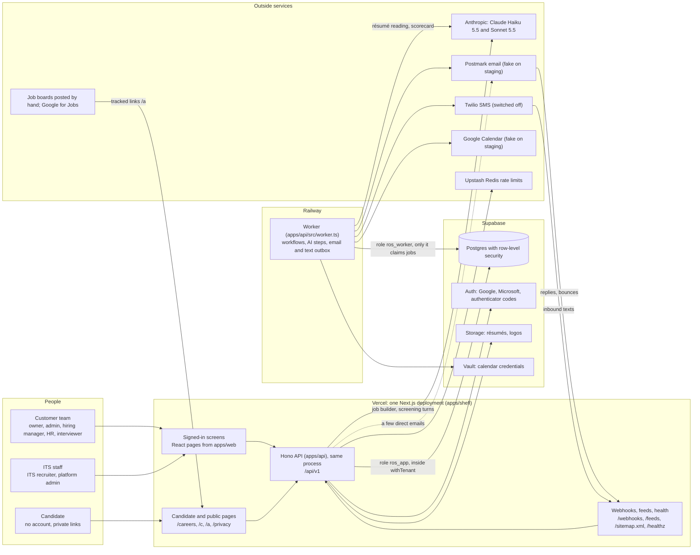
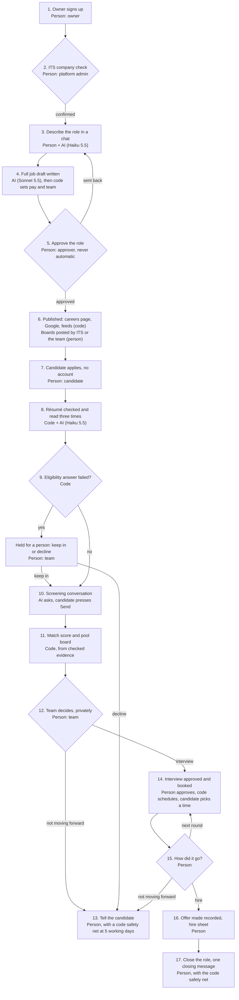

# Recruiting OS product audit: Phase One baseline

*14 October 2026. The code was read at `origin/main` commit `dafb730` (merge of PR #38), on branch `kanvis-reaudit`. Nothing in the app was changed.*

This page is the hub of the Phase One baseline. It says, in plain words, what Recruiting OS does today, who can do what, where it breaks, and what still needs a decision or live access to settle. The detail is in eleven files under [`docs/audit/`](audit/). This page links to them and does not repeat them.

| File | What it holds |
|---|---|
| [01-platform.md](audit/01-platform.md) | Architecture, sign-in, keeping companies apart, roles and permissions |
| [02-routes.md](audit/02-routes.md) | Every screen and API address, and who may open it |
| [03-jobs.md](audit/03-jobs.md) | Company sign-up, the job builder, approval, publishing, distribution |
| [04-apply.md](audit/04-apply.md) | The candidate journey: applying, résumés, the screening conversation, candidate pages |
| [05-pipeline.md](audit/05-pipeline.md) | Match score, pool board, private decisions, telling candidates |
| [06-interviews.md](audit/06-interviews.md) | Interviews, scheduling, the Cancelled column |
| [07-ai.md](audit/07-ai.md) | AI models, prompts, the workflow engine, evaluations, fairness |
| [08-ops.md](audit/08-ops.md) | Email and texts, notifications, recruiter on demand, admin console, privacy, operations |
| [09-tests.md](audit/09-tests.md) | Tests, CI, the baseline run, gaps |
| [feature-inventory.md](audit/feature-inventory.md) | All 364 features, one row each (generated) |
| [known-bugs.md](audit/known-bugs.md) | All 136 bugs, highest first (generated; a few appear twice, once for each area that found them) |

How to read this page:
- Plain words come first. The "Evidence" columns carry file paths, relative to the repository root, for engineers.
- The people named are the customer's team (owner, admin, hiring manager, HR, interviewer), the candidate, and ITS staff (ITS recruiter, platform admin).
- "Staging" facts come from the runbooks and session notes, not from code, and are marked as such. Nobody in this audit could see the live systems.

## Summary for the founder

1. **The product is broad and mostly built.** The audit found 364 features: 274 fully built, 58 partly built and 32 not built. The automated tests are green: 2,148 passed and none failed.
2. **The biggest gaps are about running it live, not about missing screens.** According to the staging runbook and session notes, no email leaves staging. Candidates get no status links, screening links or interview times, and ITS gets no mail about new companies.
3. **Two plan problems would block a real pilot.**
   - Every new company starts on Trial (one live role, 25 screening conversations). Only an engineer making a hand-made admin API call can move it to the Design Partner plan.
   - The "monthly" allowances never reset.
4. **Privacy.**
   - Deleting a candidate leaves copies of their data in the AI log and in the stored AI readings.
   - In the one-visit apply flow, a stranger who types someone's email address on another role is greeted with that person's first name.
5. **Permissions.**
   - Through the API, an interviewer, or an ITS recruiter given one candidate, can list every interview on a role.
   - An interviewer can open any role's details by its address.
   - HR can sign an owner out of every session.
6. **Interviews.**
   - Once the original two-week window has passed, rescheduling can find no times.
   - Several quieter scheduling paths lose the candidate's chosen time, or never email the new times.
7. **Telling candidates.** The decline screens say nothing is sent. Under your decision Q27, the standard decline goes by itself after 5 working days. The behaviour matches Q27; the screen wording is what is wrong.
8. **AI.** The controls in code are strong: quotes are checked, a person makes every decline, and the model never writes the number. The gaps:
   - Candidate-written text is not fenced off from the AI's instructions.
   - The screening scorecard is read once (the résumé is read three times).
   - A claim with no quote still counts in full in the score.
   - An AI outage of only 15 to 20 seconds stops processing of new applications until ITS retries each one by hand.
9. **Operations.**
   - Alerts appear only in the admin console, and acknowledging one silences that kind of alert for good.
   - Requests for a person that the system raises itself (a candidate's HUMAN reply, a screening hand-off, a failed workflow and others) are never emailed to ITS; only the stuck-role nudges are. Nothing alerts when a request goes past its reply-by time.
10. **Documents.** `docs/STATUS.md` and several specs are out of date (section 10).

---

## 0. How this audit was done

**The code is the truth.** The audit read the code at `dafb730`. Docs were used only as leads; where they disagree with the code, section 10 says so.

**Two readers per area.**
- One reader traced each of the nine areas from the screen, through the API route and the service, to the database.
- A second, skeptical reader then re-checked every bug and every "partly" or "not built" status, plus a sample of 20 to 25 fully built features per area, and tried to refute them.
- Each area file ends with "Verification notes" that list what changed. Claims that were refuted were removed. For example, the tests area struck a bug about the fairness summary, and the routes area struck a test-gap claim about the interview sheet.

**What was run.**
- **Unit and integration tests:** the full vitest suite, set up like CI (every provider fake, in-memory PGlite database, worker running inline). Result: 204 test files and 2,154 tests, of which 2,148 passed, 6 were skipped and none failed. It took 954 seconds (about 16 minutes) on this machine. Five skips are deferred hiring-scenario steps; the sixth needs a real Postgres test database.
- **TypeScript check:** per package. All 15 workspace packages that CI checks are clean. `tests/web`, which CI never type-checks, has 26 errors; none of them changes what a test proves today ([09-tests.md](audit/09-tests.md) section 9). `tests/policy` is clean.

**What was not run.**
- The 32 Playwright browser runs (they run in CI).
- Biome lint (blocked on this machine), the production build, the dependency audit and the secret scan.
- Anything live: there was no access to staging, production, Supabase, Vercel, Railway or GitHub Actions results.

**Kanvis.** The Kanvis research (7 and 14 October) is used only in section 12, with these evidence labels:
- **OBSERVED:** seen on 14 October.
- **OBSERVED-EARLIER:** seen on 7 October and not re-checked.
- **INFERRED:** read from shipped code strings or marketing copy.
- **UNKNOWN:** not checked.

Kanvis has shipped no new build since 7 October, so the 14 October findings re-confirm the earlier ones and add newly read code. Kanvis recruiter access is still by waiting list only, so no recruiter account was available, and Apply was never pressed. The "Reverse Engineer Anything" toolkit was assessed and not used.

**Working files.** The raw test output, the per-area working data and the Kanvis notes are in the audit session's working folder, not in the repository.

### Status classes

| Status | What it means | Features |
|---|---|---|
| Fully implemented | Works end to end in code: screen, API, data. Most of these were proven only against fake providers. | 274 |
| Partially implemented | Part is missing: an API with no screen, built but switched off, or a gap in one path | 58 |
| UI present but not functional | A control on screen that does nothing | 0 |
| Planned or referenced, not implemented | Promised in docs, columns, settings or on-screen words, but no working code | 32 |
| Unknown | Could not be settled from code | 0 features (the open questions about live systems are in section 11) |

| Area | Fully | Partly | Not built | Total |
|---|---|---|---|---|
| [01 Platform](audit/01-platform.md) | 27 | 6 | 5 | 38 |
| [02 Routes](audit/02-routes.md) | 34 | 7 | 1 | 42 |
| [03 Jobs](audit/03-jobs.md) | 37 | 3 | 2 | 42 |
| [04 Apply](audit/04-apply.md) | 43 | 5 | 3 | 51 |
| [05 Pipeline](audit/05-pipeline.md) | 38 | 2 | 3 | 43 |
| [06 Interviews](audit/06-interviews.md) | 29 | 7 | 5 | 41 |
| [07 AI](audit/07-ai.md) | 27 | 5 | 5 | 37 |
| [08 Ops](audit/08-ops.md) | 25 | 14 | 5 | 44 |
| [09 Tests](audit/09-tests.md) | 14 | 9 | 3 | 26 |
| **Total** | **274** | **58** | **32** | **364** |

**Bugs.** [known-bugs.md](audit/known-bugs.md) has 136 rows: 6 high, 33 medium, 96 low and 1 informational. Some bugs were reported by two or three areas. After merging those, the top list in section 9 has 34 entries.

---

## 1. Architecture map

### 1.1 Components

| Component | What it is, in plain words | Where it runs | Evidence |
|---|---|---|---|
| Shell (`apps/shell`) | The one website. It draws the signed-in screens and passes 12 address prefixes (`/api`, `/c`, `/careers`, `/a`, `/files`, `/feeds`, `/webhooks`, `/dev`, `/privacy`, `/healthz`, `/sitemap.xml`, `/robots.txt`) straight to the API in the same process. | Vercel (region `pdx1`; up to 300 s per request on `/api` and `/c`, 60 s elsewhere) | `apps/shell/lib/hono.ts`, `apps/shell/lib/container.ts`, `apps/shell/middleware.ts`, `apps/shell/app/**/route.ts` |
| Staff screens (`apps/web`) | The signed-in pages as React components: Today, Roles, the job builder, Talent, Interviews, Setup, the recruiter queue, the admin console. They have no routing of their own. | Drawn by the shell | `apps/web/src/pages/*`, `apps/web/src/api/client.ts` |
| API (`apps/api`) | The Hono application: the JSON API under `/api/v1`, the candidate and public pages (server-rendered, work without JavaScript), webhooks, feeds and the health check | Inside the shell on Vercel | `apps/api/src/app.ts`, `src/routes/*`, `src/pages/*`, `src/middleware/*` |
| Worker | A separate long-running process. It is the only process that runs workflows, AI steps and the email/text outbox in production, and it reports its own health. | Railway (`pnpm worker:start`, health check `/healthz`) | `apps/api/src/worker.ts`, `apps/api/src/worker-health.ts`, `railway.json` |
| Domain rules (`packages/core`) | Sign-in and sessions, the permission matrix, staff access, stages, policies, match score, pool board, outcomes, privacy requests | Library | `packages/core/src/*` |
| Database layer (`packages/db`) | Tables, migrations `0000` to `0035`, the company-separation wrappers `withTenant` and `withPlatform`, PGlite for development and tests | Library | `packages/db/src/client.ts`, `packages/db/src/schema/*`, `packages/db/migrations/*` |
| AI layer (`packages/ai`, `packages/agents`) | One Anthropic adapter and one runner. The model allow-list is Haiku 5.5 and Sonnet 5.5. Versioned prompts; the job-builder, reading and screening logic. | Library, run by the API and the worker | `packages/ai/src/routing.ts:8-12`, `packages/ai/src/runner.ts`, `packages/agents/src/*` |
| Workflow engine (`packages/workflows`) | Long-running jobs backed by Postgres: intake, screening, scheduling, publishing, new times, the stuck-role detector | Library, run by the worker | `packages/workflows/src/engine.ts`, `src/definitions/*` |
| Integrations (`packages/integrations`) | Adapters, each with a fake: Supabase sign-in and storage, Vault, Postmark, Twilio, Google Calendar, ClamAV, job boards, BLS pay data, analytics, Sentry | Library | `packages/integrations/src/registry.ts` |
| Other packages | `contracts` (data shapes), `ui` (design system), `evals` (AI evaluations), `playbooks` (dental and consumer hiring guides) | Libraries | `packages/*` |
| Supabase | Postgres with row-level security, Auth (Google, Microsoft, authenticator codes), Storage (résumés, logos), Vault (calendar credentials). The Supabase Data API is locked out. | Managed | migration `0017_supabase_api_roles.sql` |
| Upstash Redis | Shared rate-limit counters and second-factor attempt counters; required in production | Managed | `apps/api/src/env.ts:190-192` |

### 1.2 Diagram

In development and in every test, the same code runs on PGlite (Postgres in WebAssembly) with every outside service replaced by a fake, and the worker loop runs inside the shell (`WORKER_INLINE=true`, `apps/shell/lib/container.ts:16-29`).

### 1.3 Boundaries that matter

- **One web address.** Every screen calls the API on the same origin with the `ros_session` cookie. There is no second API host and no cross-origin access (`apps/web/src/api/client.ts:22-32`).
- **Companies are kept apart by the database.** Each company request runs inside `withTenant`. That switches to the `app_tenant` role with the company id set, and Postgres row-level security returns nothing from another company (`packages/db/src/client.ts:323-338`).
  - The caveat: every connection starts in "platform mode", which sees all companies. Isolation therefore depends on each route using the wrapper.
  - A test ratchet watches for raw queries, but it misses some ways of writing them (PLATFORM-12; bug B7 in [01-platform.md](audit/01-platform.md) section 10, not your decision B7).
- **Two database roles.** The website uses `ros_app` and the worker uses `ros_worker`. Only the worker can claim background jobs (`packages/db/migrations/0003_platform_roles.sql:32`).
- **Nothing reaches the outside world mid-transaction.** Emails, texts, calendar changes and credential deletions are written as rows in the same database transaction as the change that caused them. The worker carries them out after commit (section 6.3).
- **Candidates never sign in.** Each candidate page opens from an unguessable link token: status, screening, scheduling, confirm-answers, privacy verification (PLATFORM-28).
- **ITS staff never become members of a customer.** They reach a customer only through a time-limited "staff access grant", created when they accept a request. Every request they make is recorded in the customer's history (PLATFORM-21).

### 1.4 One application, from apply to decision

| # | What happens | Where it runs | What is written | Who decides | Evidence |
|---|---|---|---|---|---|
| 1 | The candidate opens the job page and the apply form. Pages exist only once ITS has confirmed the company. | Vercel (candidate pages) | analytics event only, with no identity | Code (ITS check gate) | `apps/api/src/pages/candidate.tsx:126-129,238,313` |
| 2 | The résumé goes straight to a private "quarantine" area of storage, with a one-use signed grant | Browser to Supabase Storage | storage object | Code | `candidate.tsx:326-342`; `apps/api/src/uploads.ts` |
| 3 | Apply: in one company transaction, the system finds or creates the person and creates the application and the document. A one-visit role also creates the conversation. | Vercel | `candidates`, `applications` (stage applied, status token), `documents` (quarantined), `events`, `workflow_runs`, `jobs`; plus `screens` for one-visit | Code | `apps/api/src/services/applications.ts:69`; `apps/api/src/services/apply-conversation.ts:90-126` |
| 4 | Acknowledgment email with the status link (held while the company is unconfirmed) | Worker | `communications` | Code | `packages/workflows/src/definitions/application-intake.ts`; `packages/agents/src/outbox.ts` |
| 5 | The file is checked by its bytes, scanned for malware, moved to its final private place and turned into text | Worker | `documents` (clean or rejected) | Code; scanner (fake by default) | `packages/workflows/src/documents.ts:37-94` |
| 6 | The AI pulls facts from the résumé, and code checks each quote | Worker | `applications.extraction`, `ai_runs` | AI, then code | `application-intake.ts:94-130`; `packages/agents/src/triage.ts:11-28` |
| 7 | Eligibility rules are checked by code. A "no" holds the application for a person; it never declines. | Worker | `applications.eligibility`, notifications | Code; a person decides | `packages/core/src/eligibility.ts`; `application-intake.ts:132-194` |
| 8 | The résumé is read three times. Evidence rules apply, the middle answer is kept, and the stage becomes "triaged". | Worker | `assessments`, `ai_runs` | AI, then code | `packages/agents/src/triage.ts:48-151,218-268` |
| 9 | Under the default policy, a consistent "screen" reading invites the candidate to the screening conversation and the owner is told afterwards | Worker | `screens`, `communications` | Code under the company's AI rules | `application-intake.ts:272-316`; `packages/core/src/policy.ts:74` |
| 10 | The conversation: the candidate answers and presses Send, then the scorecard is written. Under the default policy, a strong scorecard marks the person "recommended for interview". | Vercel (each turn) and worker (scorecard) | `screens`, `assessments`, `ai_runs` | AI talks, the candidate sends, code checks | `packages/agents/src/screening.ts`; `packages/workflows/src/definitions/screen.ts:354-438` |
| 11 | The team opens Talent. The match score and pool-board place are worked out by code on every view and never stored. | Vercel | nothing (read only) | Code | `packages/core/src/match-score.ts:108-146`; `packages/core/src/board.ts:102-185` |
| 12 | A person shortlists, holds or declines, privately | Vercel | `application_marks` or stage change; `told_state = not_told` | Person | `apps/api/src/services/application-actions.ts:509-591` |
| 13 | Telling: a person sends the approved wording (with 30 seconds to undo). Under the default, the standard message goes by itself after 5 working days. | Worker (outbox) | `communications`, `events` | Person; the code safety net | `packages/agents/src/decision-messages.ts:251-314` |
| 14 | Or an interview: a person approves it, the candidate books, the interview happens, and a person decides (next round, finalist, hire, not moving forward) | Worker and Vercel | `interviews`, `interview_participants`, `offers`, `hiring_outcomes` | Person (and the candidate picks the time) | `apps/api/src/services/interview-create.ts:52`; `apps/api/src/routes/interviews.ts:363-432` |

---

## 2. Route and page inventory

The full table of every page and API address, with its guard and caller, is in [02-routes.md](audit/02-routes.md) section 4.

### 2.1 Summary by audience

| Audience | How they get in | Count | Main screens and addresses |
|---|---|---|---|
| Public (anyone) | Nothing needed | 1 signed-out page, plus part of the about 43 server-rendered pages | Sign-in page `/login`; careers page `/careers/:slug`; job page and apply form; privacy notice `/privacy`; public privacy-request form `/c/privacy-request`; "Lost your link?" `/c/link-request` |
| Candidate holding a link | Unguessable token in an email | the rest of the about 43 server-rendered pages | Status page `/c/status/:token` (withdraw, texts, future roles, privacy request); screening conversation `/c/screen/:token`; scheduling `/c/schedule/:token` (pick, none work, reschedule, cancel, calendar file); confirm repeat answers `/c/confirm-answers/:token`; tracked link `/a/:token` |
| Customer team | Google or Microsoft sign-in, then an active company | 12 signed-in page routes (2 of them redirects from old addresses) | Today `/`; Roles `/roles`; job builder `/roles/new`; role page `/roles/:id` (8 tabs); Talent `/roles/:id/talent` and `/talent` (list, pool board, Review and apply, candidate panel, Compare); Interviews `/interviews`; Setup `/setup` (13 sections); Updates `/updates` |
| New owner | Signed in, no company yet | 1 | Create your company `/setup/company` |
| ITS recruiter | Microsoft sign-in plus an authenticator code | 2 | Recruiter queue `/recruiter/queue`, request detail `/recruiter/queue/:id`; then the customer's own screens under a grant |
| Platform admin | Microsoft sign-in plus an authenticator code, plus the platform admin role | 1 page, 10 tabs | `/admin`: Customers, Workflows, AI runs, Failures, Costs, Queue, Business calendar, Privacy requests, Administrators, Outcomes |
| Machines | Shared secrets or signatures | 5 webhooks, 5 feeds, health and reports | Postmark inbound, bounces, spam and events; Twilio inbound; `/sitemap.xml`, `/robots.txt`, `/feeds/jobs.xml`, `/feeds/jobs.json`, `/feeds/linkedin.xml`; `/healthz`; `/api/csp-report`; local file stand-in `/files/*`; development outboxes `/dev/*` |
| JSON API behind the screens | Session cookie and permission checks | about 250 endpoints under `/api/v1` | Counted from about 247 route registrations in `apps/api/src/routes` (plus 52 in `apps/api/src/pages`) |

Counts come from [02-routes.md](audit/02-routes.md) sections 1 and 12: 17 `page.tsx` files, 12 address prefixes passed to the API, about 43 server-rendered candidate and public pages, 5 feeds, 5 webhooks, 2 file stand-in routes, 1 health check and 2 development outboxes.

### 2.2 How a screen is protected

There are two layers ([02-routes.md](audit/02-routes.md) section 6):
- **The page layout decides who may open a screen.** Any session for the signed-in area; an active company for the company screens; ITS staff for the queue; a platform admin for the console.
- **The API checks every request again.** That covers the same-site check, the session, rate limits, the active company, the permission matrix (`assertCan`), and scope guards that hold ITS staff to the role or candidate named in their grant.
- Inside the company area there is no role check at page level. Pages hide controls they should not show, using `apps/web/src/roles.ts`; the API is the authority.

### 2.3 Admin actions with no screen

These work only through hand-made API calls from a second-factor admin session (ROUTES-37, ROUTES-38, OPS-22, OPS-23):
- **Put a customer on a plan,** including Design Partner (`apps/api/src/routes/admin.ts:390`). This is the high-severity one: see section 9, H1.
- Break-glass emergency access (`admin.ts:360`), plus the `POST /auth/switch` call needed to use it.
- The staff-access ledger (`admin.ts:377`) and the overview of recruiter requests (`admin.ts:289`).
- Sign a person out everywhere after a lost device (`admin.ts:494`).
- AI run detail (`admin.ts:206`) and adding an email suppression (`admin.ts:227`).
- The privacy deadline check and the candidate lookup (`apps/api/src/routes/privacy-requests.ts:67,173`).

On the customer side, "sign one team member out everywhere" also has an API and no button (`apps/api/src/routes/company-settings.ts:498`).

### 2.4 Routes missing from, or wrong in, older route docs

| Address | Problem | Doc |
|---|---|---|
| `/roles/new` (job builder), `/updates` | Missing | `docs/spec/16-route-inventory.md` |
| `/a/*`, `/files/*`, `/sitemap.xml`, `/robots.txt`, `/api/csp-report` | Missing from the list of addresses passed to the API | `docs/spec/16-route-inventory.md`; `docs/03-technical-architecture.md:18,63` (which also misses `/dev`) |
| Server-rendered pages under `/api`: second factor `/api/v1/auth/mfa`, email-link landing `/api/v1/auth/consume`, invitation `/api/v1/auth/invite`, job previews `/api/v1/roles/:id/preview/page` and `/api/v1/intake/sessions/:id/preview/page` | Missing | `docs/spec/16-route-inventory.md` |
| `/c/link-request`, `/c/confirm-answers/:token`, `/c/privacy-request` | `/c` is described only as status, screening, scheduling and privacy | `docs/spec/16-route-inventory.md` |
| Admin tabs Privacy requests, Administrators, Outcomes | Doc says 7 tabs; the code has 10 | `docs/spec/16-route-inventory.md` |
| Setup | Doc lists 5 parts; the code has 13 sections | `docs/spec/16-route-inventory.md` |
| Role page tabs History and Report | Doc lists 6 tabs; the code has 8 | `docs/spec/04-screens-and-states.md` |
| `/login/consume`, `/roles/:id/packets/:version`, `/setup/availability`, `/setup/calendar/google` and `/setup/calendar/microsoft` | Listed, but do not exist. The email link lands on `/api/v1/auth/consume`; availability is a Setup card; calendar connect is `/api/v1/integrations/calendar/google/connect`; Microsoft is not built. | `docs/spec/16-route-inventory.md`, `docs/spec/04-screens-and-states.md` |
| `PUT /companies/current/notices`, `/admin/users/:id/platform-role`, `/admin/spend`, `/admin/customers/:id/spend-cap`, `/admin/calendar-connections/:id/probe`, `/admin/activity`, `/admin/runs/:id/cancel`, `POST /applications` (manual add) | Listed, but do not exist | `docs/spec/07-api-specification.md`; `docs/12-api-contracts.md` |
| Postings prepare, ask-ITS and updated; board ticks; share links; closing date; apply mode; decision and closing messages; change by chat; requirements check; preview; notes; offer; outcomes; company profile; staff access; notification preferences; most admin routes | Exist, but missing from the API doc | `docs/spec/07-api-specification.md` |

`docs/readiness/02-route-inventory.md` only points to spec 16, so it inherits the same gaps.

---

## 3. Existing feature inventory

One row per group of related features. Statuses: **Fully** = fully implemented; **Partly** = partially implemented; **Not built** = planned or referenced, not implemented. "Deferred" marks items you postponed on purpose in September 2026. The IDs point to rows in [feature-inventory.md](audit/feature-inventory.md), which lists all 364 with evidence.

### 01 Platform: sign-in, company separation, roles (38 features: 27 fully, 6 partly, 5 not built)

| Group | What it covers | Who | Status | IDs |
|---|---|---|---|---|
| One deployment | Vercel website with the API inside it; a Railway worker; production refuses to start with fake sign-in, fake AI, PGlite or an over-powered database role | everyone | Fully | PLATFORM-01 to 03 |
| Signing in | Google or Microsoft through Supabase; the app's own hashed sessions (30 days for customers, 8 hours for staff); "Your sessions"; "Confirm it's you" before sensitive changes; email link for development only | all team members | Fully | PLATFORM-04 to 06, 09, 10 |
| ITS staff security | Microsoft plus an authenticator code with attempt limits; a ledger of platform roles changed only by another admin, with a reason; the console guard | ITS recruiter, platform admin | Fully | PLATFORM-07, 19, 24 |
| Keeping companies apart | Postgres row-level security; the Supabase Data API locked out | every customer | Fully | PLATFORM-11, 13 |
| Raw-query safety test | A ratchet test against unscoped queries; misses some ways of writing them | platform | Partly | PLATFORM-12 |
| Team and permissions | Permission matrix; invitations (7 days, only the invited address); role changes and removals with clean-up | owner, admin, HR | Fully | PLATFORM-14, 16, 17 |
| Interviewer limits | Lists are limited to their own roles and interviews, but role detail and the role's interview list are not | interviewer | Partly | PLATFORM-15 |
| Recruiter on demand: access | "Bring in a recruiter" with a chosen scope; ITS sees a preview before accepting; scoped grant for 14 days; the customer sees it and can end it | owner, admin, hiring manager, HR, ITS recruiter | Fully | PLATFORM-20 to 22, 38 |
| Candidate links | Unguessable tokens; "Lost your link?"; tracked links for sources | candidate | Fully | PLATFORM-28, 29, 31 |
| Open sign-up, audit history, protections | Anyone signed in can create a company; customer audit history and CSV; same-site checks; webhook signatures | owner; platform | Fully | PLATFORM-27, 32, 33, 36 |
| API-only controls | Sign a member out; break-glass; admin signs a person out; switching company | owner, admin, platform admin | Partly | PLATFORM-18, 23, 25, 26 |
| Not built | Second factor for customer owners and admins; candidate "get a new link"; customer-side handling of privacy requests; limiting a hiring manager to their own roles; leaving or closing a company | owner, admin, HR, hiring manager, candidate | Not built | PLATFORM-08, 30, 34, 35, 37 |

### 02 Routes and navigation (42 features: 34 fully, 7 partly, 1 not built)

| Group | What it covers | Who | Status | IDs |
|---|---|---|---|---|
| Frame and guards | Session gate, navigation rail (Start a hire, N key, Today, Roles, Talent, Interviews, Setup, Queue, Console), page guards, old-address redirects, error and not-found pages | all signed-in people | Fully | ROUTES-01 to 04, 19, 20 |
| Main screens | Sign-in, invitation and second-factor pages; Create your company; Today; Roles; job builder; role page with 8 tabs; Talent; Interviews; Setup with 13 sections; Updates; recruiter queue | team, ITS recruiter | Fully | ROUTES-05 to 17 |
| Admin console | 10 tabs work; several admin actions have no screen | platform admin | Partly | ROUTES-18 |
| Candidate, public and machine addresses | Careers, job and apply pages; screening; status; scheduling; privacy pages; tracked links; feeds; webhooks; health; CSP reports; previews; protections; old aliases | candidate, public, machines | Fully | ROUTES-21 to 34, 42 |
| API-only or incomplete | Company switcher; sign a member out; plan change; break-glass; version comparison; the role's interview list (over-broad) | various | Partly | ROUTES-35 to 38, 40, 41 |
| Microsoft calendar | Not built (deferred; Google connect and "Your availability" work) | interviewers | Not built | ROUTES-39 |

### 03 Jobs: sign-up, job builder, approval, publishing, distribution (42 features: 37 fully, 3 partly, 2 not built)

| Group | What it covers | Who | Status | IDs |
|---|---|---|---|---|
| Company sign-up | Self sign-up; the one-time ITS company check (decision B7); getting-started card; company profile with an AI-drafted "about" text a person approves | owner, platform admin | Fully | JOBS-01 to 04 |
| Plan limits | Active-role allowance checked at start and again when asking for approval | owner | Fully | JOBS-05 |
| Plans and allowances | Plan change is API only; monthly counters never reset; seats not enforced; trial never ends | platform admin, owner | Partly | JOBS-06 |
| Job builder | Start points; question cards; pasted ad read as data; pay card with a market figure; AI draft written beside the chat; private drafts; fairness word check; change by chat; requirements check; candidate-view preview | owner, admin, hiring manager | Fully | JOBS-07 to 14 |
| Approval | Ask for approval (six essentials, pay set by a person, no open flags); approver rules, named decision maker, no self-approval, 14-day expiry; legal check | owner, admin, hiring manager | Fully | JOBS-15, 16, 21 |
| Settings for a role | Skills editor; "What the AI may do"; eligibility questions with reasons | owner, admin | Fully | JOBS-18 to 20 |
| Editing a live job | Versions and editor; paused-role edits get stranded; closed roles still editable through one route; version comparison has no screen | owner, hiring manager | Partly | JOBS-17, 42 |
| Publishing and distribution | Publish workflow; posting states; board ticks; ITS posting tasks; team self-posting; live link check; Google for Jobs; email-in; tracked links and sharing; careers and job pages; feeds; "boards still show an old version" | owner, ITS recruiter, candidate | Fully | JOBS-22 to 30, 33, 34, 36 |
| Running a role | Closing date with 24-hour grace; accepting switch; pause and resume; after-approval screen; closing a role lists boards still up; apply-flow switch set by ITS; daily volume figures | owner, admin, ITS | Fully | JOBS-31, 32, 35, 37, 40, 41 |
| Not built (deferred) | Paid sponsorship; job-board API connections | owner | Not built | JOBS-38, 39 |

### 04 Apply: the candidate journey (51 features: 43 fully, 5 partly, 3 not built)

| Group | What it covers | Who | Status | IDs |
|---|---|---|---|---|
| Finding and applying | Careers and job pages (only after the ITS check); apply form with an acknowledgment that people decide; bot defence without a CAPTCHA; résumé direct upload; file inspection; quarantine and text extraction | candidate | Fully | APPLY-01 to 07, 09 |
| Malware scan | ClamAV adapter is built; the default is a fake; production only raises an alert | candidate, platform admin | Partly | APPLY-08 |
| Reading and eligibility | AI résumé extraction; eligibility checked by code, a "no" is held for a person | candidate, owner | Fully | APPLY-10, 11 |
| Repeat and lost links | Repeat applications change nothing; one person across roles; receipt never shows the status link; "Lost your link?"; tracked links; closing-date grace | candidate | Fully | APPLY-12 to 17 |
| One-visit conversation (decision B1) | ITS switch per company or role; straight from form to conversation; fixed AI introduction; one question at a time; taps and skip; "Check your answers" with nothing shown before Send; "I'd rather talk to a person"; keywords; reminders; outage pause; allowance; repeat-submission confirmation | candidate, ITS | Fully | APPLY-18 to 29 |
| Later-path invitation and scorecard | Emailed invitation; scorecard with checked quotes (with a gap, section 9 M9) | candidate, owner | Fully | APPLY-30, 32 |
| Texting | Screening by SMS is built and switched off (deferred) | candidate | Partly | APPLY-31 |
| Candidate pages | Status page with four steps; message thread; withdraw; text preference; future-roles opt-out; privacy requests from the status page and a public form; privacy page | candidate | Fully | APPLY-33 to 40 |
| Deletion | Anonymization works, but leaves the AI copies | candidate | Partly | APPLY-41 |
| Email and interviews | Email replies (HUMAN, "no thanks", EXPLAIN); emailed-in applications and holding while paused; self-scheduling with an accommodation note; help line before applying | candidate | Fully | APPLY-42 to 44, 49, 51 |
| Protections with gaps | Content-security policy is report-only; candidate text is not fenced against prompt injection | candidate | Partly | APPLY-47, 48 |
| Not built | "Get a new link"; a CSRF token on the form; adding a candidate by hand | candidate, owner, ITS | Not built | APPLY-45, 46, 50 |

### 05 Pipeline: score, board, decisions, telling (43 features: 38 fully, 2 partly, 3 not built)

| Group | What it covers | Who | Status | IDs |
|---|---|---|---|---|
| Stages and marks | 25 internal stages; stage strip with counts (decision B3); stage button; private Longlist, Shortlist and On hold with a return date; list filters and sorts | owner, hiring manager, HR, ITS recruiter | Fully | PIPELINE-01 to 04, 06 |
| "Not a fit for now" mark | In the data and the report, but no screen can set it | owner | Partly | PIPELINE-05 |
| AI reading and evidence | Three résumé readings with the middle answer kept; quote rules; "Needs a closer look"; consistency check before any automatic step; automatic forward moves under the company's rules | system, team | Fully | PIPELINE-07 to 10 |
| Match score (decision B2) | 0 to 100 worked out by code; must-have line; "read against version N" label | team | Fully | PIPELINE-11 to 13 |
| Pool board (decisions B4, B5) | Three-column board with reasons; pool summary; Review and apply for up to 50; one-click pool questions; Compare up to 5 | owner, hiring manager, HR, ITS recruiter | Fully | PIPELINE-14 to 16, 18, 20 |
| Board extras | On hold, invite to screen and ask a recruiter are in the API but not in Review and apply | owner | Partly | PIPELINE-17 |
| Private decisions and telling (decisions B6, Q27, Q28, Q30) | Private decline with a reason; Send with 30-second Undo; bulk "Review and send"; "I told them myself"; quiet undo; 5-working-day safety net; one closing message | owner, hiring manager, ITS recruiter | Fully | PIPELINE-21 to 27 |
| Holds, flags, notes | Eligibility hold actions; "Ask about this in a screen"; "Something wrong?" flag to ITS; private team notes (Q24) | team | Fully | PIPELINE-28 to 31 |
| After interviews | Decision after an interview; "Offer made" recorded only (Q29); hire sheet; outcomes and admin corrections; role report and CSV; requirements check; "still reviewing" note (off by default); candidate privacy on the status page; AI suggestions waiting for Yes or Not now; "Record what happened" | team, platform admin | Fully | PIPELINE-32 to 37, 39, 40, 42, 43 |
| Not built | Typed free-text pool questions (later, per decision B5); reference, offer-drafting, negotiation and onboarding stages (deferred); "the system learns from it" | owner | Not built | PIPELINE-19, 38, 41 |

### 06 Interviews (41 features: 29 fully, 7 partly, 5 not built)

| Group | What it covers | Who | Status | IDs |
|---|---|---|---|---|
| Main interview loop | Approve an interview (a person, always); AI-suggested personal line (disclosed); declared hours; slot computation; pick-a-time page; reminder and expiry of the offer; booking with a calendar file; reminders at 24 and 2 hours; "Did it take place?"; automatic close; decision; interviewer brief without pay; interviewer's own note; Interviews page; interview plan tab; interviewer's Today; notifications | owner, admin, hiring manager, ITS recruiter, interviewer, candidate | Fully | INTERVIEWS-01 to 03, 06, 07, 09 to 11, 17 to 22, 39 to 41 |
| Cancelled column (decisions 1A to 4A) | Candidate cancels with a choice; no-show goes under Cancelled; one automatic set of new times after N working days; send new times to one or many; guards; migration backfill; status page news | candidate, team | Fully | INTERVIEWS-24 to 31 |
| Leaving and cancelling | Team cancel tells the candidate; a removed interviewer is taken off; leaving the process calls interviews off; calendar files | candidate, team | Fully | INTERVIEWS-14, 32 to 34 |
| Scheduling with gaps | Google Calendar (built, fake on staging); "none of these work"; candidate and team reschedule; book on the candidate's behalf; slot-collision escalation; interviewer-only view | team, candidate | Partly | INTERVIEWS-04, 08, 12, 13, 15, 16, 23 |
| Not built | Microsoft calendar, recording, scorecards and debrief, texts for interviews (all deferred); widening the window or changing interviewers | interviewers, owner | Not built | INTERVIEWS-05, 35 to 38 |

### 07 AI layer (37 features: 27 fully, 5 partly, 5 not built)

| Group | What it covers | Who | Status | IDs |
|---|---|---|---|---|
| Model plumbing | Allow-list (Haiku 5.5 and Sonnet 5.5 only); effort per task; Anthropic adapter; run log; fake provider for tests | ITS, everyone indirectly | Fully | AI-01 to 04, 28 |
| Cost views | Work, but under-report the Sonnet cache price, show all-time totals only, and name companies by id | platform admin | Partly | AI-05 |
| Ten live AI tasks | Job-builder chat; pasted-ad reading; full draft (Sonnet); change by chat; company "about"; suggested personal line; résumé extraction; résumé reading three times; screening conversation; scorecard | owner, candidate | Fully | AI-07 to 10, 12 to 15, 18 to 20 |
| Code-side controls | Requirements check (no model); match score by code; automatic screening invitation under policy; flag a reading; playbooks; interviewer brief (no model); stuck-role ladder; candidate asks for a human review; "read against an older version" label | team, candidate | Fully | AI-11, 16, 17, 25, 29, 30, 32, 36, 37 |
| Engine and fairness button | Durable workflow engine; a manual "fairness test" run on the real models | ITS | Fully | AI-24, 27 |
| Protections with gaps | Protected traits; prompt injection; evaluation harness (fake provider only in CI); console hides unsent conversations except repeat submissions | candidate, ITS | Partly | AI-21 to 23, 26 |
| Not built | Daily AI spend cap; six task names with no prompt; deleting AI data; AI monitoring alerts; release gate on real-model results | platform admin, candidate | Not built | AI-06, 31, 33 to 35 |

### 08 Operations: messages, recruiter on demand, admin, privacy (44 features: 25 fully, 14 partly, 5 not built)

| Group | What it covers | Who | Status | IDs |
|---|---|---|---|---|
| Outbox | Messages written inside the transaction and sent once by the worker; 30-second Undo; held until the ITS check; fake adapters and a standing "emails are not being sent" alert | candidate, team, ITS | Fully | OPS-01 to 03, 05 |
| Notifications | Updates page; email alerts per group (at once, daily, weekly, off) with an 8:00 summary; stuck-role nudge ladder | team | Fully | OPS-08, 09, 42 |
| Recruiter on demand | Ask a recruiter with a reply-by time; ITS queue, claim, thread, resolve, release; automatic requests; customer ends access | team, ITS recruiter | Fully | OPS-10, 11, 13, 14 |
| ITS mailbox | Only requests a customer raises are emailed | ITS recruiter | Partly | OPS-12 |
| Running the service | Worker health and alerts; recurring jobs; audit history; admin tabs; platform roles; team; company settings; sessions; role and customer reports; privacy requests; rate limits; security headers; "Lost your link?" | platform admin, team, candidate | Fully | OPS-16, 17, 20, 21, 24, 25, 27, 28, 30, 31, 33 to 35, 43 |
| Built but not live on staging | Postmark sending; suppression list and delivery webhooks; Twilio; Sentry; PostHog; inbound email; secret rotation (never called) | everyone | Partly | OPS-04, 06, 07, 19, 32, 36, 37 |
| Partly built controls | Alerts (no resolve, console only); retention sweep (operational rows only); plan change (API only); admin API-only actions; member sign-out (API only); billing (counters only) | platform admin, owner | Partly | OPS-15, 18, 22, 23, 26, 29 |
| Not built | AI spend cap; admin views promised in `docs/16-admin.md`; requeue a failed job; sending alerts to a person; an alert when a request passes its reply-by time | platform admin, ITS recruiter | Not built | OPS-38 to 41, 44 |

### 09 Tests and CI (26 features: 14 fully, 9 partly, 3 not built)

| Group | What it covers | Who | Status | IDs |
|---|---|---|---|---|
| Automated checks | vitest suite; API tests; shell tests; Playwright in CI; evals on the fake provider; the CI `verify` job; lint; secret scan and dependency audit; migration validation; release migration workflow; load script; dead-worker detection tests; staging database scripts | ITS engineering | Fully | TESTS-01, 02, 04, 07 to 09, 12, 14 to 17, 20, 25, 26 |
| Checks with gaps | Company separation proven only on PGlite; scenario tests with skipped steps; `tests/web` not type-checked; real-AI fairness tests are manual with no recorded result; real-model evals of other prompts; typecheck coverage; staging smoke; real-Postgres runs; local CI script | ITS engineering | Partly | TESTS-03, 05, 06, 10, 11, 13, 18, 19, 21 |
| Not built | Deferred scenario steps; pull-request template; nightly real-model evals and upgrade tests | ITS engineering | Not built | TESTS-22 to 24 |

---

## 4. Role and permission matrix

Source: the permission matrix in `packages/core/src/permissions.ts:44-74`, the object rules in `apps/api/src/services/team.ts` and `packages/core/src/approval-deciders.ts`, and the staff guards in `apps/api/src/middleware/session.ts:64-117`. Full detail: [01-platform.md](audit/01-platform.md) section 7.

"Y" = can, "N" = cannot. "ITS recruiter" means an ITS recruiter working inside a customer under a scoped grant (shown in code as the role "recruiter").

### 4.1 Matrix

| What | Owner | Admin | Hiring manager | HR | Interviewer | ITS recruiter (grant) | Platform admin | Candidate (link) | Public | Evidence |
|---|---|---|---|---|---|---|---|---|---|---|
| See the company, team list and pending invitations | Y | Y | Y | Y | Y (sees invitations too; see 4.3) | Y | only through a grant | N | N | `permissions.ts` company.read; `apps/api/src/routes/companies.ts:55-60` |
| Change company settings, candidate notices, the cancel setting | Y (recent sign-in) | Y (recent sign-in) | N | N | N | N | N | N | N | company.update; `apps/api/src/middleware/reauth.ts` |
| Invite, change or remove team members | Y | Y (admin and below) | N | Y (not owners or admins) | N | N | N | N | N | members.manage; `team.ts:80-245` |
| Start a hire (job builder) | Y | Y | Y | N | N | Y, only with a company-wide grant | N | N | N | role.create + compensation.read; `apps/api/src/routes/intake.ts:27-36` |
| Approve a role | Y (may override a named decision maker) | Y (not one they started) | Y (not one they started) | N | N | N | N | N | N | role.approve; `packages/core/src/approval-deciders.ts:30-65` |
| Pause, resume, closing date, boards, postings | Y | Y | N | N | N | Y | N | N | N | role.manage |
| Close a role with its outcome | Y | Y | Y | Y | N | N | N | N | N | outcome.record |
| See pay | Y | Y | Y | Y | N | Y | N | public range only | public range only | compensation.read; pay removed at `apps/api/src/routes/roles.ts:105-106` |
| See applicants, pool board, Compare, report | Y | Y | Y | Y | N (bug: see 4.3) | Y (granted role or candidate) | N | N | N | application.read |
| Decline and send decision messages | Y | Y | Y | N (talent pool only) | N | Y | N | N | N | application.reject; `application-actions.ts:47-72` |
| Approve, reschedule, cancel and decide interviews | Y | Y | Y | N (records "did it take place" only for one they sat on) | N (records "did it take place" for their own) | Y | N | pick, reschedule twice, cancel | N | interview.request, manage, decide; `apps/api/src/routes/interviews.ts:209-249` |
| Record "Offer made" and a hire | Y | Y | Y | Y | N | N | corrects outcomes | N | N | outcome.record; `apps/api/src/routes/admin.ts:516` |
| Private team notes | Y | Y | Y | Y | own note, on people they interviewed | Y | N | N | N | note.read, note.write; `apps/api/src/services/notes.ts` |
| Change "What the AI may do" | Y (recent sign-in) | Y (recent sign-in) | N | N | N | N | N | N | N | policy.manage; `apps/api/src/routes/policies.ts:78` |
| Bring in a recruiter, choosing the scope | Y | Y | Y | Y | N | n/a | n/a | "I'd rather talk to a person" | N | escalation.create; `approvals-escalations-events.ts:119-177` |
| End ITS access | Y | Y | N | N | N | n/a | n/a | N | N | staff_access.revoke; `companies.ts:134-174` |
| Read the audit history and CSV | Y | Y | Y | Y | N | N (refused) | n/a | N | N | events.read; `company-settings.ts:457-492` |
| ITS recruiter queue and accepting requests | N | N | N | N | N | Y (Microsoft + authenticator) | Y | N | N | `requireRecruiterOrAdmin`, `session.ts:75-90` |
| Admin console: confirm companies, apply flow, platform roles, privacy requests, outcomes; plan and break-glass by API | N | N | N | N | N | N | Y (Microsoft + authenticator) | N | N | `requirePlatformAdmin`; `apps/api/src/routes/admin.ts` |
| Status page, screening, scheduling links | N | N | N | N | N | N | N | Y, own application only | N | `apps/api/src/pages/candidate.tsx:713`; `apps/api/src/pages/schedule.tsx:28-41` |
| Careers, job pages, apply, privacy form, lost link | Y | Y | Y | Y | Y | Y | Y | Y | Y (ITS-confirmed companies only) | `candidate.tsx:126-129` |

### 4.2 Object rules on top of the matrix

- Only an owner invites, promotes, changes or removes an owner, and the last owner cannot be demoted or removed. Only an owner or an admin touches the admin role; HR never does. Nobody changes their own role (`team.ts:104-113,163,176-181`).
- Making someone an admin or owner, changing the AI rules, the candidate notices or the cancel setting needs a session younger than 30 minutes, or a "Confirm it's you" in the last 10 minutes (`packages/core/src/auth.ts:98-109`).
- A person may not approve a role they started, or a version they wrote, unless they are the company's only owner. A request reserved for a named decision maker can be decided only by them or an owner (`approval-deciders.ts:30-65`).
- Drafts are visible to the person who started them and to owners and admins, who can take them over (`intake.ts:207-211,367-370`).
- Any team member who may ask for a recruiter, a hiring manager or HR included, can choose "all of your hiring" as the scope ([01-platform.md](audit/01-platform.md) section 7.3).
- Platform admins cannot grant themselves a role or revoke the last admin. They cannot enter a customer except through an accepted request or break-glass (API only, at most 60 minutes, with a fresh second factor) (`packages/core/src/platform-roles.ts:51-103`).

### 4.3 Permission bugs

| Bug | Who gains what | Severity | Evidence |
|---|---|---|---|
| `GET /api/v1/roles/:id/interviews` checks only "can read roles" | An interviewer, or an ITS recruiter granted one candidate, can list every interview on the role: names, stages, meeting links, interviewers' emails, decision notes, accommodation notes. No screen calls it; untested. | Medium (reported by three areas) | `apps/api/src/routes/interviews.ts:434-450`; `packages/core/src/staff-access.ts:89` |
| Interviewers can open any role by its address | Applicant counts by stage, the packet (evaluation criteria, red flags, deal-breakers, internal notes; pay removed), postings, plan | Low | `apps/api/src/routes/roles.ts:91-135` versus `:50-54` |
| HR can sign an owner or admin out everywhere (API) | Repeated sign-outs; sessions are per person, so the person is signed out of their other companies too | Medium | `apps/api/src/routes/company-settings.ts:498-516` |
| HR can withdraw an owner's invitation for a new owner or admin | Quietly cancels a co-owner or admin invitation (the withdrawal is audited) | Low | `apps/api/src/services/team.ts:138-144` |
| Every member sees pending invitations | Interviewers see invitees' emails and intended roles in Setup | Low | `companies.ts:55-60`; `apps/web/src/pages/TeamCard.tsx:144-158` |
| Approval decisions skip the grant's scope | An ITS recruiter under a one-role grant could decide another role's interview or takeover request if they know its id (plausible, untested) | Low | `approvals-escalations-events.ts:36-99` |
| The role report's JSON ignores a narrow grant | Aggregates and other applicants' ids for a one-candidate grant (plausible; the CSV is limited correctly) | Low | `apps/api/src/routes/reports.ts:29-38` |
| Only the newest ITS grant per company is used | A recruiter working two requests at one customer loses the first | Low | `packages/core/src/staff-access.ts:62-68` |
| ITS staff can create their own company | They become its owner, outside the grant model, with no staff-access audit | Low | `companies.ts:18-29`; `apps/api/src/services/companies.ts:38` |
| The "staff sign in with Microsoft" rule reads the account's first provider | Plausible; depends on identity linking in the live Supabase project | Low | `packages/integrations/src/identity/claims.ts:9`; `packages/core/src/identity.ts:30` |
| Repeat-submission conversations are not withheld in the AI runs console | Platform admins can read answers typed under someone else's address and never confirmed | Low | `packages/core/src/screen-answers.ts:200-207` |

---

## 5. Workflow map per major journey

"Who decides" uses four labels: **Person** (and which one), **Code** (fixed rules), **AI** (Claude Haiku 5.5 or Sonnet 5.5), and **External** (an outside service).

### 5.0 The main hiring journey

On the default "form now, conversation later" path, step 10 happens only when the reading recommends a screen and the company's AI rules allow the invitation (section 5.5). On the one-visit path it happens straight after applying (section 5.4).

### 5.1 Company sign-up and the ITS check

| # | Step | Who decides | Evidence |
|---|---|---|---|
| 1 | A person signs in with Google or Microsoft | External (Supabase Auth); Code opens the app's own session | `apps/api/src/routes/auth.ts:42-86` |
| 2 | With no company, they fill in "Create your company". The company starts on the Trial plan with the owner as a member, and the stuck-role detector starts. | Person (owner); Code | `apps/api/src/routes/companies.ts:18-29`; `apps/api/src/services/companies.ts:16-49` |
| 3 | The ITS queue mailbox is emailed about the new company (on staging the fake adapter "sends" it, so nobody is told) | Code; External (Postmark) | `apps/api/src/services/company-trust.ts:116-127` |
| 4 | Until ITS confirms, the careers page, job pages, feeds and tracked links are offline and candidate messages are held. Today says ITS is confirming. | Code | `candidate.tsx:126-129`; `packages/agents/src/outbox.ts:88-105` |
| 5 | A platform admin presses Confirm in Admin, Customers, with a reason. Held messages are released (stale ones cancelled), waiting publish runs wake, and owners are told. | Person (platform admin); Code | `apps/api/src/routes/admin.ts:79-93`; `company-trust.ts:32-53` |
| 6 | The plan stays Trial unless a platform admin calls the plan API by hand | Person (platform admin, API only) | `admin.ts:390-410` |
| 7 | A getting-started card leads the owner through company details, team, interview hours, first role, job-board access and AI rules | Code | `apps/api/src/services/brief.ts:434-539` |

### 5.2 Opening and publishing a role

| # | Step | Who decides | Evidence |
|---|---|---|---|
| 1 | "Start a hire" (rail, N key, Today box, Roles page, Hire again) | Person (owner, admin, hiring manager; ITS recruiter only with a company-wide grant) | `apps/web/src/start-hire.ts`; `intake.ts:166-185` |
| 2 | Plan room checked; a full plan stops here with "Talk to ITS about more roles" | Code | `intake.ts:138-149` |
| 3 | The chat asks up to three question cards; a pasted ad is read as data | AI proposes (Haiku 5.5); Code rebuilds the cards, drops unfair options and keeps team facts | `packages/agents/src/intake.ts:177-206,279-353` |
| 4 | Pay counts as set only when a person typed or confirmed the figures | Code | `packages/core/src/intake-builder.ts:66-70` |
| 5 | The full draft is written, then pay, decision maker, interviewers, deal-breakers and flags are set by rule | AI (Sonnet 5.5), then Code | `packages/agents/src/intake.ts:437-548` |
| 6 | Optional: preview; change by chat (confirmed by a person); requirements check; keep a flagged phrase with a reason | Person; AI proposes; Code checks | `apps/api/src/routes/role-packets.ts:260-418` |
| 7 | Ask for approval. Refused until the six essentials are in, pay was set by a person, no flag is open, and the plan has room. Creates the role, version 1 and the approval workflow. | Code | `intake.ts:321-364`; `packages/agents/src/intake.ts:591-667` |
| 8 | Approval by the named decision maker or an approver. No self-approval except a sole owner. Open flags or a failed legal check block it. Expires after 14 days. | Person (owner, admin or hiring manager); Code gates | `apps/api/src/services/packet-approval.ts:46-57`; `packages/workflows/src/definitions/role-approval.ts` |
| 9 | The role opens; a Colorado or remote role gets a 30-day closing date; publishing starts | Code | `role-approval.ts:154,204-210` |

### 5.3 Distribution

| # | Step | Who decides | Evidence |
|---|---|---|---|
| 1 | Publishing waits for the ITS check, then opens each chosen channel | Code | `packages/workflows/src/definitions/publish-role.ts:60-151` |
| 2 | Careers and job page live; a link check is queued | Code | same |
| 3 | Google for Jobs through structured data on the job page; a person marks it "found" | External (Google); Person | `packages/integrations/src/jobboards/native.ts:121-148` |
| 4 | Email-in address per role; live only when the inbound mail domain is set up | External (Postmark) | `native.ts:47-62`; `apps/api/src/webhooks/postmark.ts:29-80` |
| 5 | Indeed, LinkedIn and ZipRecruiter (only with the company's own ZipRecruiter plan) are posted by hand from the company's own accounts. ITS does it by default through posting tasks, or the team does it itself. | Person (ITS recruiter, or owner or admin) | `packages/core/src/posting-tasks.ts`; `apps/api/src/routes/postings.ts:212-312` |
| 6 | The listing address is recorded and fetched. It is called "Live and verified" only if the page shows the job title (outside production a fake calls every address live). | Code; External | `apps/api/src/container.ts:216-255`; `packages/integrations/src/registry.ts:74` |
| 7 | Tracked links per board and per sharing place; public feeds and sitemap | Code | `postings.ts:604-682`; `apps/api/src/pages/public-feeds.ts` |
| 8 | Channel failures are retried three times, 8 hours apart, and never block the role | Code | `publish-role.ts` |

### 5.4 The candidate applies (both modes)

| # | Step | Who decides | Evidence |
|---|---|---|---|
| 1 | Careers page, job page or a tracked link leads to the apply form | Candidate | `candidate.tsx:167-320`; `apps/api/src/pages/links.tsx:56-83` |
| 2 | Name, email, optional phone and location; a résumé or four short answers; eligibility answers; a required acknowledgment that people decide | Candidate | `apps/api/src/pages/job-page.tsx:286-381` |
| 3 | Honeypot, rate limits (60 an hour per internet address, 600 per role), validation, closing-date grace | Code | `candidate.tsx:344-476`; `apps/api/src/middleware/rate-limit.ts:31` |
| 4 | One transaction creates the person (or reuses an existing one, untouched), the application and the document. A repeat application for the same role changes nothing. | Code | `apps/api/src/services/applications.ts:69-185` |
| **Mode A** | **"Form now, conversation later" (the default)** | | |
| 5 | A "check your email" receipt; the status link arrives by email (Q14) | Code; External (email) | `candidate.tsx:483-516` |
| 6 | The worker scans, reads and checks eligibility. If the reading says "screen" and the company's rules allow it, the invitation is emailed. | Code; AI; Code under policy | `application-intake.ts:272-316` |
| **Mode B** | **"One visit" (pilot roles only; ITS switches it per company or role; decision B1)** | | |
| 5 | If eligible, the invitation rule is automatic and the allowance has room, the candidate goes straight into the conversation | Code | `apply-conversation.ts:90-126` |
| 6 | A fixed introduction says it is an AI. Start, Do this later, or "I'd rather talk to a person" (send without the conversation, or ITS contacts them within four business hours). | Candidate | `candidate.tsx:1177-1212,1380-1553` |
| 7 | One question at a time in the job's own words. Taps, skips and keywords are handled in code; follow-ups are written by the AI, with no person in the loop (disclosed). | AI (Haiku 5.5); Code limits | `packages/agents/src/screening.ts:355-446,598-650,804-841` |
| 8 | "Check your answers", then Send. The team sees nothing before Send (decision of 9 October). | Candidate | `screening.ts:753-793`; `packages/core/src/screen-answers.ts` |
| 9 | Not sent: one reminder after 24 hours, closed as unfinished 48 hours later; the team reviews the application without the answers | Code | `packages/workflows/src/definitions/screen.ts:260-300` |

### 5.5 AI reading and the match score

| # | Step | Who decides | Evidence |
|---|---|---|---|
| 1 | Résumé facts extracted; quotes not in the text are dropped | AI (Haiku 5.5), then Code | `packages/agents/src/triage.ts:11-28` |
| 2 | Eligibility rules written by the owner are checked by code. A "no" holds the application, with daily reminders and an ITS request after 72 hours. Only a person can decline. | Code; Person | `application-intake.ts:132-194` |
| 3 | The résumé is read three times at high effort. Evidence rules apply (a "not met" needs a checked quote) and the middle answer per finding is kept. | AI, then Code | `triage.ts:48-151,218-268` |
| 4 | After a sent conversation, the scorecard is written once and its quotes are checked | AI, then Code | `screening.ts:880-926` |
| 5 | Match score 0 to 100, worked out by code on each view. Weights: must-have 4, Essential 3, Important 2, Helpful 1. Unknowns are left out. A proven missing must-have caps the score at 54. Bands: 85+, 70+, 55+ (decision B2). | Code | `packages/core/src/match-score.ts:108-146` |
| 6 | Under the default rules, two forward moves happen without a click: the screening invitation, and "recommended for interview". The owner is told afterwards and can switch either to "Ask me first". | Code under the company's rules | `packages/core/src/policy.ts:74,76` |
| 7 | No software path ever declines a candidate | Code guarantee | `packages/core/src/stages.ts:133`; `policy.ts:40-51` |

### 5.6 Pool board and Review and apply

| # | Step | Who decides | Evidence |
|---|---|---|---|
| 1 | "Sort the pool" places each person in Shortlist, Longlist or Not moving forward, with a reason, a next step and "Needs your eye" where unsure. Built from stored findings; no new AI call. | Code | `packages/core/src/board.ts:102-185`; `apps/api/src/routes/roles.ts:516-522` |
| 2 | "Ask about this pool": one-click questions answered from stored findings (typed questions come later, decision B5) | Code | `packages/core/src/pool-summary.ts:113-180` |
| 3 | Review and apply, up to 50 people: confident ones start ticked, unsure ones unticked, held ones locked | Person (owner, hiring manager, ITS recruiter; HR without declines) | `apps/web/src/pages/board/ReviewApply.tsx`; `board-model.ts:209-234` |
| 4 | A preview first, then apply, one transaction per person. Each decline carries its own reason, pre-filled from the person's evidence and editable (decision B4). | Person; Code | `apps/api/src/services/review-apply.ts:92-227` |
| 5 | Nobody is emailed at apply time; the safety net applies later (5.8) | Code | `review-apply.ts` |
| 6 | Compare up to five people side by side | Person | `apps/api/src/routes/compare.ts` |

### 5.7 Stage moves and private decisions

| # | Step | Who decides | Evidence |
|---|---|---|---|
| 1 | Stage strip with counts; a stage button on each row and in the candidate panel, showing a reason when a stage cannot be chosen | Person | `application-actions.ts:209-254`; `apps/web/src/pages/People.tsx:218-339` |
| 2 | Longlist, Shortlist and On hold are private marks. On hold ends on a date (14 days by default, 56 at most) and the person returns to Today. | Person; Code | `packages/core/src/marks.ts` |
| 3 | Interviewing, Offer, Hired and Not moving forward open the matching step | Person | `apps/web/src/talent-actions.ts:331-352` |
| 4 | A decline needs a reason from the fixed list. The candidate's told state becomes "not told"; open screens and interviews are called off. Someone holding a booked interview gets a short "the interview is off" note with no reason (Q25). | Person; Code | `application-actions.ts:531-544`; `apps/api/src/services/exit-cleanup.ts` |
| 5 | "Take back this decision" works quietly while the candidate has not been told | Person | `stages.ts:77-107` |

### 5.8 Telling candidates and the safety net

| # | Step | Who decides | Evidence |
|---|---|---|---|
| 1 | A "Not told yet" card; a reminder after 2 working days | Code | `packages/agents/src/orchestrator.ts:87-95` |
| 2 | Send: approved wording plus an optional personal line, checked for scores, reasons and personal traits. Depending on the company's rule it is queued with 30 seconds to undo, or it waits for approval, or only a person may send it. | Person; Code | `application-actions.ts:369-382`; `decision-messages.ts:137-160` |
| 3 | "I told them myself", or bulk "Review and send" for a role | Person | `application-actions.ts:597-607`; `roles.ts:467-476` |
| 4 | **Safety net (Q27):** at 5 working days, under the default "Do it", the standard wording goes by itself with no Undo window and the owner is told who got it. Under other settings, or when ITS runs the role, an ITS recruiter is brought in instead. | Code | `decision-messages.ts:251-314` |
| 5 | Closing a role offers one closing message, approved once (Q30); the safety net covers anyone moved to the talent pool | Person; Code | `roles.ts:485-505` |
| 6 | The candidate's status page shows a decision only after they were told, in four plain steps | Code | `stages.ts:351-361`; `candidate.tsx:594` |

### 5.9 Interviews, including the Cancelled column

| # | Step | Who decides | Evidence |
|---|---|---|---|
| 1 | "Approve an interview": round, interviewers, link, optional AI-suggested line (disclosed if kept). Nothing schedules on its own. | Person (owner, admin, hiring manager, ITS recruiter) | `interview-create.ts:52`; `routes/interviews.ts:278-338` |
| 2 | Times are worked out from each interviewer's declared hours (or Google Calendar when live) over the next 10 business days, at least 24 hours ahead | Code | `packages/core/src/scheduling.ts:107-180` |
| 3 | A "Pick a time" email with a 14-day link (held until the ITS check); reminder at 48 hours, expiry at 96 hours | Code; External (email) | `packages/workflows/src/definitions/schedule-interview.ts:168-222` |
| 4 | The candidate picks a time in their own time zone, can add an accommodation note, or says "none of these work" | Candidate | `apps/api/src/pages/schedule.tsx:151-250` |
| 5 | Booked: confirmation with a calendar file; each interviewer gets an email with a brief built from the evidence (pay hidden for those who may not see it) | Code | `schedule-interview.ts:235-283` |
| 6 | Reminders at 24 and 2 hours; the interview closes an hour after it ends; "Did it take place?" and "How did it go?" | Code; Person answers | `schedule-interview.ts:289-331` |
| 7 | Decision: next round, finalist, hire, or not moving forward (private) | Person | `routes/interviews.ts:363-432` |
| 8 | The candidate cancels and must choose "send me new times later" or "I'm no longer interested", and goes under Cancelled. A candidate no-show also goes under Cancelled, labelled No-show (decisions 1A, 2A, 4A). | Candidate; Person | `schedule.tsx:392-435`; `routes/interviews.ts:233-244` |
| 9 | One automatic set of new times after N working days (default 3, 1 to 10, or off), with many guards (decision 3A) | Code | `packages/agents/src/new-times.ts:26-82`; `packages/workflows/src/definitions/new-times.ts` |
| 10 | The team can send new times to one person or to the whole column | Person | `apps/api/src/services/new-times.ts:65-137` |

### 5.10 Offer, hire and close

| # | Step | Who decides | Evidence |
|---|---|---|---|
| 1 | "Offer made" is recorded only; the app never writes or sends an offer (Q29) | Person (owner, admin, hiring manager, HR) | `apps/api/src/services/offers.ts`; `roles.ts:898-912` |
| 2 | "They accepted" opens the hire sheet: start date, backups to keep warm, close the role | Person | `apps/api/src/services/hire-sheet.ts` |
| 3 | The outcome is recorded; a platform admin can correct it, and the original is kept | Person; Person (platform admin) | `packages/core/src/outcomes.ts` |
| 4 | Closing the role closes every posting, lists boards still showing the job for take-down, and moves everyone still active to the talent pool privately | Person; Code | `outcomes.ts:117-130` |
| 5 | The closing message is offered; the safety net applies after 5 working days | Person; Code | `decision-messages.ts` |
| 6 | Report tab and CSV downloads (audited) | Code | `apps/api/src/routes/reports.ts` |

### 5.11 Recruiter on demand

| # | Step | Who decides | Evidence |
|---|---|---|---|
| 1 | "Bring in a recruiter": choose one candidate, one role or all hiring, and the urgency. The form shows the reply-by time in ITS business hours. | Person (owner, admin, hiring manager, HR) | `apps/web/src/components/AskRecruiter.tsx`; `approvals-escalations-events.ts:144-198` |
| 2 | Counted against the plan's recruiter requests but never refused (Q33). The ITS mailbox gets a generic preview. | Code; External (email) | `apps/api/src/services/escalation-queue.ts:22-31` |
| 3 | The system also raises requests by itself: a failed workflow, a HUMAN reply, a screening hand-off, a 72-hour eligibility hold, the stuck-role ladder, failed bookings, the safety net when its setting brings in a recruiter, a privacy human review. Only the stuck-role ladder emails ITS (bug M21). | Code | `packages/core/src/escalations.ts:18-68` |
| 4 | The ITS recruiter sees a preview only (each view audited), then Accept creates a scoped grant for 14 days and tells the customer in plain words | Person (ITS recruiter); Code | `approvals-escalations-events.ts:378-477` |
| 5 | The recruiter works inside the customer as "recruiter", held to the scope; every request is recorded in the customer's history | Code | `session.ts:46-58,97-117` |
| 6 | Messages on the request; Resolve cuts access to 24 hours later; the customer can reopen, or end access at once with a reason | Person (ITS recruiter, owner, admin) | `approvals-escalations-events.ts:523-595`; `companies.ts:134-174` |

### 5.12 Privacy requests

| # | Step | Who decides | Evidence |
|---|---|---|---|
| 1 | Three ways in: the status-page form (copy, correct, delete, human review); a public form that emails a 24-hour confirmation link; or a platform admin records an emailed request | Candidate; Person (platform admin) | `candidate.tsx:1695-1725`; `apps/api/src/pages/privacy-request.tsx:73-231` |
| 2 | The request is recorded with a 45-day deadline and acknowledged. The customer only learns that a request of a certain kind exists. | Code | `packages/core/src/privacy-requests.ts:24` |
| 3 | A platform admin works it: assign, note, verify, record the counsel decision, fulfil or decline. Deletion needs a recorded counsel approval and an explicit confirmation. | Person (platform admin) | `apps/api/src/routes/privacy-requests.ts` |
| 4 | Access sends a JSON export; correction updates the field; deletion anonymizes the candidate (leaving the AI copies, bug H4); SMS opt-out applies at once; human review opens a recruiter request | Code | `privacy-requests.ts:80-270,426-434` |
| 5 | A daily deadline check alerts 10 days before the deadline and again when overdue | Code | `apps/api/src/recurring-jobs.ts` |
| 6 | Withdrawing on the status page is also recorded as a fulfilled "withdrawal" request | Code | `candidate.tsx:1727-1759` |

---

## 6. Critical data models and dependencies

### 6.1 Tables by group

Table definitions are in `packages/db/src/schema/*.ts`. Company tables have row-level security (migration `0001`).

| Group | Tables | Notes |
|---|---|---|
| Companies and people | `companies`, `users`, `memberships`, `sessions`, `magic_links`, `invitations` | `companies.settings` (JSON) holds the ITS check, notices, the cancel setting, the profile, pilot dates. Sessions store only a hash of the token. |
| Plans | `plans`, `entitlements`, `usage_events` | Five plans are seeded: Design Partner (3 roles, 300 conversations, 10 recruiter requests), Trial (1, 25, 1, 3 seats), Core, Growth, Company (`packages/db/src/seed.ts:8-40`). `used` only counts up (bug H2). |
| ITS access | `platform_role_grants`, `staff_access_grants`, `recruiter_escalations`, `escalation_messages`, `business_calendar_versions` | The ledgers are append-only; grants are written only by the platform |
| Roles and jobs | `playbooks`, `roles`, `role_packets`, `intake_sessions`, `approval_requests`, `policies`, `postings`, `application_links` | `role_packets` are append-only versions. `roles.hiring_manager_user_id` is written and never read. |
| Candidates and applications | `candidates`, `applications`, `documents`, `application_marks`, `application_notes`, `screens`, `unconfirmed_screens`, `assessments`, `offers`, `hiring_outcomes`, `data_requests` | Status, screening and schedule tokens are stored as-is (staff tokens are hashed). `assessments.secondary_score` is always empty: the AI never writes a number. |
| Interviews | `interviews`, `interview_participants`, `interviewer_availability`, `interview_followups`, `integrations` (calendar) | `interview_followups` is the Cancelled column. `scorecards` and `debriefs` exist and are never written; `onboardings` is defined in the schema and used nowhere else. |
| Messages and notifications | `communications` (the outbox), `inbound_emails`, `notifications`, `notification_preferences`, `email_suppressions`, `webhook_receipts` | see 6.3 |
| Workflow engine | `workflow_runs`, `workflow_steps`, `jobs`, `worker_heartbeats`, `interventions`, `takeovers` | `takeovers` is written only by tests; the takeover flow was deferred by recorded decision P10 |
| AI | `ai_runs` (plus `assessments` above) | see 6.5 |
| Audit and operations | `audit_records`, `events`, `admin_alerts`, `csp_reports` | No app role may change or delete `audit_records` (`0014`) |

### 6.2 Migrations `0000` to `0035`

All 36 run in order on every fresh database. CI validates their numbering, destructive statements, row-level security and grants (`packages/db/src/cli/validate.ts`).

| # | What it adds | # | What it adds |
|---|---|---|---|
| 0000 | Base schema (with the vector extension) | 0018 | Fix so each interviewer can connect their own calendar |
| 0001 | Row-level security and grants | 0019 | Communications outbox |
| 0002 | Screening conversation progress, expiry and reminders | 0020 | Job distribution, tracked links, accepting switch, volume alert |
| 0003 | Database roles; only the worker claims jobs | 0021 | Worker heartbeats |
| 0004 | Staff access grants | 0022 | Team invitations |
| 0005 | Queue preview and ITS business calendar | 0023 | Reply addresses per application |
| 0006 | Secret lifecycle, admin alerts | 0024 | "Confirm it's you" (re-authentication) |
| 0007 | Sign-in through an outside identity service (provider and subject on each user) | 0025 | Read access to the migration ledger, for the production boot check |
| 0008 | Scheduling: availability, slots, calendar connections | 0026 | Private marks and told state |
| 0009 | Privacy requests, anonymization | 0027 | ITS company check |
| 0010 | Email failures and the suppression list | 0028 | Notification preferences |
| 0011 | Platform role ledger | 0029 | Messages on recruiter requests |
| 0012 | Hiring outcomes and CSP reports | 0030 | Draft owner for the job builder |
| 0013 | Company transactions may add jobs to the queue but not read it | 0031 | Role publishing: channels, closing date, board versions, posting tasks |
| 0014 | Ledger hardening; audit made unchangeable | 0032 | Where a tracked link lands |
| 0015 | Staff second-factor enrolment date | 0033 | One-visit apply: apply mode, repeat-submission conversations |
| 0016 | Résumé quarantine | 0034 | Team notes; "offer made" fields |
| 0017 | Supabase Data API locked out | 0035 | Interview follow-ups (the Cancelled column), with a backfill |

### 6.3 The outbox

Every email and text to a candidate goes through one path ([08-ops.md](audit/08-ops.md) section 3.1; `packages/agents/src/outbox.ts`).
- **Written inside the business transaction.** Each message is a `communications` row with an idempotency key. It is `queued`, or `held` if the company is not yet confirmed by ITS. A queued row also gets a `communication.send` job.
- **Sent once, after commit.** The worker re-checks before sending. It cancels the message if the candidate stopped texts, left the process, was anonymized, the step the message invites to has ended, or the decision was undone. Otherwise it calls the provider.
- **Undo.** A message a person sent waits 30 seconds first (`MESSAGE_UNDO_SECONDS`).
- **Failures.**
  - A retryable failure is tried 6 times over about 62 seconds, then marked `failed`; the team is told and ITS gets an alert (bug M19).
  - A send that was interrupted becomes `unknown` and is never re-sent automatically. Such sends are found only by the daily sweep (bug M20).
- **Not every message uses it.** Team notifications use it too and are never held. A few emails are sent directly and leave no outbox row: the email sign-in link, "access ended", the ITS queue mail, platform-role changes and the privacy-deletion confirmation. The emails to ITS (new or reopened request, access ended) ignore a failed send and leave no trace ([known-bugs.md](audit/known-bugs.md) row 125, low).

### 6.4 Workflow engine

The engine is in `packages/workflows/src/engine.ts` and is run only by the worker in production.
- **How it works.** Steps are durable rows in Postgres (`workflow_runs`, `workflow_steps`, `jobs`). A step that calls the AI runs in two phases: the model call happens outside any database transaction, then the result is saved in a short transaction.
- **Retries.** Steps retry with waits that double from 2 seconds. Application intake and screening fail on the fourth attempt (after waits of 2, 4 and 8 seconds); other workflows allow 3 to 5 attempts (`packages/workflows/src/engine.ts:327-341`; `maxAttempts` in each definition). A failed run that names a role or candidate opens an ITS request; otherwise it raises an admin alert. This short window is bug M17.
- **Leases.** A job lease is 5 minutes and is not renewed while the job runs.
- **Workflows.** `application_intake`, `screen`, `schedule_interview`, `interview_new_times`, `role_approval`, `publish_role`, `role_closing_date`, `stuck_role_detector`, `notification_digest`.
- **Jobs.**
  - Messages: `communication.send`, `notification.email`, `email.retry`, `email.fallback_sms`.
  - Hiring: `posting.verify`, `candidate.link_request`, `screen.unconfirmed_discard`, `screen.unconfirmed_retry`, `document.discard_object`, `interview.cancel_events`.
  - Housekeeping: `privacy.deadline_check`, `maintenance.daily`, `ops.health_check`.

### 6.5 `ai_runs`

There is one row per model call (`packages/db/src/schema/platform.ts:119-150`). It is written outside any business transaction by `packages/ai/src/runner.ts`.
- **What it holds:** the prompt key, version and hash; tokens; estimated cost; time taken; status (including refused); and the full structured output.
- **Personal data in it.** The résumé extraction output holds the candidate's name, email and phone. Screening turns hold their answers word for word. Anonymization does not touch these rows (bug H4).
- **Other columns.** `human_override` is set by the "Something wrong?" flag. `model_version`, `tool_calls` and `policy_decision` are never written.
- **Who reads it.** Platform admins, in the AI runs and Costs tabs. The output of conversations a candidate never sent is withheld, except repeat-submission conversations.

### 6.6 Dependencies

- **Between packages:** contracts, then core, then agents, then workflows, then the API services and routes, then the web pages. The score, board and pool summary are pure functions, so the list, board, panel, Compare, Today and the evaluations always agree ([05-pipeline.md](audit/05-pipeline.md) section 5).
- **The worker must run** for any message, alert email, digest, retry, AI reading or recurring sweep.

---

## 7. Integrations and AI behaviour inventory

### 7.1 Integrations

"Staging today" comes from `docs/runbooks/staging-environment-variables.md` and the session notes of 6 to 14 October, as reported in [08-ops.md](audit/08-ops.md) section 7. It cannot be verified from code.

| Integration | What it is for | In code | Staging today | Evidence |
|---|---|---|---|---|
| Vercel | Hosts the website and API | Built | **Live** | `apps/shell/vercel.json` |
| Railway | Hosts the worker | Built | **Live and healthy** (each merge needs a manual "Deploy" approval) | `railway.json` |
| Supabase Postgres | The database | Built | **Live** | `packages/db/src/client.ts` |
| Supabase Auth (Google, Microsoft, authenticator codes) | Sign-in | Built | Live settings not visible from code (providers, identity linking: unknown) | `packages/integrations/src/identity/supabase.ts` |
| Supabase Storage | Résumés and logos | Built | Required in production (boot check) | `apps/api/src/env.ts:186` |
| Supabase Vault | Calendar credentials | Built | Configured, but holds nothing because the calendar is fake | `packages/integrations/src/secrets/vault.ts` |
| Upstash Redis | Rate limits | Built | **Live** | `apps/api/src/middleware/rate-limit.ts` |
| Anthropic (Claude Haiku 5.5, Sonnet 5.5) | All AI tasks | Built | **Real model on staging** (code comments record staging runs on 12 and 13 October) | `packages/ai/src/providers/anthropic.ts` |
| Postmark outbound | Every email | Built | **Fake** (`EMAIL_PROVIDER=fake`; a standing alert says emails are not sent) | `packages/integrations/src/email/postmark.ts`; `apps/api/src/email-gate.ts` |
| Postmark inbound | Email-in applications, candidate replies, HUMAN by email | Built | **Not configured** (no inbound secret or intake domain) | `apps/api/src/webhooks/postmark.ts` |
| Postmark delivery webhooks | Bounces, spam complaints, unsubscribes | Built | **Not connected** | `webhooks/postmark.ts:260-286` |
| Twilio | Texts and SMS screening | Built | **Off** (deferred by recorded decision "M2" in `docs/spec/00-decisions-and-risks.md`; no A2P registration) | `packages/integrations/src/sms/twilio.ts`; `env.ts:162` |
| Google Calendar | Free/busy, events, Meet links | Built (tested only against a scripted fake) | **Fake**; the Connect button is hidden | `packages/integrations/src/calendar/google.ts`; `registry.ts:82-85` |
| Microsoft calendar | Outlook calendars | **Not built** (deferred) | n/a | `registry.ts` |
| ClamAV | Malware scan of résumés | Built | **Fake** (standing alert) | `packages/integrations/src/scanning/clamav.ts` |
| Sentry | Error reports | Built | **Off** (no DSN) | `apps/api/src/observability.ts` |
| PostHog | Product analytics, no identity | Built | **Fake** | `packages/integrations/src/analytics/adapters.ts` |
| BLS wage data | Market pay figure in the job builder | Built | On unless switched off; the production key is unknown | `packages/integrations/src/comp/bls.ts` |
| Job boards (Indeed, LinkedIn, ZipRecruiter) | Posting | Manual posting only; **board APIs not built** (deferred) | Manual | `packages/integrations/src/jobboards/external.ts` |
| Google for Jobs | Structured data on job pages | Built | Always on; indexing never verified | `native.ts:121-148` |
| Public feeds | `jobs.xml`, `jobs.json`, `linkedin.xml` | Built | LinkedIn has not approved its feed | `apps/api/src/pages/public-feeds.ts` |
| Link checker | Checks board listing addresses | Built | Fake unless production or `LINK_VERIFIER=real` | `packages/integrations/src/jobboards/verify.ts` |
| Payments, e-signature, HRIS, background checks | Billing and the steps after hire | **Not built** (deferred) | n/a | none |

### 7.2 AI tasks

Only two models can be called, enforced at start-up and at call time: Claude Haiku 5.5 for every task, and Claude Sonnet 5.5 only for the full job draft (`packages/ai/src/routing.ts:8-12,21-42,72-75`; `packages/ai/src/runner.ts:51-54`). Every call is logged in `ai_runs`.

| Task (prompt version) | Purpose, in plain words | Model, effort | Does a person approve before it affects a candidate? | Evidence |
|---|---|---|---|---|
| `intake.turn` v4 | The job-builder chat: a reply and up to three question cards | Haiku 5.5, medium | Yes: the draft must be approved before anything is public | `packages/ai/src/prompts/intake.ts:84-125` |
| `intake.extract` v1 | Reads a pasted job ad; its pay is never treated as confirmed | Haiku 5.5, medium | Yes | `prompts/intake.ts:172-192` |
| `intake.compile` v5 | Writes the full job draft | **Sonnet 5.5**, high, up to 32,000 tokens | Yes: a person asks for approval, an approver approves | `prompts/intake.ts:127-170` |
| `packet.revise` v1 | "Change it by asking" on a draft or role | Haiku 5.5, medium | Yes: a person confirms; material changes on a live role need approval | `prompts/packet-revise.ts` |
| `company.about` v1 | A few sentences about the company | Haiku 5.5, medium | Yes: approved in Setup before candidates see it | `prompts/company-about.ts` |
| `message.suggest_line` v1 | A suggested personal line for an interview invitation or update; it sees the company, job and round, never the candidate | Haiku 5.5, medium | Yes: a person keeps or edits it; the email says the assistant helped | `prompts/message-line.ts` |
| `resume.extract` v2 | Facts from the résumé, with quotes checked by code | Haiku 5.5, medium | No direct effect; feeds the reading | `prompts/resume.ts` |
| `triage.assess` v3 (read 3 times) | The evidence reading against the role; no number | Haiku 5.5, high | **No** for the automatic screening invitation (default rule "do it and tell me"); **yes** for any decline | `prompts/triage.ts`; `packages/agents/src/triage.ts` |
| `screen.turn` v4 | Talks to the candidate in the screening conversation (follow-ups only; questions come from the job) | Haiku 5.5, medium | **No**: goes straight to the candidate, disclosed as AI | `prompts/screen.ts:41-102` |
| `screen.assess` v4 (read once) | The screening scorecard; no number | Haiku 5.5, high | **No** for "recommended for interview" (default rule "do it and tell me"); **yes** for any decision | `prompts/screen.ts:104-139` |

**What code guarantees, not the model** ([07-ai.md](audit/07-ai.md) section 1):
- Every quote about a candidate is checked against the source.
- A must-have can be "not met" only on a checked quote from the candidate's own words.
- The 0 to 100 score is arithmetic over the checked findings.
- Declines, offers and hires are always a person's.
- Eligibility is decided by code and only ever holds an application.
- Interviews always need a person's approval.

**Not AI (deterministic code):** the requirements check, the pool board and its questions, the interviewer brief, the stuck-role ladder, scheduling, notifications and reports.

**Six task names with no prompt and no caller:** `brief.compose`, `owner.reply`, `interview.brief`, `scorecard.draft`, `debrief.compose`, `offer.propose` (AI-31). The `candidates.embedding` column is never used, so there is no AI matching or rediscovery.

---

## 8. Tests and important missing coverage

### 8.1 Baseline

| Check | Result |
|---|---|
| vitest (run like CI) | 204 files, 2,154 tests: **2,148 passed, 6 skipped, 0 failed**. 954 s on this machine. The slowest files were `new-times.test.ts` (125 s), `interview-loop.test.ts` and `candidate-cancel.test.ts`. |
| Skips | Five deferred scenario steps (`tests/scenario/lifecycle.test.ts:495-499`); one real-Postgres pool test (`packages/db/src/pool.test.ts:117`) |
| TypeScript, 15 packages CI checks | 0 errors |
| TypeScript, `tests/web` (not checked in CI) | 26 errors; none changes a test's result today. 414 tests have no type check at all. |
| TypeScript, `tests/policy` (not checked in CI) | 0 errors |
| Playwright, lint, build, audit, secret scan | Not run in this audit. The last local Playwright run passed on 12 October, but that record does not show how many journeys ran. |

Tests by group ([09-tests.md](audit/09-tests.md) section 8): `apps/api` 86 files and 799 tests; `packages/core` 269; `packages/agents` 127; `packages/db` 102; `packages/integrations` 71; `packages/ui` 86; `packages/ai` 59; `apps/shell` 161; `tests/web` 414; scenarios 28; policy 4; Playwright 18 specs, 28 tests, 32 runs.

### 8.2 CI

One required job, `verify`, runs on every pull request and every push to `main` (`.github/workflows/ci.yml`). In order: lockfile install, gitleaks and a pattern secret scan, dependency audit, typecheck, Biome lint, migration validation, vitest, AI evaluations on the fake provider, the production build, and 32 Playwright runs with accessibility checks.

Two more workflows run only by hand:
- `migrate.yml` applies migrations to a chosen environment.
- `fairness.yml` is the "fairness test" button: résumé and reading suites on the real models.

### 8.3 Important missing coverage

| Gap | Who is affected | Source |
|---|---|---|
| Company separation is proven only on PGlite (as a superuser, inside `withTenant`). Real-Postgres runs are optional and manual; the raw-query ratchet scans only `apps/api/src`. | Every customer company | [09-tests.md](audit/09-tests.md) 8.1 |
| No real-model results are recorded anywhere. The fairness button covers only résumé reading; the job draft, screening conversation, scorecard, change by chat, "about" text and suggested lines have no real-model check. `.gitignore` blocks committing result files. | Candidates (fairness); owners (drafts) | 8.2; 9 item 3 |
| Every outside service is tested only with fakes: email, SMS, sign-in, calendar, storage, malware scan, rate limits, error reports | Every candidate message and every sign-in | 8.3 |
| Worker crash recovery (re-claiming a dead worker's job) is untested; only detection is tested | Candidates and owners waiting on messages and readings | 8.4 |
| The recruiter takeover is tested only with rows the tests insert themselves (the flow is deferred by recorded decision P10) | ITS recruiters | 8.5 |
| No vitest test clicks or focuses anything; 7 web modules are reached by no vitest test (CompanySetup, Login, Roles, RoleDetail, RoleEditor, RoleRefine, Updates). Interaction relies on Playwright. | Owners and hiring teams | 8.6 |
| No browser journey for the owner's Cancelled column, Compare, the report CSVs, admin privacy handling, team invitations in the UI, most admin actions; `/recruiter/queue/:id` is never opened; four admin tabs are never clicked; no interviewer, HR, hiring-manager or ITS-recruiter persona walks the routes | Owners, platform admins | 8.7; [02-routes.md](audit/02-routes.md) 8 |
| No test that every API route refuses an anonymous caller and a wrong role | Everyone | [02-routes.md](audit/02-routes.md) 8 |
| Untested bug paths: the role's interview list (M1); interviewer opening another role; anonymization of AI data (H4); prompt injection in résumés and answers (M8); a one-visit application for a second role with an existing address (M4); reschedules after the window (H3); picks while the workflow waits (M27); outages longer than the retry windows (M17, M19); acknowledged alerts blocking new ones (H5) | Candidates, owners, ITS | area files, section 8 |
| No upgrade test from the previous release, no load test in CI, no coverage measurement, no automated dependency updates; deploys are not visibly gated on `verify` | ITS engineering; every customer | 8.9 to 8.14 |

---

## 9. Known bugs and incomplete features

### 9.1 Top list (every high and medium bug, duplicates merged)

All 136 bugs, including the lows, are in [known-bugs.md](audit/known-bugs.md). The "KB rows" column gives the row numbers there; several bugs were found by more than one area and are merged here.

**High**

| # | What goes wrong | Who is affected | Areas | Evidence | KB rows |
|---|---|---|---|---|---|
| H1 | **A new company cannot get past the Trial limits without an engineer.** Every self-signed-up company starts on Trial: one live role at a time, 25 screening conversations, one recruiter request. The Design Partner plan the pilot agreement promises (3 roles, 300 conversations, 10 requests) can be applied only by a hand-made admin API call; the console has no plan screen. Break-glass, the staff-access ledger, "sign a person out" and AI-run detail are API-only too. | Owner of every new company; platform admin | 02, 03, 08 | `apps/api/src/routes/admin.ts:390-410`; `apps/api/src/services/companies.ts:34`; `packages/db/src/seed.ts:17-20` | 1 |
| H2 | **"Monthly" allowances never reset.** Once a company has used its screening conversations (Trial 25, Core 150), each later applicant's conversation waits, is re-checked every 6 hours, and after 60 days the applicant is told it is not going ahead. Screens say "this month". Recruiter-request counts stay over for good. Design Partner companies are exempt. | Candidate; owner; ITS (billing alerts never clear) | 03, 08 | `packages/core/src/entitlements.ts:46-57,67-82`; `packages/workflows/src/definitions/screen.ts:121-145` | 2, 6 |
| H3 | **Rescheduling reuses the original two-week window.** Once it has passed, no times can be offered: the owner gets "No common times" every 48 hours, the candidate sees "We are getting new times ready" indefinitely, and no screen can widen the window. Workaround: cancel and approve a new interview. | Candidate; owner, hiring manager; interviewers | 06 | `apps/api/src/routes/interviews.ts:90-91`; `apps/api/src/pages/schedule.tsx:350`; `packages/core/src/scheduling.ts:110,133` | 3 |
| H4 | **Deleting a candidate leaves AI copies of their data.** Anonymization clears files, transcripts, messages and notes, but not the AI run log (name, email, phone, answers) or the stored readings (résumé quotes). The pool board and candidate page still show the deleted person's reading. | Candidate (privacy right); platform admin (can read the log); owner | 04, 07 | `packages/core/src/privacy-requests.ts:233-270`; `packages/ai/src/runner.ts:111`; `apps/api/src/routes/roles.ts:432,607-609` | 4, 14 |
| H5 | **Acknowledging an alert silences that kind of alert for good.** There is no "resolve". After one "worker stopped" alert is acknowledged, a later outage raises nothing; the fake-email alert asks to be resolved, which nobody can do. | Platform admin; indirectly every candidate and owner when the worker stops | 08 | `packages/core/src/alerts.ts:18-30`; `apps/api/src/routes/admin.ts:246-254` | 5 |

**Medium: privacy and permissions**

| # | What goes wrong | Who is affected | Areas | Evidence | KB rows |
|---|---|---|---|---|---|
| M1 | Interviewers, and ITS recruiters granted one candidate, can list every interview on a role through the API (names, stages, meeting links, interviewers' emails, decisions and decision notes, accommodation notes). No screen uses the route; it is untested. | Candidates and the hiring team (privacy); interviewer, ITS recruiter (can see) | 01, 02, 06 | `apps/api/src/routes/interviews.ts:434-450`; `packages/core/src/staff-access.ts:89` | 7, 10, 25 |
| M2 | HR can sign an owner or admin out of every session (API), and the sign-out reaches the person's other companies too | Owner, admin; HR | 01, 08 | `apps/api/src/routes/company-settings.ts:498-516` | 8 |
| M3 | No company switcher. Someone invited by two companies lands in either one at sign-in, in no fixed order, and cannot move to the other. | Owner, hiring manager, HR or interviewer in two companies | 01, 02 | `packages/core/src/identity.ts:75-76`; `apps/api/src/routes/auth.ts:304-315` | 9, 49 |
| M4 | In the one-visit flow, a stranger who types someone's email on a second role is greeted with that person's first name on file, and their answers join the real person's application | Candidate (privacy) | 04 | `apps/api/src/services/apply-conversation.ts:105,655` | 17 |
| M5 | Applicants who emailed in (from a job board) are recorded as having accepted the application terms and AI notice they never saw | Candidate; owner and ITS (wrong consent records) | 04 | `apps/api/src/services/applications.ts:83-87`; `apps/api/src/webhooks/postmark.ts:98-100` | 16 |

**Medium: jobs**

| # | What goes wrong | Who is affected | Areas | Evidence | KB rows |
|---|---|---|---|---|---|
| M6 | An approver can add wording the fairness check flags, "keep" it with their own reason, and publish it on the live job with nobody else looking (two saves in the editor, one through the advanced editor). A related low bug: an approver's wording edit to a live job skips the named decision maker. | Candidate (proxy wording made public); owner | 03 | `packages/core/src/packet-guard.ts:265,299`; `apps/api/src/services/packet-versions.ts:142,149`; `apps/api/src/job-builder.test.ts:225-236` | 11, 59 |
| M7 | Edits saved while a role is paused never take effect and cannot be sent for approval. On resume the job page shows the old version, and the next edit silently drops the changes. | Owner, hiring manager; candidate sees the old ad | 03 | `packet-versions.ts:182-183`; `apps/api/src/routes/roles.ts:224`; `apps/web/src/pages/RoleDetail.tsx:143-149` | 12 |

**Medium: AI reading and score**

| # | What goes wrong | Who is affected | Areas | Evidence | KB rows |
|---|---|---|---|---|---|
| M8 | Candidate-written text (résumé, file name, answers) is not fenced off from the AI's instructions the way owner text is. Hidden text could steer the reading and the automatic screening invitation. No adversarial tests exist. | Owner (a steered reading); candidates (fairness) | 04, 07 | `packages/ai/src/prompts/triage.ts:67`; `prompts/resume.ts:19`; `prompts/screen.ts:94-99,134`; `prompts/registry.ts:26` | 15, 31 |
| M9 | The scorecard's quote check accepts words the AI itself recorded as the candidate's answer, so a paraphrase can be shown as a verified quote | Owner, hiring manager; candidate | 04 | `packages/agents/src/screening.ts:627,863-865,903-909` | 13 |
| M10 | The screening scorecard is read once, without the expired-licence rule, yet per requirement it overrides the résumé reading in the score; a re-read can move the score by several points | Owner, hiring manager; candidate | 05, 07 | `screening.ts:886,923`; `packages/core/src/match-score.ts:60-67` | 20 (and a low in 07) |
| M11 | A "yes" with no quote counts in full in the score, while a misquoted "yes" is marked down | Owner, hiring manager; candidate | 07 | `packages/agents/src/triage.ts:248-259`; `match-score.ts:46-57` | 32 |
| M12 | The résumé quote check passes, unchecked, quotes attributed to sources such as "verified" or "playbook" | Owner; candidate | 07 | `triage.ts:158-166` | 34 |
| M13 | A skill marked "checked in the interviews" (role editor, or the requirements-check fix) is still read from résumés and still moves the score and board place | Candidate (fairness); owner | 05 | `match-score.ts:80-90`; `prompts/triage.ts:43`; `apps/web/src/skills-form.ts:24-28` | 18 |
| M14 | Protected cues and earlier outcomes reach the reading model. The full résumé is sent (name, address, school year), plus the person's earlier applications at the company with their stage (for example "rejected"). Bias is tested only for name, graduation year and zip. | Candidate (fairness); owner (legal risk) | 04, 05, 07 | `packages/workflows/src/definitions/application-intake.ts:209-218`; `prompts/triage.ts:67-70` | 28 (and a low in 05, info in 04) |
| M15 | AI-written questions reach candidates without a code fairness check: focus questions after a team click, and follow-ups with no person at all | Candidate | 07 | `packages/agents/src/screen-focus.ts:26-36`; `screening.ts:836-839` | 29 |
| M16 | When the owner overrides a failed eligibility answer, the AI is still told the candidate failed, so the automatic screening invitation is unlikely | Candidate; owner | 07 | `apps/api/src/services/application-actions.ts:545-552` | 30 |
| M17 | An AI outage longer than about 15 to 20 seconds stops processing of new applications for good; an ITS request opens per application and ITS must retry each by hand | Candidate; owner; ITS recruiter | 07 | `packages/workflows/src/engine.ts:327-341` | 33 |

**Medium: telling candidates**

| # | What goes wrong | Who is affected | Areas | Evidence | KB rows |
|---|---|---|---|---|---|
| M18 | The decline confirmation, eligibility notices, Review and apply footer and hire sheet say nothing is sent to the candidate. Under the default rule, the standard decline goes by itself after 5 working days with no Undo window (your decision Q27). The behaviour is as decided; the wording is wrong. | Owner, hiring manager (expect privacy); candidate | 05 | `apps/web/src/talent-actions.ts:213-229`; `packages/core/src/policy.ts:97`; `packages/agents/src/decision-messages.ts:251-314` | 19 |

**Medium: operations**

| # | What goes wrong | Who is affected | Areas | Evidence | KB rows |
|---|---|---|---|---|---|
| M19 | An email-provider outage longer than about one minute fails queued messages for good (screening links, interview times, status links); nothing is re-sent | Candidate; team; platform admin | 08 | `packages/agents/src/outbox.ts:29`; `engine.ts:177` | 35 |
| M20 | A send that was interrupted is found only by the daily sweep, so a decision can sit "waiting to go out" and "not told" for a day | Candidate; owner | 08 | `apps/api/src/maintenance.ts:53` | 37 |
| M21 | Requests for a person that the system raises itself (HUMAN replies, screening hand-offs promised "within four business hours", failed workflows, eligibility holds, failed bookings, safety-net and privacy reviews) are never emailed to ITS; they appear only on the queue page | Candidate waiting for a person; ITS recruiter; owner | 08 | `packages/core/src/escalations.ts:18-68` | 36 |
| M22 | Nothing alerts when a recruiter request passes its reply-by time | Candidate; ITS recruiter | 08 | `apps/api/src/services/role-report.ts:450` | 38 |
| M23 | Alerts reach nobody outside the console (no email, pager or chat), so a stopped worker can go unnoticed | Platform admin; everyone indirectly | 08 | `packages/core/src/alerts.ts:7-10` | 39 |

**Medium: interviews**

| # | What goes wrong | Who is affected | Areas | Evidence | KB rows |
|---|---|---|---|---|---|
| M24 | After "none of these work", the new times are never emailed (the email reuses the earlier message's key). The candidate waits, the offer expires, and the owner sees "did not pick a time". | Candidate; owner | 06 | `schedule-interview.ts:176`; `packages/agents/src/interview-messages.ts:84`; `outbox.ts:181-182` | 27 |
| M25 | Saving availability does not wake interviews stuck on "no common times" or "none of these work"; only the 48-hour timer does, although the toast says otherwise | Interviewers; candidate; owner | 06 | `schedule-interview.ts:159,205`; `routes/interviews.ts:471` | 21 |
| M26 | A team reschedule of a booked interview never tells the candidate the booked time is off; the next email reads like a first invitation, and other interviewers are not told | Candidate; interviewers | 06 | `routes/interviews.ts:90-102`; `interview-messages.ts:70` | 22 |
| M27 | A candidate's pick, or "Book this for them", is silently lost when the workflow is not waiting for it | Candidate; owner, hiring manager | 06 | `schedule.tsx:161-162`; `routes/interviews.ts:260-266`; `engine.ts:101-109` | 24 |
| M28 | The "three collisions" escalation counts every reschedule, cancel and reopen, so it can fire on the first taken slot | Candidate; ITS recruiter | 06 | `schedule-interview.ts:25,245-251` | 23 |
| M29 | An interviewer with no hours set on a mixed panel is treated as free Monday to Friday, 9 to 5, and is never asked; the approval card says they will be asked | Interviewer; candidate | 06 | `scheduling.ts:43,69`; `schedule-interview.ts:141,156` | 26 |

### 9.2 Most important incomplete features

These are not bugs: the feature is missing or only partly there. Statuses are in section 3.

- **Plans and billing.** No plan or allowance screen, no top-up, no payments; plans are counters ITS changes by API (JOBS-06, OPS-22, OPS-29).
- **Admin API-only actions.** Break-glass, staff-access ledger, sign a person out, AI run detail, add a suppression, requeue a failed job (none), resolve an alert (none) (OPS-23, OPS-40, OPS-15).
- **Team controls.** Sign a member out (API only), company switcher, leave a company or close the account (PLATFORM-18, 26, 37).
- **Not yet decided for release 1.** Customer second factor, limiting a hiring manager to their own roles, customer-side privacy requests (PLATFORM-08, 35, 34; see section 11.2).
- **Candidate side.** "Get a new link", a CSRF token on the apply form, adding a candidate by hand (APPLY-45, 46, 50).
- **Pipeline.** "Not a fit for now" has no control; Review and apply lacks the API's extra actions; the version comparison has no screen (PIPELINE-05, 17; JOBS-42).
- **Interviews.** No way to widen the scheduling window or change interviewers on an existing interview (INTERVIEWS-38).
- **AI operations.** Spend cap, AI monitoring alerts, deletion of AI data, a release gate on real-model results (AI-06, 34, 33, 35).
- **Deferred on purpose (September 2026), not gaps.**
  - SMS live, interview recording, scorecards and debrief.
  - Offers and e-signature, onboarding and HRIS.
  - Board API connections, paid sponsorship, payments.
  - Microsoft calendar, rediscovery, automatic rejection.
  - The recruiter takeover flow (recorded decision P10).

---

## 10. Doc drift

These are the most important places where existing docs disagree with the code. None of these docs was edited. More detail is in each area file's "Doc/code drift" section.

| Doc | What it says | What the code does | Area |
|---|---|---|---|
| `docs/STATUS.md` (dated 9 October) | 172 test files, 1,725 tests; `intake.turn` v3; no prompt has run on the real model; the Kanvis and Cancelled work is unmerged and "on mocks"; a deploy check about missing `/a`, sitemap and robots handlers | 204 files and 2,154 tests; `intake.turn` v4 and `intake.compile` v5; code comments record staging runs on 12 and 13 October and fairness runs on 14 October; all of it is merged; the handlers exist | 03, 07, 08, 09 |
| `docs/spec/02-roles-and-permissions.md` | Magic-link sign-in; an ITS recruiter added as a member; interviewers can read applications and events; permissions `calendar.connect`, `sessions.manage`, `data_request.manage`; platform roles by `/admin/users/:id/platform-role`; break-glass "refused until MFA exists"; status links rotate; a removed member's interviews are "flagged for reassignment"; an admin reason is required | Google or Microsoft only (email link off in production); ITS staff are never members; interviewers have neither permission; those permissions do not exist; `POST /admin/platform-roles` by email; break-glass works with a fresh second factor; no rotation; removal cancels sole-interviewer interviews; the reason header is optional | 01, 02, 04 |
| `docs/spec/16-route-inventory.md` and `docs/readiness/02-route-inventory.md` | The route list | Many pages and mounts missing, one page that does not exist, 7 admin tabs instead of 10 (section 2.4) | 02 |
| `docs/spec/04-screens-and-states.md` | Four routes that do not exist; 6 role tabs; Setup can "sign a member out"; the console can "assign plan"; a CSRF token on the apply form; status-link rotation | 8 tabs; neither control has a screen; no CSRF token; no rotation | 02, 04 |
| `docs/spec/07-api-specification.md`, `docs/12-api-contracts.md` | Routes that do not exist (including manual add `POST /applications` and `/admin/spend`), and many current routes missing | section 2.4 | 02, 04, 08 |
| `docs/spec/08-ai-architecture-and-evals.md`, `docs/11-evaluation-framework.md`, `docs/05-agents.md` | Medium effort for every task but the draft; step retries "up to 10 minutes apart"; a spend cap and AI monitoring alerts; injection evaluations for résumés and messages; 10 bias pairs; a signed live-model gate; seven model-driven agents | High effort for the reading and the scorecard; retries at 2, 4 and 8 seconds; no spend cap or alerts; no candidate-side injection evaluations; 3 bias pairs; no gate; only the job builder, reading, screening, "about" and suggested lines call a model | 07 |
| `docs/readiness/09-data-retention-matrix.md`, `docs/spec/05-database-schema.md:190` | Assessments are anonymized with the candidate; run logs are deleted | Neither happens (bug H4) | 04, 07 |
| `docs/readiness/08-data-flow-map.md:19` | No phone or email is sent to Anthropic | The résumé text contains them, and the extraction asks for them | 07 |
| `docs/customer/01-what-you-get-and-what-is-not-included.md` and `docs/customer/06-hiring-manager-guide.md` | Nothing is sent after a decline until someone sends it (other lines in the same docs describe the automatic send); pay is shown "where a state requires"; bookings go on calendars by itself; every page and message says an AI helps; résumés are scanned; you can widen the window or change interviewers; "after three collisions" | The 5-working-day automatic send (Q27); pay on every ad (Q9); only with live Google Calendar; status-link, opt-out emails and scheduling pages carry no AI line; the scanner is fake by default; no such screens; every attempt is counted | 03, 04, 05, 06 |
| `docs/16-admin.md` | Cross-company search, impersonation, credit edits, prompt promotion, cancel run, bulk retry, mark resolved; queue-age alert at 5 minutes; SLA-breach and other alerts; every read audited with the admin's own reason | None of these exist; the queue alert fires at 30 minutes; the console always sends the fixed reason "admin console" | 08 |
| `docs/spec/06-workflow-state-machines.md` (schedule_interview) | 6 to 10 offered times with an escalation; SMS offers; a `window.updated` signal resumes the run; an interviewer no-show offers a reschedule | Up to 8 times and no escalation; email only; nothing emits that signal; the next round is proposed | 06 |
| `docs/13-test-plan.md`, `docs/spec/10-test-and-deployment-plan.md`, `docs/readiness/17-skipped-tests.md`, `packages/evals/README.md` | Nightly real-model evaluations; a pull-request template; worker-crash recovery tested; "exactly five" skips; commit the `-anthropic.json` result | None scheduled; no template; recovery untested; 6 skips; `.gitignore` excludes result files | 09 |
| `docs/03-technical-architecture.md:18,63` | The list of addresses passed to the API | Also `/a`, `/files`, `/dev`, `/sitemap.xml`, `/robots.txt` | 01 |
| `docs/spec/00-decisions-and-risks.md` (A10), `docs/spec/01-mvp-prd.md` (AC1.3), `docs/spec/05-database-schema.md:85` | A design partner is put on the pilot plan by a platform admin before any role; a "pilot" plan with 5 roles | No screen to do it (H1); the seeded `design_partner` plan has 3 roles | 02, 03 |
| `docs/FOUNDER-CONTEXT.md` sections 10 and 15 | No primary numeric score | Superseded by your decision B2 (7 October), which the code follows. Counsel item 21 on the visible score is still open. This is noted, not re-asked. | 05 |
| Comments in code | Break-glass "refuses every request" (`admin.ts:356-364`); "nowhere in the product to change plans" (`intake.ts:133-134`); only managers list invitations (`TeamCard.tsx:144`); a privacy human review "closes when the request resolves" (`privacy-requests.ts:420`); Railway restarts the worker on a failing health check (`worker.ts` header) | None of these is true as written | 01, 03, 08 |

---

## 11. Unknowns that need live access or founder input

### 11.1 Needs live access (staging, production or hosting settings)

| Question | Why it matters | Area |
|---|---|---|
| What `EMAIL_PROVIDER` is set on Vercel and on the Railway worker today? (The runbook and the 13 and 14 October notes say fake; a Postmark token was entered on 6 October.) | With fake email, no candidate gets any link, and ITS is never told about new companies | 08, 06 |
| Is the Postmark inbound domain configured? | Email-in applications, replies, HUMAN and "no thanks" by email | 03, 04, 08 |
| Is `CALENDAR_PROVIDER=google` set in production, and has Google verified the app for calendar scopes? | Without it no calendar connects; production does not require it | 06, 02 |
| Do staging and production run with `NODE_ENV=production` or `LINK_VERIFIER=real`? | Otherwise every board address reads "Live and verified" | 03 |
| Is ClamAV running? What happens to an application whose scan fails four times? | Résumés are passed by the fake scanner | 04 |
| Is CSP switched from report-only to enforce in production? | Candidate page protection | 04 |
| Supabase project settings: providers, automatic identity linking, authenticator codes, JWT method | The staff "Microsoft only" bug (section 4.3; bug B4 in [01-platform.md](audit/01-platform.md), not your decision B4); sign-in in general | 01 |
| Are the production `ros_app` and `ros_worker` roles provisioned as the migrations expect? What is `COOKIE_DOMAIN`? Do Vercel previews ever run outside production mode? | Company separation; fake sign-in exposure | 01 |
| Does the storage bucket have a lifecycle rule for `quarantine/`? | Orphaned résumé uploads are never cleaned up | 04 |
| Do `APP_BASE_URL` and `JOBS_BASE_URL` differ in production? | Some candidate emails use one, some the other | 04 |
| Is `SENTRY_DSN` set anywhere? Does an uptime monitor poll `/healthz?strict=1`? Does Railway restart a stalled worker? Does anyone watch Admin, Failures and the ITS mailbox on a schedule? | With H5, M21 and M23, outages can go unseen | 08 |
| Is CI green at `dafb730`? Does branch protection require `verify`? Do deploys wait for it? Do the `migrate` environments need a reviewer? | Release safety | 09 |
| Has the fairness workflow run on the real models since PRs #36 to #38, and with what result? (Only 90-day artifacts would show it.) Have the isolation suites ever run on a real Postgres? | Fairness and separation evidence | 07, 09 |
| Has any staging or pilot company been moved off Trial? Does any real customer belong to two companies? | Impact of H1, M2 and M3 | 08, 01 |
| What is the Anthropic data-retention setting for résumé text? Real latency and cost per role? Does the Twilio screening turn finish inside the 60-second webhook limit? Does `intake.compile` finish inside 270 seconds? | Privacy terms; reliability | 07, 02, 03 |
| Does Google index job pages on the ITS domain? What are the BLS key and rate limits in production? | Distribution; pay figures | 03 |

### 11.2 Needs founder input (not previously decided)

Each question below is asked in [workflow-decisions.md](workflow-decisions.md): allowances as a confirmation within fix F-01; second factor as L-16 and hiring-manager scope as L-03; several companies as L-17; earlier applications in the reading as D-04; the interviewer no-show as L-12; HR and the talent pool as L-04.

| Question | Context | Area |
|---|---|---|
| Confirm the allowances are monthly, as the screens say. (The comparison and the implementation plan treat the monthly reset as a fix that needs no decision, F-01, so only a confirmation is needed.) And how should ITS top them up between resets? | The code writes 30-day period dates but never uses them (H2). Q17 says keep accepting and send the link "once topped up", but no top-up path exists; F-01 adds a console plan screen, not a top-up. | 03, 08 |
| Are a second factor for customer owners and admins, and limiting a hiring manager to their own roles, still wanted for release 1? | Specs say "before general release" and "release 2" | 01 |
| May one person own several companies? | The API allows it; the sign-up screen does not | 03 |
| Should the résumé reading be given the person's earlier applications at the company and how they ended? | Possibly useful for returning applicants, but undocumented to candidates and untested for bias (M14) | 04, 05, 07 |
| After an interviewer no-show, should the approval card propose the same round again rather than the next one? | The code proposes the next round deliberately; spec 06 says the owner is offered a reschedule | 06 |
| HR can file a talent-pool decision but cannot tell the candidate; the safety net or a colleague does. Is that intended? | From the permission matrix | 05 |

### 11.3 Follow-ups where recorded decisions pull apart

These are not new questions. Each points at two recorded decisions, or a decision and its built behaviour, that need a wording or scope confirmation.

- **B6 and Q27.** B6 says telling the candidate is a separate, later action by a person. Q27 says the standard message goes after 5 working days. The code follows Q27 (the safety net), while several screens repeat B6's "nothing is sent" (M18). Asked as follow-up D-03 in [workflow-decisions.md](workflow-decisions.md) (recommended: keep Q27 and make the screens describe the safety net with its date; the alternatives change the default for batch and role-closing decisions).
- **Q10 and the approval rules.** Q10 lets wording-only edits to a live job go live after preview. The fairness check lets the same person "keep" a flagged phrase with their own reason. Together they let one person publish flagged wording on a live job (M6), and skip a role's named decision maker. Asked as L-01 in batch 2 of [workflow-decisions.md](workflow-decisions.md).
- **Q14 and B1.** Q14 gave everyone the same receipt so that typing an address reveals nothing. The one-visit flow (B1) greets a second-role applicant with the first name on file (M4). This is a bug fix inside both decisions, not a change to either.

### 11.4 Lawyer (counsel) items still open

`docs/spec/11-counsel-register.md` lists 25 items. All are open, and counsel has not been engaged. Under the register's own rule, these features may be built and tested with made-up data but not used with real candidates. The items most tied to what is now built:
- **20:** the conversation in the same visit as applying.
- **21:** a New York City bias audit for the visible score and the ranked list.
- **22:** batch "not moving forward".
- **23:** decision wordings, the 5-day safety net and the immediate "interview is off" note.
- **24:** the Colorado adverse-decision line.
- **25:** team notes in privacy requests.
- **Others in the area files:** whether a deletion must also remove the AI readings, and whether an access request must include the reading and score.

---

## 12. Unique Recruiting OS features Kanvis does not have (to preserve)

Kanvis evidence is labelled as in section 0.
- **Sources (7 October):** `compare/side-by-side.md`, `kanvis/catalogue.md`, `kanvis/critic.md`.
- **Sources (14 October):** `kanvis-live/public-2026-10-14.md` and `kanvis-live/browser-2026-10-14.md` (all in the research working folders, not the repository).
- **Limits:** Kanvis recruiter screens could not be used (waiting list only), so most of the recruiter side is INFERRED from Kanvis's shipped code, and "absence" means a keyword sweep of 139 Kanvis code files found nothing.

### 12.1 Strong evidence that Kanvis lacks it

| # | What Recruiting OS has | Who it protects or helps | Recruiting OS evidence | What is known about Kanvis | Label |
|---|---|---|---|---|---|
| 1 | **A real ITS recruiter on demand.** "Bring in a recruiter" from almost any screen; requests the system raises itself when something goes wrong; a reply-by time in business hours; candidates can ask for a person | Owner, hiring manager, HR, candidate | PLATFORM-38; OPS-10, 11, 13; APPLY-24 | No human recruiter in the product. Support appears only on a "workspace suspended" screen; a founder call is offered before sign-up and a named contact on the top plan. | INFERRED (code); the founder-call link and plan contact OBSERVED |
| 2 | **Recruiter access the customer controls.** Preview before accepting, scoped to a candidate or role, time-limited, every page recorded in the customer's audit history, ended at once by the owner | Owner, admin; candidates' privacy | PLATFORM-20 to 22; OPS-14, 20 | No recruiter-staff access exists; no cross-organisation audit log screen was found | INFERRED (absence) |
| 3 | **Five team roles** with a permission matrix: interviewers never see pay, HR and hiring-manager limits | Owner; interviewer; candidate | PLATFORM-14, 16, 17 | Only Owner and Member roles in the code; every seat sees all applicant data. (Kanvis does protect the last owner too, so that part is not a difference.) | INFERRED (code, 7 and 14 October) |
| 4 | **A person approves every role** before it is public: named decision maker, no self-approval, fairness flags and a legal check block approval, 14-day expiry; plus the ITS company check before anything goes public | Owner; candidate | JOBS-02, 11, 15, 16, 21 | Publish is the author's own button press; no approval strings in the code | OBSERVED (demo film, 14 October) and INFERRED (absence) |
| 5 | **Interview scheduling.** Times from interviewers' hours or Google Calendar, self-booking in the candidate's time zone, reminders, reschedule and cancel, the Cancelled column with automatic new times, an interviewer brief with pay hidden | Candidate, interviewer, owner | INTERVIEWS-01 to 04, 06 to 34, 40, 41 (INTERVIEWS-05, the Microsoft calendar, is not built) | No scheduling, calendar or booking anywhere in the code; interview rounds are stage labels moved by hand | INFERRED (absence, 14 October sweep) |
| 6 | **Distribution to real job boards.** Indeed, LinkedIn and ZipRecruiter posted from the company's own accounts (by ITS by default) with live link checks; tracked links per board; public feeds; email-in applications | Owner; candidate | JOBS-22 to 30, 34 | Publishes to its own jobs board with Google structured data; LinkedIn through a copy-and-open composer | OBSERVED (job pages and structured data); INFERRED (LinkedIn composer) |
| 7 | **Closing a role cleanly.** One closing message to everyone still in; a list of boards still showing the job; closed roles drop out of the careers page and feeds | Candidate; owner | JOBS-37; PIPELINE-27; JOBS-34 | A closed role stays on the public jobs board and in "More roles" lists, looking open | OBSERVED (14 October) |
| 8 | **Candidates never see a score or the AI's reading.** A decision appears only once a person has told them, in four plain steps | Candidate | PIPELINE-40; APPLY-33 | The candidate's Applications page promises "Live status, scores, and your own answers"; a fit score is shown after applying | OBSERVED (page text); INFERRED (post-apply screen) |
| 9 | **Applying needs no account.** Private link tokens; the candidate pages work without JavaScript | Candidate | PLATFORM-28; APPLY-01 to 04 | Applying needs a Kanvis sign-in (Google or an emailed 6-digit code) and a profile | INFERRED (code); parts OBSERVED-EARLIER |
| 10 | **"What the AI may do on its own".** Per-action rules with locked "always a person" rows; nothing ever declines automatically; eligibility "no" only holds | Owner; candidate | JOBS-19; PIPELINE-10, 28; APPLY-11 | No equivalent settings were found; the AI drafts and a person commits | INFERRED (7 October comparison) |

### 12.2 Likely unique, but the Kanvis side cannot be checked

Keep these, but do not claim them as differences in sales material until Kanvis's recruiter side can be seen.

| What Recruiting OS has | Recruiting OS evidence | What is known about Kanvis |
|---|---|---|
| Quotes checked by code against the candidate's own words; "not met" only on a checked quote; three readings with the middle answer kept | PIPELINE-07, 08; AI-15 | Marketing promises "evidence links on every claim", but candidate profiles show none, even to their owner (OBSERVED). The recruiter-side evidence is UNKNOWN. |
| Compliance built in: versioned AI-use notices recorded per candidate, pay range on every ad, eligibility questions with their reason, a Colorado closing date and adverse-decision line, privacy requests with 45-day deadlines | JOBS-20, 21; APPLY-04, 38, 39; OPS-27, 33 | Pay is shown on job pages and candidates have a "Your data" page (OBSERVED). Employer-side notices, versioning and deadlines were not seen (UNKNOWN). |
| Holding on an eligibility answer for a person, with "review anyway" | APPLY-11; PIPELINE-28 | Kanvis has a "Dealbreakers" step (INFERRED); what it does to an applicant is UNKNOWN |
