# 06. Workflow state machines (release 1)

Engine: `packages/workflows/src/engine.ts` (durable runs, step ledger, jobs queue with `FOR UPDATE SKIP LOCKED`, human/event/timer waits with tokens, exponential backoff, escalation on final failure). Definitions live in `packages/workflows/src/definitions/`. Every step is idempotent; every external call carries an idempotency key.

## 1. Application stages (subset used in release 1)

```mermaid
stateDiagram-v2
  [*] --> applied: application.received
  applied --> received: system, acknowledged
  received --> eligible: system, rules pass
  received --> ineligible: system, owner rule fails
  received --> triaged: system, no extraction possible
  ineligible --> eligible: human override (reason)
  ineligible --> rejected: human only, with a job-related reason (never the system)
  rejected --> eligible: human "review anyway" (eligibility reason only)
  eligible --> triaged: system, assessment created
  triaged --> screen_invited: policy application.invite_screen or human
  screen_invited --> screening: system, candidate started
  screening --> screen_invited: system, re-invite after hand-off
  screening --> screen_complete: system
  screen_invited --> screen_complete: system
  screen_complete --> interview_recommended: policy application.recommend_interview or human
  triaged --> interview_recommended: human
  interview_recommended --> interview_scheduled: system, slot booked (after human interview.request)
  screen_complete --> interview_scheduled: system, slot booked
  triaged --> interview_scheduled: system, slot booked
  interview_scheduled --> interview_complete: system, interview ended; or any member on the interview recording what happened
  interview_complete --> interview_scheduled: human next round → booked
  interview_complete --> finalist: human (D10): owner, admin, hiring manager, recruiter (the roles that hold interview.decide)
  finalist --> hired: human, recorded outside the product (D10)
  interview_complete --> rejected: human with reason
  finalist --> rejected: human with reason
  applied --> withdrawn: candidate or human, any active stage
  rejected --> talent_pool: system or human
  withdrawn --> talent_pool: human
```

Rules that hold in code (`packages/core/src/stages.ts`): `rejected` from any active stage requires a human, including from `ineligible` (correction 6); `withdrawn` from any active stage by the candidate, a human, or the system on the candidate's behalf; `talent_pool` from rejected, declined, withdrawn, or any active stage. Release 1 adds: `interview_recommended` → `interview_scheduled` by system only after an `interviews` row exists with a human `created_by` (the approval); `interview_complete` → `finalist` and `finalist` → `hired` by human only (already true); `interview_complete` → `interview_scheduled` by system after a new booking. As built (30 Sep 2026, audit fixes): `interview_scheduled` → `interview_complete` is open to every membership role including HR, because recording that an interview ended is a fact any member who sat on it may state (the outcome route checks they did, or that they hold `interview.manage`); `interview_complete` → `finalist` lists exactly the roles that hold `interview.decide` (owner, admin, hiring manager, recruiter), so the permission and the state machine agree.

## 2. Role, packet, screen, interview, escalation, run

- Role: `draft → pending_approval → open ⇄ paused → closed | filled` (filled is set by the human decision "hired" when the owner confirms the role is filled; otherwise stays open).
- Packet: `proposed → approved → superseded`; a rejected approval returns the role to `draft` with the packet still `proposed`.
- Screen: `invited → reminded → in_progress → completed | expired | abandoned | human_requested`.
- Interview (new definition): `proposed → scheduling → scheduled → completed | cancelled | no_show`; `scheduling → offer_expired` (no slot chosen); `scheduled → scheduling` on reschedule.
- Escalation: `open → claimed → in_progress → resolved | cancelled`.
- Workflow run: `running ⇄ waiting → completed | failed | cancelled | paused`.
- Approval request: `pending → approved | rejected | expired | cancelled`.
- Calendar connection: `connected ⇄ needs_attention → disconnected`.
- Data request: `received → verified → in_progress → fulfilled | declined`.

## 3. Workflow catalog

### role_approval (existing, unchanged)

request_approval (gate `role_packet.approve`) → wait human → on_decision → open (packet approved, role open, `role_packet.approved`, `role.opened`) → publish (starts `publish_role`). Rejected or expired: role back to `draft`.

### publish_role (existing, changed)

Channel order: careers_page, google_jobs, email_in; then linkedin_basic, indeed, ziprecruiter only when `CHANNELS_EXTERNAL` is on (D5). Per-channel retry ×3 over 24 h; a channel failure never fails the run.

### application_intake (existing, changed)

acknowledge → extract (moved fully into the worker; S6) → eligibility → ineligible_review (hold: notify, review timer, reminders every 24 h, escalation to a recruiter after 72 h; never a decline) | ready (assess) → after_triage (gate `application.invite_screen`) → after_triage_decision.

### screen (existing, unchanged)

invite → after_invite → remind → after_remind → expire; started/completed → assess → recommend (gate `application.recommend_interview`) → on_decision.

### schedule_interview (new)

State: `{ interviewId, applicationId, roleId, roundKey, attempt, offerToken?, remindedAt?, bookedSlotId? }`. `maxAttempts: 5`, `escalationKind: "candidate_issue"`.

| Step | Does | Result |
|---|---|---|
| prepare | Loads the interview (must be `proposed`), the round, the participants; resolves each participant's availability source (calendar connection with status `connected`, else declared windows, else `none`); if every participant is `none` → notify the owner (`interview.needs_availability`) and `wait(event: availability.updated:<interviewId>, until +24h)` → back to prepare; sets status `scheduling`; emits `interview.scheduling_started` | next: propose_slots |
| propose_slots | Computes candidate slots in the scheduling window (default next 10 business days, company timezone): for calendar participants, free/busy via the adapter (retryable failure → step retry; after 5 attempts over ~2 h fall back to declared windows with `integration.failed` and an owner notification); intersect windows, subtract existing interviews and buffers, cap per day; pick 6 to 10 spread across days and times of day; fewer than 3 → notify the owner to widen the window or add availability; `wait(event: availability.updated | window.updated, until +24h)`; on timer with still <3 → escalation `stuck_role` | next: offer_slots |
| offer_slots | Issues `schedule_token` (14 days); stores `offered_slots`; sends the slots email (and SMS when enabled, quiet hours respected) with the disclosure; emits `interview.slots_offered`; `wait(event: slot_selected | none_work, subject interview:<id>, until +48h)` | resume: after_offer |
| after_offer | On `slot_selected` → book. On `none_work` → notify owner (candidate asked for other times) → `wait(event: window.updated, until +48h)` → propose_slots. On timer: not reminded → remind; reminded → expire_offer | |
| remind | Sends the slots reminder; `remindedAt`; `wait(event: slot_selected | none_work, until +48h)` | resume: after_offer |
| expire_offer | Status `offer_expired`; token invalidated; notify owner with actions (offer again, decline, bring in a recruiter); emits `interview.offer_expired`; complete | complete |
| book | Re-checks free/busy for the chosen slot for every calendar participant (same second); on conflict → recompute and re-offer (attempt +1; at 3 → owner told, escalation); creates one calendar event per participant with the conference link (Meet for Google, Teams for Microsoft; pasted link otherwise), idempotency key `interview:<id>:<slotId>:<userId>`; writes `calendar_refs`, `meeting_url`, `starts_at`, `ends_at`, status `scheduled`; transitions the application to `interview_scheduled`; emits `interview.scheduled` | next: confirm |
| confirm | Sends confirmation to the candidate (ICS attached, both timezones, prepare notes) and to interviewers (in-app + email); schedules reminder timers at −24 h and −2 h and the completion timer at end +1 h; `wait(timer)` | resume: on_timer |
| on_timer | −24 h and −2 h: send reminders (idempotent by template + interview + kind), re-wait. End +1 h: if status still `scheduled` → close | |
| close | Status `completed`; transition to `interview_complete`; emits `interview.completed`; notifies the interviewer "Did it take place?" (yes / candidate no-show / we no-showed) and the owner "How did it go?" with the decision actions (D10); complete. If a participant recorded the outcome before this timer, the outcome route has already moved the candidate, emitted `interview.completed` (payload `via: "outcome"`) and asked "How did it go?"; close then finds the interview ended and completes without repeating any of it | complete |

Reschedule (human or candidate): a route cancels the calendar events (idempotent), sets status `scheduling`, increments the candidate count when the candidate did it (limit 2), and signals `window.updated`; the run resumes at propose_slots (the run is `waiting` on the timer token, so the signal wakes it; if the run completed, a new run starts with the same interview id and `attempt` incremented). Cancel: route sets `cancelled`, deletes events, notifies, cancels the run. Interviewer no-show: outcome recorded; the owner is offered a reschedule.

### stuck_role_detector (existing, changed)

Adds detectors: `slots_unanswered` (offer open ≥ 3 days), `decision_pending_after_interview` (interview_complete with no decision ≥ 2 days), `no_availability` (an approved interview waiting on availability ≥ 1 day). Same ladder and cooldown policy. As built (30 Sep 2026, audit F3): the existing `candidates_waiting` rule counts `interview_complete` among the decisions pending, at its 3-day threshold, and its message says "decide after an interview"; a separate 2-day `decision_pending_after_interview` detector is not built.

### calendar_health (new, platform-level per company)

Daily: for each connection, a free/busy probe; on auth failure set `needs_attention`, emit `integration.failed`, notify the user and the owner; three consecutive failures → `disconnected` and credentials deleted.

### escalation (existing service, unchanged)

create → notify queue → claim → resolve → notify customer.

## 4. Timers and SLAs

| Timer | Value | Configurable |
|---|---|---|
| Magic link | 15 min | no |
| Packet approval expiry | 14 d | no |
| Ineligible review window | 24 h | policy param |
| Screen: reminder / expiry | 48 h / +72 h | no |
| Slots: reminder / expiry | 48 h / +48 h | no |
| Schedule token | 14 d | no |
| Interview reminders | −24 h, −2 h | no |
| Interview close | end +1 h | no |
| Escalation SLA | 4 h candidate_issue; 8 h takeover, negotiation; 24 h ask, review, stuck_role; 48 h search_support | D14 |
| Intervention cooldown | 48 h | policy param |
| Data request SLA | 30 d | no |
| Job lease | 5 min | engine option |

## 5. Idempotency and recovery

Every step checks the ledger (`alreadyDone`) or the state before acting; sends carry idempotency keys; calendar events use deterministic keys and are looked up before creation; a worker crash mid-step rolls the transaction back and the lease expires, so the step re-runs safely. Failed runs after `maxAttempts` create an escalation and appear in the admin console with a retry action. Cancelling an application (withdrawal) cancels its waiting runs, marks open screens abandoned, cancels scheduled interviews and their calendar events, and notifies everyone.
